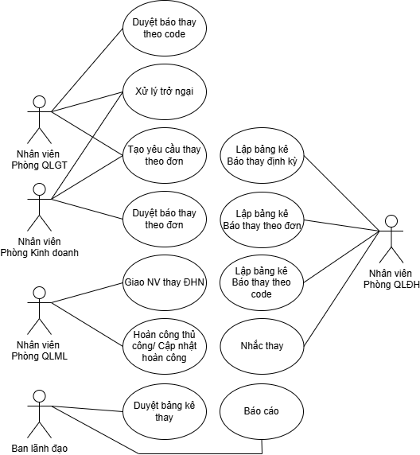
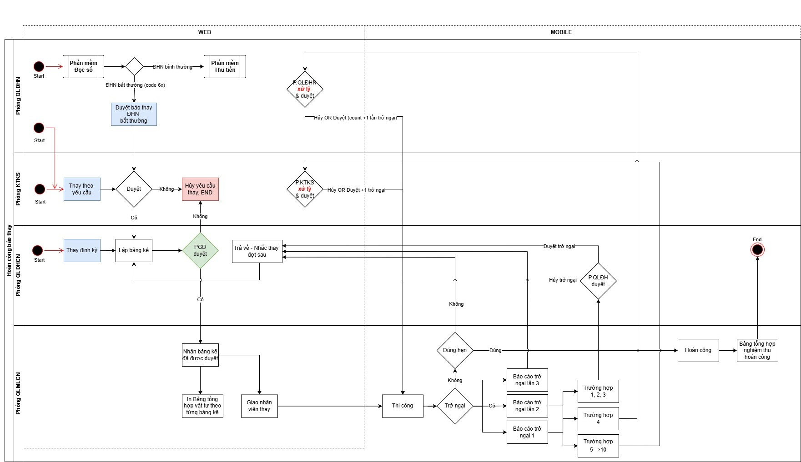
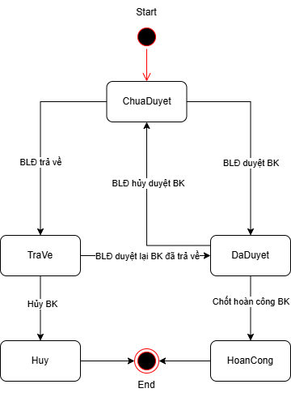
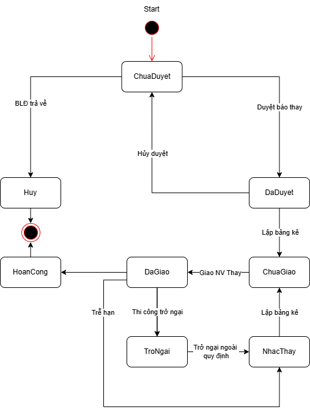
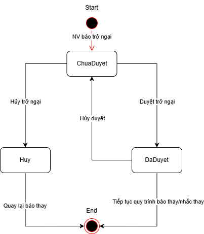

# 1. Tổng quan hệ thống & Phân quyền — Phần mềm Báo thay ĐHN (Nhà Bè)

> **Phiên bản:** `v1.1` · **Cập nhật:** 2026-11-23 · **Trạng thái:** Đồng bộ `v1.1` (`As-Is` — 12 tính năng, bổ sung Phòng DVKH; cấu trúc chuẩn ISO/IEC/IEEE 29148)

> [!NOTE]
> Tài liệu này chuyển thể nguyên trạng nội dung bản gốc **SRS_ThayDHN_V1.4** (tài liệu ký hợp đồng với Công ty Cổ phần Cấp nước Nhà Bè, ngày 10/03/2026) sang cấu trúc chuẩn **ISO/IEC/IEEE 29148** trên Living Docs. Các nội dung còn thiếu hoặc mâu thuẫn ở bản V1.4 được đánh dấu bằng thẻ `[!WARNING]` và `[!CAUTION]` để BA/PM/Dev/QA bổ sung và đối chiếu với phần mềm thực tế.

---

## 1. Thông tin chung & Mục đích tài liệu

| Thuộc tính | Nội dung (theo SRS V1.4) |
|---|---|
| Tên sản phẩm | Phần mềm Báo thay Đồng hồ nước (Web Portal + Mobile App) |
| Khách hàng | Công ty Cổ phần Cấp nước Nhà Bè (CNNB) |
| Đơn vị phát triển | Công ty TNHH Dịch vụ WAO |
| Phiên bản gốc đối chiếu | `SRS_ThayDHN_V1.4` (Tạo 13/10/2025 → V1.4 ngày 10/03/2026) |
| Nhân sự gốc | Tác giả: Đoàn Thái Minh Hoàng (BA) · Xem xét: Nguyễn Bảo Bằng (PM) · Duyệt: Nguyễn Phương Bình |

**Mục đích tài liệu:**
- Định nghĩa phạm vi, chức năng chính (Web & Mobile) và luồng nghiệp vụ thay ĐHN.
- Xác định các tác nhân, phân quyền, ràng buộc dữ liệu và giao tiếp hệ thống.
- Làm cơ sở tham chiếu cho phát triển, kiểm thử (`AC`), vận hành và bóc tách các thay đổi ở giai đoạn nâng cấp.

---

## 2. Phạm vi hệ thống & Tích hợp

### 2.1. Phạm vi nghiệp vụ
Phần mềm quản lý quy trình báo thay và thay đồng hồ nước (ĐHN) theo **3 nguồn báo thay**:
1. **Báo thay định kỳ** (theo niên hạn, ngày kiểm định, danh bạ thiếu, theo hiệu...).
2. **Báo thay bất thường (theo code đọc số)** (code đầu 6 phát sinh từ công tác đọc số).
3. **Báo thay theo yêu cầu (theo đơn)** (22 loại báo thay do QLĐHN / KTKS tạo).

> [!NOTE]
> Trong `SRS V1.4` mục `1.3 Phạm vi` có lỗi biên tập ghi nhầm *"phạm vi triển khai của phần mềm quản lý thu tiền"* — đã hiệu chỉnh lại thành *phần mềm báo thay đồng hồ nước* theo đúng ngữ cảnh dự án.

### 2.2. Ranh giới với hệ thống hiện tại (Billing & Văn phòng điện tử)

Phần mềm mới **không thay thế hoàn toàn** hệ thống hiện tại của Cấp nước Nhà Bè mà đồng bộ dữ liệu hai chiều:

| Thành phần | Hệ thống hiện tại (Billing / VPĐT) | Hệ thống mới (Web Portal + Mobile App) |
|---|---|---|
| Quản trị người dùng & Đăng nhập | Quản lý tài khoản tập trung (liên kết Văn phòng điện tử), cung cấp API đăng nhập | Gọi API đăng nhập; phân quyền truy cập module Thay ĐHN |
| Nghiệp vụ thay ĐHN | Lưu dữ liệu gốc danh bộ, chỉ số đọc số, hóa đơn | Thực hiện toàn bộ luồng báo thay, bảng kê, thi công, hoàn công, trở ngại, nhắc thay |
| Đồng bộ dữ liệu & API | Cung cấp API đầu vào / nhận kết quả thay ĐHN | Xây dựng API xử lý dữ liệu cho Mobile App và đồng bộ với Billing |
| Cơ sở dữ liệu | Kiến trúc dữ liệu sẵn có của CNNB | Thiết kế DB tương thích với hệ thống hiện có của CNNB |

> [!WARNING] Thiếu đặc tả ở V1.4 — Kiến trúc tích hợp & API
> Mục `1.4` chỉ mô tả ở mức khái niệm, chưa có tài liệu đặc tả API (endpoint, payload, đồng bộ real-time hay batch/cron, xử lý retry khi Billing sập). Xem chi tiết cần bổ sung tại [2.2. Đặc tả Tích hợp & API](04-tich-hop-api.md).

---

## 3. Thuật ngữ & Viết tắt (Glossary)

| Viết tắt | Diễn giải |
|---|---|
| **NB / CNNB** | Công ty Cổ phần Cấp nước Nhà Bè |
| **ĐHN** | Đồng hồ nước |
| **MH** | Màn hình |
| **NV** | Nhân viên |
| **BK** | Bảng kê |
| **MLT** | Mã lộ trình |
| **QLĐHN** | Phòng Quản lý đồng hồ nước (gồm QLĐHN 1 và QLĐHN 2) |
| **QLML** | Phòng Quản lý mạng lưới cấp nước (gồm QLML 1 và QLML 2) |
| **QLĐH / QLĐHCN** | Phòng Quản lý điều hành cấp nước |
| **KTKS** | Phòng Kiểm tra kiểm soát |
| **DVKH** | Phòng Dịch vụ khách hàng |
| **BLĐ / PGĐ** | Ban lãnh đạo / Phó Giám đốc |
| **VPĐT** | Văn phòng điện tử |

---

## 4. Các tác nhân & Ma trận phân quyền (RBAC)

### 4.1. Vai trò nghiệp vụ (theo SRS V1.4 mục 3.1)

| Tác nhân | Trách nhiệm chính |
|---|---|
| **NV Phòng QLĐHN** | Ghi nhận code ĐHN từ công tác đọc số; duyệt báo thay bất thường (cấp 1); tạo báo thay theo yêu cầu; xử lý và duyệt trở ngại trên tab **`Phòng ĐHN`** (bao gồm loại 4). |
| **NV Phòng DVKH** | Xử lý và duyệt trở ngại thuộc nhóm dịch vụ khách hàng trên tab **`Phòng DVKH`** (bao gồm loại 1–3 — chốt `TBD-01` / `DEC-04`). |
| **NV Phòng KTKS** | Tạo và duyệt báo thay theo yêu cầu; duyệt báo thay bất thường (cấp 2); xử lý và duyệt trở ngại trên tab **`Phòng KTKS`**. |
| **NV Phòng QLĐHCN** | Lập bảng kê thay ĐHN và bảng kê nhắc thay cho cả 3 loại báo thay; theo dõi, in, hủy bảng kê trước khi BLĐ duyệt. |
| **Ban Lãnh đạo (PGĐ)** | Duyệt hoặc trả về bảng kê thay ĐHN và bảng kê nhắc thay. |
| **NV / Tổ trưởng QLML** | Tiếp nhận bảng kê đã duyệt; giao nhân viên thi công; cập nhật/hủy hoàn công trên Portal; thống kê vật tư và chốt bảng kê. |
| **NV Thi công (Mobile App)** | Nhận danh sách ĐHN được giao trên Mobile; thi công, gửi thông tin hoàn công hoặc báo cáo trở ngại tại hiện trường. |
| **Quản trị hệ thống (Admin)** | Quản trị phân quyền người dùng module Thay ĐHN (đăng ký/đổi mật khẩu nằm ngoài phạm vi, thuộc VPĐT). |

### 4.2. Ma trận phân quyền tổng hợp (CRUD Matrix)

> [!WARNING] Thiếu đặc tả ở V1.4 — Ma trận phân quyền chi tiết
> SRS V1.4 chưa có bảng phân quyền tổng hợp (Xem / Tạo / Sửa / Xóa / Duyệt / Hủy / Xuất Excel) theo từng vai trò và phạm vi đơn vị (`QLĐHN 1/2`, `QLML 1/2`). Dưới đây là khung đối chiếu ban đầu suy ra từ mô tả chức năng — **cần review lại với phần mềm thực tế**.

| Nhóm chức năng | QLĐHN | DVKH | KTKS | QLĐHCN | BLĐ (PGĐ) | QLML (Web) | NV Thi công (App) | Admin |
|---|---|---|---|---|---|---|---|---|
| Đăng nhập & Dashboard | Xem | Xem | Xem | Xem | Xem | Xem | Xem (App) | Xem |
| Báo thay theo yêu cầu (Tạo/Sửa/Hủy) | Tạo / Sửa / Hủy | — | Tạo / Sửa / Hủy | — | — | — | — | — |
| Duyệt báo thay theo yêu cầu | — | — | Duyệt / Trả về / Hủy duyệt | — | — | — | — | — |
| Duyệt báo thay bất thường | Duyệt cấp 1 | — | Duyệt cấp 2 | — | — | — | — | — |
| Lập / Gửi duyệt / Hủy / In bảng kê | — | — | — | Toàn quyền | — | — | — | — |
| Duyệt / Trả về / Hủy duyệt bảng kê | — | — | — | — | Duyệt / Trả về / Hủy duyệt | — | — | — |
| Giao NV thay ĐHN & Thu hồi | — | — | — | — | — | Giao NV / Hủy giao | — | — |
| Danh sách hoàn công & Chốt BK | — | — | — | — | — | Cập nhật / Hủy / Chốt | Gửi hoàn công | — |
| Xử lý trở ngại (3 tab — `DEC-04`) | Duyệt/Hủy (Tab ĐHN) | Duyệt/Hủy (Tab DVKH) | Duyệt/Hủy (Tab KTKS) | *(TBD-10)* | — | *(TBD-10)* | Báo trở ngại | — |
| Nhắc thay | — | — | — | Lập BK nhắc thay | Duyệt BK nhắc thay | — | — | — |
| Import & Quản lý kho vật tư | *(TBD-10)* | — | *(TBD-10)* | *(TBD-10)* | — | Xem / Tra cứu | — | Import / Quản lý |
| Báo cáo Thay ĐHN (6 mẫu) | Xem / Xuất | Xem / Xuất | Xem / Xuất | Xem / Xuất | Xem / Xuất | Xem / Chốt BC1 / Xuất | — | Xem / Xuất |

---

## 5. Sơ đồ tổng quan & Vòng đời trạng thái

### 5.1. Sơ đồ Use Case tổng quan

### 5.2. Flowchart tổng quan quy trình Thay ĐHN

### 5.3. Vòng đời trạng thái các đối tượng (State Diagrams)

Theo mục `3.5` của SRS V1.4, hệ thống có 4 đối tượng có vòng đời trạng thái riêng:

**1. Đối tượng Bảng kê:**

**2. Đối tượng Báo thay:**

> [!CAUTION] Lỗi sơ đồ trong SRS V1.4
> Trong `state-bao-thay.png`, nhánh từ `ChuaDuyet` → `Huy` ghi nhãn `"BLĐ trả về"`, trong khi về nghiệp vụ ở bước duyệt báo thay chưa lập bảng kê thì BLĐ không tham gia (chỉ có người tạo tự hủy hoặc KTKS/QLĐHN hủy). Cần kiểm tra lại sơ đồ thực tế.

**3. Đối tượng Trở ngại:**

**4. Đối tượng Nhắc thay:**

> [!WARNING] Thiếu sơ đồ trong SRS V1.4
> Trong file `SRS_ThayDHN_V1.4.docx` mục `3.5.4 Nhắc thay`, tác giả đã dán nhầm trùng ảnh của mục `3.5.2 Báo thay` (`media/image24.png`). Hiện tại chưa có State Diagram đúng cho đối tượng **Nhắc thay** — cần bổ sung lại.

---

## 6. Cấu trúc bộ tài liệu SRS (chuẩn IEEE 830 / ISO 29148)

- **Chương 1 — Giới thiệu & Tổng quan hệ thống:** [README](README.md) · Tài liệu này (`00-tong-quan.md`)
- **Chương 2 — Dữ liệu & Tích hợp hệ thống:** [2.1. Quy tắc chung, Dữ liệu & Master Data](02-quy-tac-chung.md) · [2.2. Đặc tả Tích hợp & API](04-tich-hop-api.md)
- **Chương 3 — Đặc tả chức năng (`3.1` → `3.12`):** [Danh mục 12 tính năng Web & Mobile](01-tinh-nang/README.md)
- **Chương 4 — Yêu cầu phi chức năng (NFR):** [4.1. Hiệu năng, Offline, Bảo mật & Audit Log](05-yeu-cau-phi-chuc-nang.md)
- **Chương 5 — Phụ lục & Quản trị thay đổi:** [5.1. Điểm thiếu & mâu thuẫn V1.4](06-diem-thieu-va-mau-thuan.md) · [5.2. Nhật ký chốt (`DEC-*`), TBD List (`TBD-*`) & Roadmap `v2.0`](03-nhat-ky-chot.md)

---

## 7. Tài liệu tham khảo gốc

1. `output/SRS_ThayDHN_V1.4.docx` — Tài liệu đặc tả SRS V1.4 (10/03/2026).
2. `Meeting Note/MEETING NOTE WAO - NHÀ BÈ 28_07_2025.docx` (và các biên bản họp `30/06/2025`, `31/07/2025`, `30/12/2025`, `07/01/2026`).
3. `reference/Diagram/` — Bộ sơ đồ Use Case, Flowchart, Swimlane và Sequence Diagram.
4. `Thiết kế giao diện Web & Mobile PM Thay ĐHN` — Figma (ảnh màn hình sẽ được bổ sung vào từng mục Giao diện sau).
