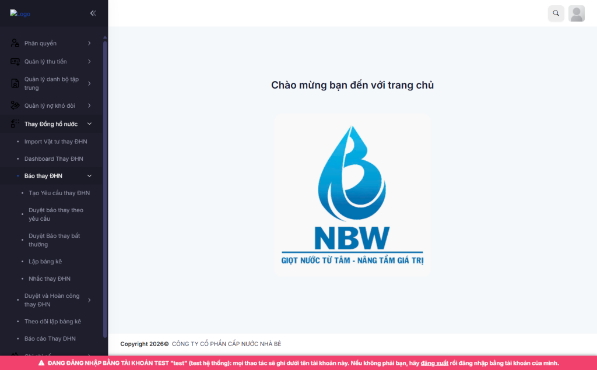
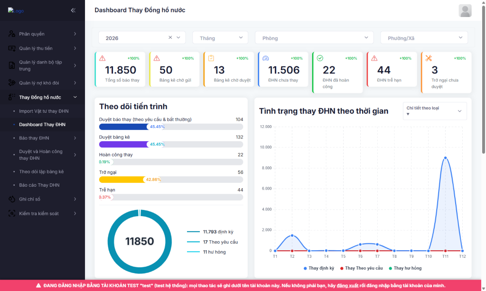

# 01. Đăng nhập & Dashboard quản lý thay ĐHN

> **Phiên bản hiện tại:** `v1.1` · **Cập nhật lần cuối:** 2026-11-23 · **Trạng thái:** Cập nhật theo phần mềm hiện tại (`As-Is` — bổ sung Dashboard, đưa Nhật ký hoạt động UI vào Roadmap `v2.0`)

---

## 1. Mục tiêu & Tác nhân liên quan

- **Mục tiêu:** Xác thực người dùng vào cổng phần mềm tập trung (CMS NBW), điều hướng vào module **Thay Đồng hồ nước** và cung cấp màn hình **Dashboard Thay ĐHN** (`/dashboard`) theo dõi tiến độ tổng quan, KPI và danh sách báo thay.
- **Tác nhân liên quan:** Tất cả người dùng được phân quyền truy cập module Thay ĐHN; Admin (quản trị phân quyền).
- **Tham chiếu SRS V1.4:** Mục `3.2.1 Đăng nhập`, `3.2.2 Chức năng khác`, `3.2.3 Nhật ký hoạt động`.

> [!NOTE] Ghi chú về Nhật ký hoạt động (`Roadmap v2.0`)
> Hệ thống hiện tại đã ghi nhận log thao tác ngầm ở tầng Backend/DB (log duyệt yêu cầu/bất thường, log chỉnh sửa hoàn công), **chưa có màn hình UI tra cứu "Nhật ký hoạt động"** dưới menu `Thay Đồng hồ nước`. Giao diện tra cứu Audit Log được đưa vào **Roadmap `v2.0`**.

---

## 2. Luồng nghiệp vụ (Flow)

1. Người dùng đăng nhập tại cổng phần mềm tập trung (dùng chung các module Thu tiền, Danh bộ tập trung, Thay Đồng hồ nước, Ghi chỉ số, Kiểm tra kiểm soát...).
2. Sau khi đăng nhập thành công, hệ thống điều hướng vào `/home/trang-chu` (trang chào mừng NBW).
3. Chỉ các tài khoản đã được phân quyền mới thấy và truy cập được menu cha **Thay Đồng hồ nước** (gồm 13 màn hình Web).
4. Chọn **Dashboard Thay ĐHN** (`/dashboard`) để theo dõi số liệu KPI, biểu đồ tiến trình, biểu đồ thời gian và bảng danh sách báo thay.

---

## 3. Đặc tả màn hình & Trường dữ liệu (`/dashboard`)

### 3.1. Bộ lọc toàn cục (Top Global Filters)

| Trường | Kiểu | Mặc định | Mô tả & Quy tắc lọc (`v1.1`) |
|---|---|---|---|
| Năm | Select2 (clearable) | `2026` | Chọn năm thống kê (`2024`, `2025`, `2026`) |
| Tháng | Select2 | *(Tất cả)* | Chọn `Tháng 1` – `Tháng 12`; cập nhật lại toàn bộ KPI, biểu đồ & bảng |
| Phòng | Select2 | *(Tất cả)* | `Phòng Quản lý mạng lưới cấp nước 1` (`QLML 1`), `Phòng Quản lý mạng lưới cấp nước 2` (`QLML 2`) |
| Phường/Xã | Select2 | *(Tất cả)* | Lọc phụ thuộc (cascading) theo `Phòng`: • **QLML 1 (4 phường):** `Tân Mỹ`, `Tân Hưng`, `Tân Thuận`, `Phú Thuận`. • **QLML 2 (5 phường/xã):** `Vĩnh Hội`, `Khánh Hội`, `Xóm Chiếu`, `Xã Nhà Bè`, `Xã Hiệp Phước`. |

### 3.2. 7 Thẻ KPI tổng quan

| STT | Tên thẻ KPI | Drill-down Link | Màn hình đích |
|---|---|---|---|
| 1 | Tổng số báo thay | Không | — |
| 2 | Bảng kê chờ gửi | **Có** | `/lapbangke` |
| 3 | Bảng kê chờ duyệt | **Có** | `/duyetbangke` |
| 4 | ĐHN chưa thay | Không | — |
| 5 | ĐHN đã hoàn công | Không | — |
| 6 | ĐHN trễ hạn | Không | — |
| 7 | Trở ngại chưa duyệt | **Có** | `/xulytrongai` |

### 3.3. Biểu đồ & Tiến trình

- **Panel trái — `Theo dõi tiến trình`:**
  - 5 thanh tiến trình: `Duyệt báo thay (theo yêu cầu & bất thường)`, `Duyệt bảng kê`, `Hoàn công thay` (kèm %), `Trở ngại`, `Trễ hạn` (kèm %).
  - **Biểu đồ Donut:** Tổng số ở tâm, phân bổ 3 nhóm: `Định kỳ`, `Theo yêu cầu`, `Hư hỏng` *(tương ứng Báo thay bất thường/theo code)*.
- **Panel phải — `Tình trạng thay ĐHN theo thời gian`:**
  - Chế độ xem: `Chi tiết theo loại` (mặc định) | `Tổng báo thay`.
  - Biểu đồ đường/vùng theo 12 tháng (`T1`–`T12`) với 3 chuỗi: `Thay định kỳ`, `Thay Theo yêu cầu`, `Thay hư hỏng`.

### 3.4. Bảng `Danh sách báo thay` (22 cột)
- **Bộ lọc bảng:** Ô tìm kiếm (`tên, địa chỉ...`), `Trường hợp thay` (`Định kỳ`, `Theo yêu cầu`, `Hư hỏng`), `Loại thay` (phụ thuộc `Trường hợp thay`), `Trạng thái` (`Đã thay`, `Chưa thay`, `Trễ hạn`, `Trở ngại`).
- **22 cột:** `Danh bộ`, `Họ và tên`, `Địa chỉ`, `Trường hợp thay`, `Ngày thay`, `Trạng thái Hoàn công`, `Trạng thái Trở ngại`, `Trạng thái Trễ hạn`, `Trạng thái Bảng kê`, `Lý do thay`, `Bảng kê`, `Hiệu cũ`, `Hiệu mới`, `Cỡ cũ`, `Cỡ mới`, `CS gỡ`, `CS gắn`, `Số thân cũ`, `Số thân mới`, `Chì cỡ cũ`, `Chì cỡ mới`, `Ngày KD`.
- **Phân trang:** `10` (mặc định), `25`, `50`, `100` dòng/trang.

---

## 4. Yêu cầu chức năng (Functional Requirements)

| Mã | Mô tả / Hành vi hệ thống (`v1.1`) |
|---|---|
| `FR-AUTH-01` | Xác thực người dùng qua cổng CMS chung; ẩn hoặc chặn truy cập module `Thay Đồng hồ nước` nếu tài khoản chưa được cấp quyền. |
| `FR-DASH-01` | Hiển thị 7 thẻ KPI, biểu đồ tiến trình, biểu đồ theo tháng (`T1`–`T12`) và bảng `Danh sách báo thay` 22 cột theo bộ lọc `Năm / Tháng / Phòng / Phường-Xã`. |
| `FR-DASH-02` | Khi chọn `Phòng`, danh sách `Phường/Xã` tự động lọc chỉ hiển thị các phường/xã thuộc phòng đó. |
| `FR-DASH-03` | Cho phép click drill-down từ 3 thẻ KPI (`Bảng kê chờ gửi`, `Bảng kê chờ duyệt`, `Trở ngại chưa duyệt`) sang màn hình xử lý tương ứng. |

---

## 5. Quy tắc nghiệp vụ (Business Rules)

| Mã | Mô tả chi tiết (`v1.1`) |
|---|---|
| `BR-DASH-01` | **Công thức tính `Theo dõi tiến trình`:** • *Duyệt báo thay:* `Total = Tổng đơn theo YC đã tạo + Tổng bất thường ĐHN đã duyệt`; `% = Số đơn đủ điều kiện lập BK / Total`. • *Duyệt bảng kê:* `Total = Tổng BK đã tạo`; `% = Số BK được PGĐ duyệt / Total`. • *Hoàn công thay:* `Total = Tổng danh bộ đã giao NV`; `% = Số danh bộ đã hoàn công / Total`. • *Trở ngại:* Số danh bộ bị báo trở ngại trong khoảng thời gian lọc. • *Trễ hạn:* Danh bộ quá **30 ngày kể từ ngày giao NV thay** mà chưa hoàn công. |
| `BR-DASH-02` | Số liệu giữa 7 thẻ KPI, biểu đồ Donut, thanh tiến trình và bảng `Danh sách báo thay` bên dưới phải đồng nhất theo cùng tập bộ lọc. |

---

## 6. Tiêu chí nghiệm thu (Acceptance Criteria)

- [ ] `AC-DASH-01`: Tài khoản chưa được cấp quyền `Thay Đồng hồ nước` không thấy menu và không truy cập được `/dashboard`.
- [ ] `AC-DASH-02`: Chọn `Phòng QLML 1` chỉ hiển thị 4 phường thuộc Phòng 1; chọn `Phòng QLML 2` chỉ hiển thị 5 phường/xã thuộc Phòng 2.
- [ ] `AC-DASH-03`: Chọn `Tháng` bất kỳ cập nhật đồng bộ cả 7 KPI, biểu đồ và bảng danh sách bên dưới.
- [ ] `AC-DASH-04`: Click 3 thẻ KPI có drill-down điều hướng đúng tới `/lapbangke`, `/duyetbangke`, `/xulytrongai`.
- [ ] `AC-DASH-05`: Tổng số ở thẻ `Tổng số báo thay` khớp với tổng bản ghi bảng `Danh sách báo thay` và tổng 3 nhánh Donut.

---

## 7. Giao diện (UI) & Lịch sử thay đổi

**Hình 1: Cây menu thực tế module Thay Đồng hồ nước (`v1.1`)**

**Hình 2: Màn hình Dashboard Thay ĐHN thực tế (`v1.1`)**

| Phiên bản | Ngày | Người chốt | Tóm tắt thay đổi |
|---|---|---|---|
| `v1.0` | 2026-11-17 | nhanlt | Chuyển thể từ SRS V1.4 mục `3.2`; đánh dấu các phần thiếu (Dashboard, Phân quyền, Nhật ký, AC) |
| `v1.1` | 2026-11-23 | nhanlt | Bổ sung đầy đủ đặc tả thực tế Dashboard (`/dashboard`: 4 bộ lọc phụ thuộc, 7 KPI drill-down, biểu đồ, bảng 22 cột, công thức `Theo dõi tiến trình` & trễ hạn 30 ngày); đưa giao diện `Nhật ký hoạt động` vào Roadmap `v2.0` |
