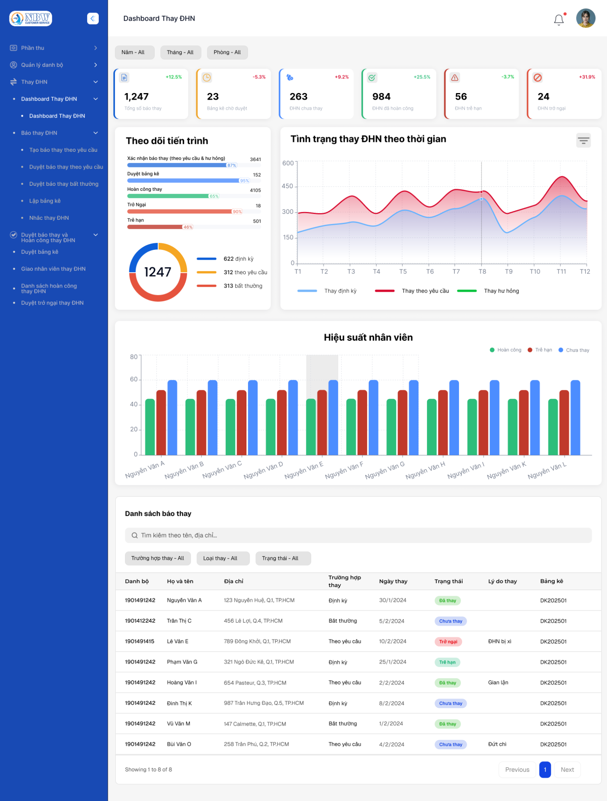

# 01. Đăng nhập, Dashboard & Nhật ký hoạt động

> **Phiên bản hiện tại:** `v1.0` · **Cập nhật lần cuối:** 2026-11-17 · **Trạng thái:** Baseline từ SRS V1.4 (thiếu chi tiết)

---

## 1. Mục tiêu & Tác nhân liên quan

- **Mục tiêu:** Xác thực người dùng, điều hướng vào module Thay ĐHN, hiển thị màn hình tổng quan (Dashboard) và tra cứu nhật ký hoạt động của người dùng.
- **Tác nhân liên quan:** Tất cả người dùng được phân quyền truy cập module Thay ĐHN; Admin (quản trị phân quyền).
- **Tham chiếu SRS V1.4:** Mục `3.2.1 Đăng nhập`, `3.2.2 Chức năng khác`, `3.2.3 Nhật ký hoạt động`.

---

## 2. Luồng nghiệp vụ (Flow)

1. Người dùng đăng nhập ngay trên cổng phần mềm thu tiền do WAO cung cấp (dùng chung cho các module Thu tiền, Danh bộ tập trung, Thay ĐHN...).
2. Tài khoản đăng nhập liên kết với tài khoản **Văn phòng điện tử (VPĐT)** của Cấp nước Nhà Bè. Mọi thao tác tạo mới hoặc thay đổi thông tin tài khoản thực hiện trên VPĐT (nằm ngoài phạm vi phần mềm Thay ĐHN).
3. Chỉ các tài khoản đã được phân quyền mới truy cập được module **Thay ĐHN**.
4. Sau khi click chọn module **Thay ĐHN**, hệ thống hiển thị màn hình **Dashboard quản lý thay ĐHN**.

> [!WARNING] Thiếu đặc tả ở V1.4 — Chức năng nền tảng
> Mục `3.2` chỉ mô tả tổng quan 3–4 dòng, hoàn toàn chưa đặc tả:
> - Luồng xử lý khi tài khoản VPĐT chưa được phân quyền trong module Thay ĐHN.
> - Cơ chế phiên đăng nhập (timeout, refresh token, đá phiên khi đổi quyền).
> - Cấu trúc và số liệu hiển thị trên **Dashboard** và **Nhật ký hoạt động**.

---

## 3. Đặc tả màn hình & Trường dữ liệu

> [!WARNING] Thiếu đặc tả ở V1.4 — Màn hình Dashboard & Nhật ký hoạt động
> - **Dashboard:** Chưa có danh sách các widget/KPI (vd: số báo thay chờ duyệt, số bảng kê chưa chốt, tỷ lệ hoàn công/trở ngại theo tháng/phòng) và bộ lọc thời gian/đơn vị.
> - **Quản trị người dùng (`3.2.2`):** Chưa có màn hình phân quyền cho Admin (gán Role, gán Phòng `QLĐHN 1/2`, `QLML 1/2`).
> - **Nhật ký hoạt động (`3.2.3`):** Chưa có bộ lọc tìm kiếm (theo user, thời gian, loại thao tác, danh bộ/số BK) và các cột dữ liệu log (`Thời gian`, `Tài khoản`, `Hành động`, `Đối tượng`, `Giá trị cũ/mới`).

---

## 4. Yêu cầu chức năng (Functional Requirements)

> [!WARNING] Thiếu đặc tả ở V1.4 — Chưa có mã `FR-*` cho nhóm chức năng này
> Các yêu cầu đề xuất cần rà lại với phần mềm thực tế:
> - `FR-AUTH-01` *(đề xuất)*: Gọi API đăng nhập/SSO từ hệ thống VPĐT/Billing; ẩn hoặc chặn truy cập module Thay ĐHN nếu tài khoản không có quyền.
> - `FR-DASH-01` *(đề xuất)*: Hiển thị số liệu thống kê tổng quan theo phạm vi phòng ban của tài khoản đăng nhập.
> - `FR-LOG-01` *(đề xuất)*: Ghi nhận và cho phép tra cứu nhật ký thao tác của người dùng theo bộ lọc thời gian, tài khoản và hành động.

---

## 5. Quy tắc nghiệp vụ (Business Rules)

> [!WARNING] Thiếu đặc tả ở V1.4 — Chưa có mã `BR-*` cho nhóm chức năng này
> Cần bổ sung tối thiểu:
> - Quy tắc phạm vi dữ liệu: User thuộc `QLĐHN 1` / `QLML 1` có nhìn thấy dữ liệu của `QLĐHN 2` / `QLML 2` trên Dashboard và Nhật ký hoạt động hay không?
> - Quy tắc lưu trữ Audit Log (có cho phép xóa log không, giữ log tối thiểu bao lâu).

---

## 6. Tiêu chí nghiệm thu (Acceptance Criteria)

> [!WARNING] Thiếu 100% ở V1.4 — Cần bổ sung `AC-*`
> - [ ] `AC-01` *(TODO)*: Tài khoản hợp lệ trên VPĐT nhưng chưa được cấp quyền Thay ĐHN không thể truy cập vào Dashboard Thay ĐHN.
> - [ ] `AC-02` *(TODO)*: Mọi thao tác thay đổi trạng thái báo thay/bảng kê đều được ghi vào Nhật ký hoạt động.

---

## 7. Giao diện (UI) & Lịch sử thay đổi

**Hình 1: Trang đăng nhập**

**Hình 2: Màn hình Dashboard quản lý thay ĐHN**

| Phiên bản | Ngày | Người chốt | Tóm tắt thay đổi |
|---|---|---|---|
| `v1.0` | 2026-11-17 | nhanlt | Chuyển thể từ SRS V1.4 mục `3.2`; đánh dấu các phần thiếu (Dashboard, Phân quyền, Nhật ký, AC) |
