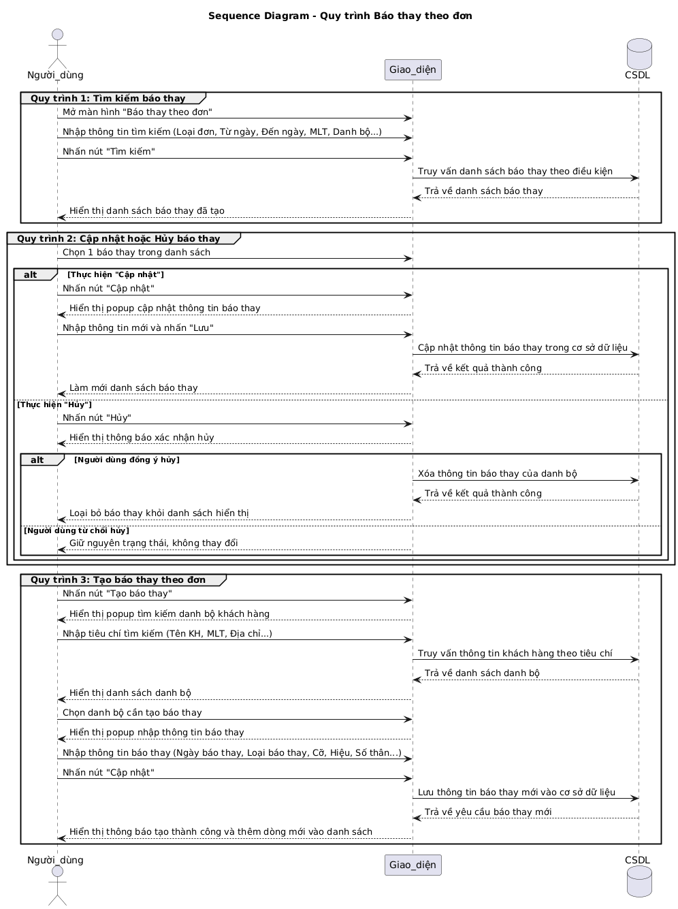
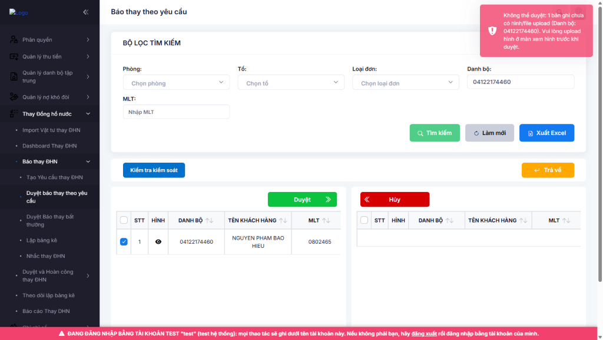
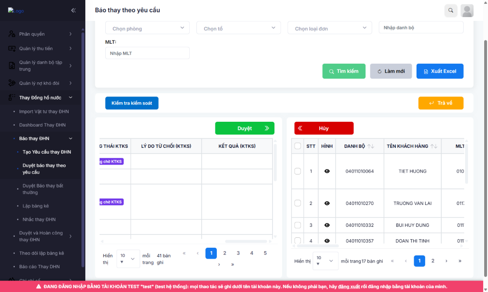

# 02. Báo thay theo yêu cầu (Tạo, Sửa, Hủy, Trả về & Duyệt)

> **Phiên bản hiện tại:** `v1.1` · **Cập nhật lần cuối:** 2026-11-23 · **Trạng thái:** Cập nhật theo phần mềm hiện tại (`As-Is`)

---

## 1. Mục tiêu & Tác nhân liên quan

- **Mục tiêu:** Cho phép tạo mới, chỉnh sửa, hủy, trả về và duyệt các **báo thay theo yêu cầu (theo đơn)** trước khi đưa vào danh sách lập bảng kê.
- **Tác nhân liên quan:**
  - **Người tạo / sửa / hủy:** Nhân viên Phòng QLĐHN (Ghi thu), Nhân viên Phòng KTKS (`BR-YC-01`).
  - **Người duyệt / trả về / hủy duyệt:** Phòng KTKS (1 cấp duyệt).
- **Routes thực tế:** `/baothaytheodon` (Tạo & Quản lý danh sách) · `/duyetbaothaytheodon` (Duyệt & Trả về).
- **Tham chiếu SRS V1.4:** Mục `4.1 Báo thay theo yêu cầu - Duyệt báo thay theo yêu cầu`.

---

## 2. Luồng nghiệp vụ (Flow & Diagrams)

### 2.1. Flowchart quy trình

### 2.2. Diễn giải luồng chính & ngoại lệ (`v1.1`)
1. **Tạo báo thay (`/baothaytheodon`):** Nhấn `Tạo báo thay`, tìm kiếm danh bộ hợp lệ, điền thông tin đồng hồ, chọn **Loại báo thay** (bắt buộc — 22 loại chia 2 nhóm `Không bồi thường` & `Bồi thường`), nhập `Ghi chú` và đính kèm tối đa 5 tệp/ảnh (không bắt buộc lúc tạo).
2. **Chồng lấn với Báo thay định kỳ (`BR-YC-13`):**
   - Nếu danh bộ đang nằm trong bảng kê **Định kỳ** đã duyệt / đã giao NV thi công: hệ thống hiển thị popup cảnh báo xác nhận với PQLML (*"Danh bạ X đã được giao nhân viên thi công. Cần xác nhận với PQLML?"*).
   - Nếu người dùng chọn `Tiếp tục` tạo báo thay theo yêu cầu thành công, bản ghi Định kỳ trong bảng kê cũ **không bị xóa vật lý** mà được giữ lại và tự động đổi sang trạng thái **`Hủy`**.
3. **Chỉnh sửa / Hủy báo thay:** Nhân viên có thể sửa hoặc hủy khi báo thay ở trạng thái **`Chưa duyệt`** hoặc **`Trả về`** (`BR-YC-05`, `BR-YC-06`).
4. **Duyệt / Trả về / Hủy duyệt (`/duyetbaothaytheodon`):**
   - **Bắt buộc có hình/file đính kèm khi Duyệt (`BR-YC-14`):** Nếu báo thay chưa có tệp/ảnh nào, hệ thống chặn duyệt và yêu cầu upload bổ sung trực tiếp qua màn xem hình (`/DuyetBaoThayTheoDon/ViewImages?id=<id>`, tối đa 5 tệp).
   - **Trả về (`BR-YC-15`):** Phòng KTKS có thể bấm `Trả về` (bắt buộc nhập `Lý do trả về`) → trạng thái chuyển sang **`Trả về`** và ghi lý do vào cột `Ghi chú` để người tạo sửa lại.
   - **Hủy duyệt (`BR-YC-12`):** Khi báo thay đã duyệt nhưng chưa lập bảng kê, KTKS có thể bấm `<< Hủy` để trả về bảng Chờ duyệt.

### 2.3. Sequence Diagram

---

## 3. Đặc tả màn hình & Trường dữ liệu

### 3.1. Màn hình Tạo & Danh sách báo thay theo yêu cầu (`/baothaytheodon`)

- **Hành vi tải trang:** Mặc định bảng rỗng (`Nhấn "Tìm kiếm" để hiển thị dữ liệu`).
- **Bộ lọc cơ bản:** `Loại đơn` (22 loại chia 2 nhóm), `Ngày báo thay` (`Từ ngày – Đến ngày`), `Danh bộ`, `MLT`.
- **Bộ lọc nâng cao:** `Tổ` (10 tổ), `Cỡ` (`15..600`), `Số bảng kê`, `Tình trạng` (`Chưa duyệt`, `Duyệt`, `Hủy`, `Trả về`).
- **Nút chức năng:** `Tìm kiếm`, `Làm mới`, `Xuất Excel`, `Tạo báo thay`.
- **Bảng danh sách (25 cột):** `STT`, `THAO TÁC`, `ĐỢT`, `MLT`, `DANH BỘ`, `HỌ TÊN`, `ĐỊA CHỈ`, `LOẠI BÁO THAY`, `NGÀY BÁO THAY`, `SỐ BK THAY`, `TRẠNG THÁI XỬ LÝ`, `TÌNH TRẠNG`, `CS BÁO`, `HIỆU`, `CỠ`, `SỐ THÂN`, `NGÀY GẮN`, `NGÀY KD`, `CHÌ THÂN`, `CHÌ GÓC`, `VỊ TRÍ`, `TỔ`, `GHI CHÚ`, `NGƯỜI TẠO`, `PHÒNG BAN`.

### 3.2. Danh mục 22 loại báo thay theo yêu cầu (`v1.1`)

- **Nhóm Không bồi thường (15 loại):** `Theo đơn (ĐHN hết pin)`, `Theo đơn (ngưng)`, `Theo đơn (định kỳ)`, `Theo đơn (lết số)`, `Theo đơn (lệch số)`, `Theo đơn (tuôn số)`, `Theo đơn (xì mặt số)`, `Theo đơn (kẹt số)`, `Theo đơn (kiếng mờ)`, `Theo đơn (chạy ngược)`, `Theo đơn (lỗi hiển thị số)`, `Theo đơn (nâng cỡ)`, `Theo đơn (hạ cỡ)`, `Theo đơn (thay đối chứng)`, `Theo đơn (Khác)`.
- **Nhóm Bồi thường (7 loại):** `Theo đơn(Bồi thường)`, `Theo đơn (bồi thường, mất ĐHN)`, `Theo đơn (bồi thường gian lận)`, `Theo đơn (bồi thường khác)`, `Theo đơn (đứt chì bồi thường)`, `Theo đơn (bể kiếng, bồi thường)` *(ghi chú: master data cần kiểm tra lại mục `Theo đơn(Không bồi thường)` đang xếp nhầm trong nhóm này)*.

### 3.3. Popup Tìm kiếm khách hàng & Tạo / Sửa báo thay

- **Popup Tìm kiếm khách hàng:** Tìm theo `Tên KH`, `Danh bộ`, `MLT`, `Địa chỉ` (bắt buộc nhập ít nhất 1 tiêu chí). Danh bộ chưa có báo thay hoạt động hiển thị `Chưa tạo` + nút Tạo; danh bộ đã có báo thay chưa hoàn tất (hoặc đang trở ngại) hiển thị `Đã tạo` + `Số BK thay` và **ẩn nút Tạo**.
- **Popup Tạo / Sửa báo thay:**
  - *Read-only (tự điền):* `Ngày báo thay`, `Danh bộ`, `MLT`, `Hợp đồng`, `Tên KH`, `Địa chỉ`, `Số BK thay`.
  - *Editable:* `Theo Số`, `Hiệu` (20 hiệu), `Cỡ`, `Số thân`, `Chỉ số báo`, `Chì thân`, `Chì góc`, `Vị trí` (`G`, `trc_benphai`, `trc_bentrai`, `ĐH`, `s_bentrai`, `KXĐ`, `P`, `P1`, `s_benphai`), **`Loại báo thay *`** (bắt buộc — bỏ trống báo `"Vui lòng nhập loại báo thay"`), `Ghi chú`, `Tệp đã tải lên (0/5)`.

### 3.4. Màn hình Duyệt báo thay theo yêu cầu (`/duyetbaothaytheodon`)
- **Hành vi tải trang:** **Tự động load dữ liệu** ngay vào 2 bảng song song: Trái (`Chờ duyệt`) và Phải (`Đã duyệt`).
- **Bộ lọc:** `Phòng` (`Phòng Quản lý ghi thu 1/2`), `Tổ` (7 tổ), `Loại đơn` (22 loại), `Danh bộ`, `MLT`.
- **Nút chức năng:** `Tìm kiếm`, `Làm mới`, `Xuất Excel`, Tab `Kiểm tra kiểm soát`, **`Trả về`**, **`Duyệt >>`**, **`<< Hủy`**.
- **15 cột mỗi bảng:** `Checkbox`, `STT`, `HÌNH` (mở `/DuyetBaoThayTheoDon/ViewImages?id=<id>` để xem & upload bổ sung tối đa 5 tệp), `DANH BỘ`, `TÊN KHÁCH HÀNG`, `MLT`, `LOẠI BÁO THAY`, `TỔ`, `NHÂN VIÊN`, `NGÀY BÁO THAY`, `NGƯỜI DUYỆT`, `LÝ DO TRẢ VỀ`, `TRẠNG THÁI KTKS`, `LÝ DO TỪ CHỐI (KTKS)`, `KẾT QUẢ (KTKS)`.

---

## 4. Yêu cầu chức năng (Functional Requirements)

| Mã | Mô tả / Hành vi hệ thống (`v1.1`) |
|---|---|
| `FR-YC-01` | Truy vấn danh sách báo thay theo bộ lọc, sắp xếp mặc định theo thời gian giảm dần (mới → cũ). |
| `FR-YC-02` | Cho phép chỉnh sửa hoặc hủy khi báo thay có trạng thái **`Chưa duyệt`** hoặc **`Trả về`**. |
| `FR-YC-03` | Ẩn nút tạo báo thay cho các danh bộ đang có báo thay chưa hoàn tất (trừ trường hợp tạo đè lên báo thay Định kỳ có xác nhận). |
| `FR-YC-04` – `FR-YC-07` | Tìm danh bộ, tự điền thông tin KH (read-only), tự gán `Ngày báo thay`, tự load thông tin ĐHN hiện tại (cho phép sửa). |
| `FR-YC-08` | Cho phép tải lên tối đa 05 tệp đính kèm tại popup Tạo/Sửa và tại màn hình xem hình khi Duyệt (`/ViewImages`). |
| `FR-YC-09` | Khi hủy báo thay, cập nhật trạng thái sang **`Đã hủy`** (không xóa vật lý). |
| `FR-YC-10` | Bắt buộc chọn **`Loại báo thay`** khi tạo báo thay. |
| `FR-YC-11` – `FR-YC-14` | Xem/phóng to ảnh hoặc tải file; hiển thị popup xác nhận khi Duyệt/Hủy duyệt; sắp xếp mới → cũ. |
| `FR-YC-15` | Khi bấm `Duyệt >>` trên bản ghi chưa có ảnh/file, chặn duyệt và thông báo rõ danh bộ thiếu ảnh. |
| `FR-YC-16` | Khi bấm `Trả về`, bắt buộc nhập `Lý do trả về` (`"Vui lòng nhập lý do trả về"`), chuyển trạng thái về **`Trả về`** và lưu lý do vào `Ghi chú`. |

---

## 5. Quy tắc nghiệp vụ (Business Rules)

| Mã | Mô tả chi tiết (`v1.1`) |
|---|---|
| `BR-YC-01` | Chỉ người dùng thuộc Phòng QLĐHN (Ghi thu) hoặc Phòng KTKS được phép tạo Báo thay theo yêu cầu. |
| `BR-YC-02` | Mỗi Danh bộ chỉ được tồn tại tối đa 01 Báo thay đang hoạt động (chưa hoàn công / chưa hủy). |
| `BR-YC-04` | Khi hủy Báo thay ở trạng thái `Chưa duyệt`, hệ thống chỉ yêu cầu xác nhận (không bắt buộc nhập lý do). |
| `BR-YC-05`, `BR-YC-06` | Báo thay chỉ được phép hủy/chỉnh sửa khi có trạng thái `Chưa duyệt` hoặc `Trả về`. |
| `BR-YC-07` – `BR-YC-12` | Hủy mềm (`Đã hủy`); bắt buộc chọn Loại báo thay; Phòng KTKS duyệt 1 cấp trước khi lập BK; chỉ hủy duyệt khi chưa lập BK. |
| `BR-YC-13` | **Ưu tiên tạo đè lên Báo thay định kỳ:** Cho phép tạo báo thay theo yêu cầu đè lên danh bộ đang có báo thay Định kỳ (có cảnh báo xác nhận PQLML nếu đã giao NV); bản ghi Định kỳ trong BK đã duyệt được giữ lại và đổi trạng thái sang **`Hủy`**. |
| `BR-YC-14` | **Bắt buộc có tệp/ảnh trước khi duyệt:** Báo thay theo yêu cầu chỉ được duyệt khi đã có tối thiểu 01 hình ảnh/tệp đính kèm. |
| `BR-YC-15` | **Trả về báo thay:** Khi KTKS trả về báo thay, bắt buộc nhập lý do trả về; người tạo có thể chỉnh sửa lại trên `/baothaytheodon`. |

---

## 6. Tiêu chí nghiệm thu (Acceptance Criteria)

- [x] `AC-01`: Danh bộ đã có báo thay chưa hoàn tất bị ẩn nút Tạo báo thay (`FR-YC-03`).
- [x] `AC-02`: Tạo báo thay thiếu `Loại báo thay` báo lỗi `"Vui lòng nhập loại báo thay"`.
- [x] `AC-03`: Bấm `Duyệt >>` khi chưa có hình/file bị chặn; sau khi upload ảnh ở `/ViewImages` thì duyệt thành công.
- [x] `AC-04`: Tạo báo thay theo yêu cầu cho danh bộ Định kỳ đang giao NV hiện cảnh báo PQLML; chọn `Tiếp tục` thì tự động đổi dòng Định kỳ trong BK cũ sang `Hủy`.
- [x] `AC-05`: Bấm `Trả về` để trống lý do bị chặn; nhập lý do trả về thành công thì bản ghi chuyển sang `Trả về` trên `/baothaytheodon` và cho phép Sửa/Xóa.

---

## 7. Giao diện (UI) & Lịch sử thay đổi

**Hình 1: Chặn duyệt khi chưa có hình/file upload (`v1.1`)**

**Hình 2: Màn hình Duyệt báo thay theo yêu cầu kèm nút Trả về & cột KTKS (`v1.1`)**

| Phiên bản | Ngày | Người chốt | Tóm tắt thay đổi |
|---|---|---|---|
| `v1.0` | 2026-11-17 | nhanlt | Chuyển thể từ SRS V1.4 mục `4.1`; sửa lỗi đánh mã `BR-YC-0` → `BR-YC-07`; gắn note các điểm thiếu |
| `v1.1` | 2026-11-23 | nhanlt | Cập nhật khớp thực tế Dev: bổ sung rule bắt buộc có hình khi duyệt (`BR-YC-14`), luồng `Trả về` (`BR-YC-15`), rule ưu tiên tạo đè Định kỳ (`BR-YC-13`), tách 2 nhóm 22 loại báo thay và 4 cột KTKS |
