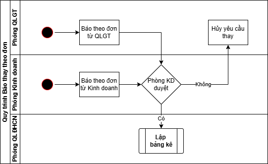
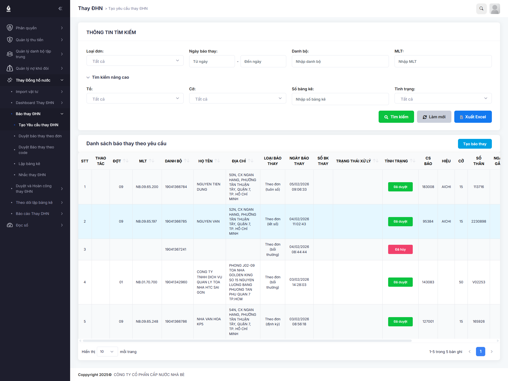
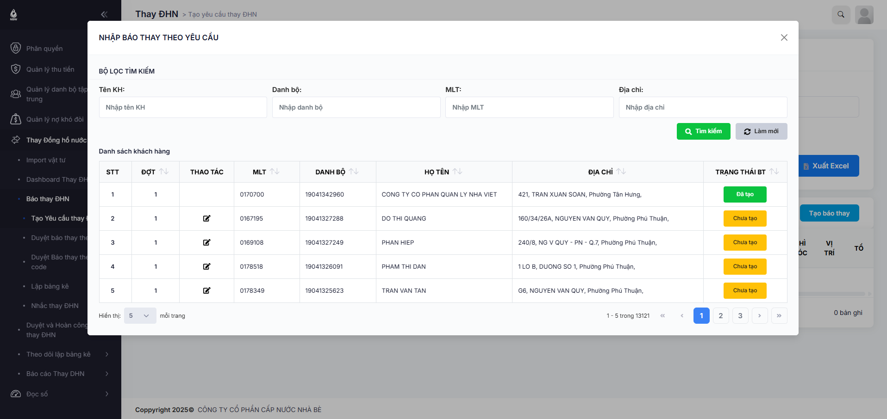
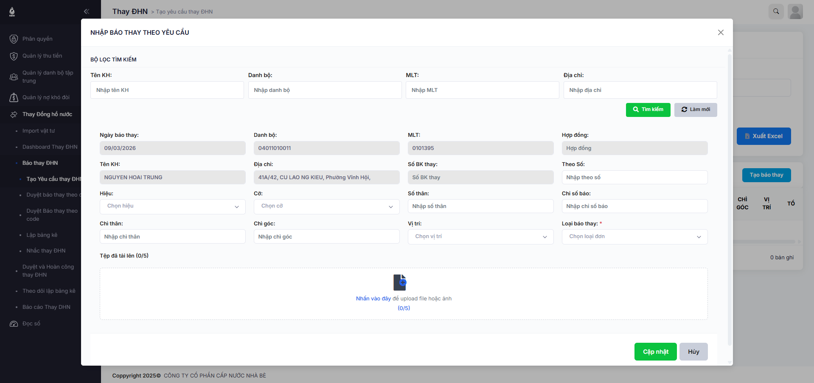
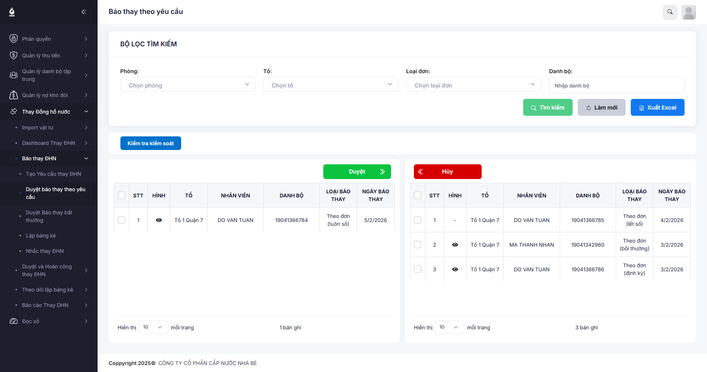

# 02. Báo thay theo yêu cầu (Tạo, Sửa, Hủy & Duyệt)

> **Phiên bản hiện tại:** `v1.0` · **Cập nhật lần cuối:** 2026-11-17 · **Trạng thái:** Baseline từ SRS V1.4

---

## 1. Mục tiêu & Tác nhân liên quan

- **Mục tiêu:** Cho phép tạo mới, chỉnh sửa, hủy và duyệt các **báo thay theo yêu cầu (theo đơn)** trước khi đưa vào danh sách lập bảng kê.
- **Tác nhân liên quan:**
  - **Người tạo / sửa / hủy:** Nhân viên Phòng QLĐHN, Nhân viên Phòng KTKS (`BR-YC-01`).
  - **Người duyệt / hủy duyệt:** Phòng KTKS (1 cấp duyệt).
- **Tham chiếu SRS V1.4:** Mục `4.1 Báo thay theo yêu cầu - Duyệt báo thay theo yêu cầu`.

---

## 2. Luồng nghiệp vụ (Flow & Diagrams)

### 2.1. Flowchart quy trình

### 2.2. Diễn giải luồng chính & ngoại lệ
1. **Tạo báo thay:** Nhân viên Phòng KTKS hoặc Phòng QLĐHN vào màn hình *Báo thay theo yêu cầu*, nhấn *Tạo báo thay*, tìm kiếm và chọn danh bộ hợp lệ, điền thông tin đồng hồ, chọn **Loại báo thay** (22 loại) và đính kèm tối đa 5 tệp/ảnh (nếu có).
2. **Chỉnh sửa / Hủy báo thay:** Tại danh sách đã tạo, nhân viên có thể chỉnh sửa hoặc hủy khi báo thay đang ở trạng thái **Chưa duyệt** (`BR-YC-05`, `BR-YC-06`).
3. **Duyệt báo thay (1 cấp — Phòng KTKS):**
   - Yêu cầu do QLĐHN hoặc KTKS tạo đều chuyển đến Phòng KTKS xác nhận/duyệt.
   - Khi Phòng KTKS duyệt, báo thay chuyển trạng thái **Đã duyệt** và đủ điều kiện để Phòng QLĐHCN lập bảng kê (`BR-YC-10`, `BR-YC-11`).
   - Nếu cần rút lại trước khi lập bảng kê, Phòng KTKS có thể **Hủy duyệt** để trả về bảng Chờ duyệt (`BR-YC-12`).

### 2.3. Sequence Diagram

---

## 3. Đặc tả màn hình & Trường dữ liệu

### 3.1. Màn hình Danh sách báo thay theo yêu cầu

**Bộ lọc tìm kiếm cơ bản:**

| Trường | Kiểu | Mô tả (theo V1.4) | Điểm cần bổ sung `[TODO]` |
|---|---|---|---|
| Chọn loại đơn | Dropdown | Lọc theo 22 loại báo thay (mục 3.2) | Có option "Tất cả" mặc định không? |
| Từ ngày – Đến ngày | Date picker | Lọc theo ngày báo thay | Giá trị mặc định khi mở màn hình? |
| Danh bộ | Textbox | Tìm kiếm chính xác (`exact match`) | Max length, trim khoảng trắng? |
| MLT | Textbox | Tìm kiếm gần đúng từ trái (`prefix search`) | Max length? |

**Bộ lọc tìm kiếm nâng cao (ẩn/hiện):**

| Trường | Kiểu | Mô tả (theo V1.4) | Điểm cần bổ sung `[TODO]` |
|---|---|---|---|
| Tổ | Dropdown | Chọn Tổ ghi thu đang quản lý danh bộ | Có phụ thuộc theo Phòng của user? |
| Cỡ | Dropdown | Lọc theo cỡ ĐHN hiện tại của danh bộ | Nguồn Master Data? |
| Số bảng kê | Textbox | Tìm báo thay đã được lập bảng kê | Tìm chính xác hay gần đúng? |
| Tình trạng | Dropdown | `Đã hủy`, `Chưa duyệt`, `Đã duyệt` *(trạng thái duyệt báo thay, khác trạng thái duyệt BK)* | — |
| Trạng thái xử lý | Dropdown | `Chưa hoàn công`, `Đã hoàn công` | Cần làm rõ trường hợp `Trở ngại` hiển thị thế nào |

**Nút chức năng & Thao tác bảng:**
- **Tìm kiếm**, **Làm mới**, **Xuất Excel** (xuất danh sách theo điều kiện lọc), **Tạo báo thay** (mở popup tìm danh bộ).
- **Cột thao tác:** Sửa (chỉ khi `Chưa duyệt`), Hủy (chỉ khi `Chưa duyệt`).

### 3.2. Danh mục 22 loại báo thay theo yêu cầu (`4.1.2`)

| STT | Loại báo thay | STT | Loại báo thay |
|---|---|---|---|
| 1 | Bồi thường | 12 | Nâng cỡ |
| 2 | Định kỳ | 13 | Hạ cỡ |
| 3 | Lết số | 14 | Thay đối chứng |
| 4 | Lệch số | 15 | Bồi thường gian lận |
| 5 | Tuôn số | 16 | Bồi thường, TT theo CSM |
| 6 | Xì mặt số | 17 | Tái lập |
| 7 | Đứt chì | 18 | Đứt chì bồi thường |
| 8 | Kiếng mờ | 19 | Bể kiếng |
| 9 | Chạy ngược | 20 | Ngưng |
| 10 | Bồi thường, mất ĐHN | 21 | Bồi thường bể kiếng |
| 11 | Lỗi hiển thị số | 22 | Kẹt số |

> [!WARNING] Thiếu đặc tả ở V1.4 — Master Data động hay tĩnh
> Chưa rõ danh mục 22 loại báo thay này cố định trong code hay có màn hình cho Admin cấu hình thêm/bớt; và loại có thu phí (`Bồi thường*`) có liên kết gì với module thu tiền/hóa đơn không.

### 3.3. Popup Tìm kiếm khách hàng & Tạo báo thay

**Popup Tìm kiếm khách hàng:** Tìm theo `Tên KH` (partial), `Danh bộ` (exact), `MLT` (partial), `Địa chỉ` (partial).

**Popup Tạo / Sửa báo thay theo yêu cầu:**

| Trường | Kiểu | Đặc tính | Bắt buộc | Mô tả & Ghi chú thiếu `[TODO]` |
|---|---|---|---|---|
| Ngày báo thay | Datetime | Read-only | Tự động | Lấy ngày giờ hệ thống hiện tại (`FR-YC-06`) |
| Danh bộ | Textbox | Read-only | Tự động | Mã danh bộ đã chọn |
| MLT | Textbox | Read-only | Tự động | Mã lộ trình |
| Hợp đồng | Textbox | Read-only | Tự động | Số hợp đồng |
| Tên KH | Textbox | Read-only | Tự động | Tên khách hàng |
| Địa chỉ | Textbox | Read-only | Tự động | Địa chỉ danh bộ |
| Số BK thay | Textbox | Read-only | Tự động | Số BK thay gần nhất (nếu có) |
| Theo số | Textbox | Read-only | Tự động | Thông tin theo số của danh bộ *(chưa giải thích rõ ý nghĩa field "Theo số")* |
| Hiệu | Dropdown | Editable | *(Chưa rõ)* | Tự load ĐHN hiện tại, cho phép sửa |
| Cỡ | Dropdown | Editable | *(Chưa rõ)* | Tự load ĐHN hiện tại, cho phép sửa |
| Số thân | Textbox | Editable | *(Chưa rõ)* | Tự load ĐHN hiện tại, cho phép sửa |
| Chỉ số báo | Textbox | Editable | *(Chưa rõ)* | Chỉ số tại thời điểm báo thay — **thiếu rule validate kiểu số/khoảng giá trị** |
| Chì thân | Textbox | Editable | *(Chưa rõ)* | Số chì thân |
| Chì góc | Textbox | Editable | *(Chưa rõ)* | Số chì góc |
| Vị trí | Dropdown | Editable | *(Chưa rõ)* | Vị trí lắp đặt ĐHN |
| Loại báo thay | Dropdown | Editable | **Bắt buộc** | Chọn từ 22 loại (`BR-YC-08`, `FR-YC-10`) |
| Upload hình ảnh | File upload | Editable | Không | Tối đa 5 tệp (ảnh hoặc tài liệu) — **thiếu dung lượng max/tệp & định dạng cho phép** |

### 3.4. Màn hình Duyệt báo thay theo yêu cầu
- Mặc định khi vào trang **không load dữ liệu**; bắt buộc chọn tối thiểu 1 điều kiện tìm kiếm: `Phòng` (Dropdown), `Tổ` (Dropdown), `Loại báo thay` (Dropdown), `Danh bộ` (Textbox exact).
- Gồm Tab **Phòng KTKS** với 2 bảng/danh sách: **Chờ duyệt** và **Đã duyệt**.
- Cho phép tick checkbox chọn 1 hoặc nhiều dòng để bấm **Duyệt** hoặc **Hủy** (hủy duyệt). Có icon xem hình ảnh/tải tệp đính kèm.

---

## 4. Yêu cầu chức năng (Functional Requirements)

| Mã | Mô tả / Hành vi hệ thống (theo SRS V1.4) |
|---|---|
| `FR-YC-01` | Khi nhập điều kiện tìm kiếm và nhấn "Tìm kiếm", truy vấn danh sách báo thay theo điều kiện, hiển thị dạng danh sách, sắp xếp mặc định theo thời gian giảm dần (mới → cũ). |
| `FR-YC-02` | Chỉ cho phép chọn chỉnh sửa hoặc hủy khi báo thay có trạng thái **Chưa duyệt**. |
| `FR-YC-03` | Không hiển thị nút tạo báo thay cho các danh bộ đã có báo thay và báo thay đó chưa được hoàn công hoặc hủy báo thay. |
| `FR-YC-04` | Khi nhập Danh bộ và tìm kiếm, hệ thống hiển thị thông tin khách hàng tương ứng. |
| `FR-YC-05` | Khi chọn Danh bộ hợp lệ, tự động điền `Tên KH`, `Địa chỉ`, `Danh bộ`, `MLT`, `Số BK thay`, `Hợp đồng` ở trạng thái read-only. |
| `FR-YC-06` | Khi tạo báo thay, tự động gán `Ngày báo thay` = ngày giờ hệ thống hiện tại (read-only). |
| `FR-YC-07` | Khi chọn Danh bộ, tự động hiển thị thông tin ĐHN hiện tại (`Hiệu`, `Cỡ`, `Số thân`, `Chỉ số báo`, `Chì thân`, `Chì góc`, `Vị trí`) và cho phép người dùng chỉnh sửa. |
| `FR-YC-08` | Cho phép tải lên tối đa 05 tệp đính kèm (ảnh hoặc tài liệu), hiển thị tiến trình tải và xem trước (preview). |
| `FR-YC-09` | Khi hủy báo thay, không xóa vật lý mà cập nhật trạng thái sang **Đã hủy**. |
| `FR-YC-10` | Bắt buộc chọn **Loại báo thay** khi tạo báo thay theo yêu cầu. |
| `FR-YC-11` | Trong quá trình duyệt, người dùng có thể xem lại hình ảnh/file báo thay. |
| `FR-YC-12` | Cho phép phóng to hình ảnh khi nhấn vào từng hình; đối với file thì cho phép download để xem. |
| `FR-YC-13` | Khi chọn một hoặc nhiều báo thay để **Duyệt** hoặc **Hủy duyệt**, hiển thị popup xác nhận trước khi thực hiện. |
| `FR-YC-14` | Danh sách trong bảng Chờ duyệt và Đã duyệt sắp xếp mặc định theo thời gian giảm dần (mới → cũ). |

---

## 5. Quy tắc nghiệp vụ (Business Rules)

| Mã | Mô tả chi tiết (theo SRS V1.4) | Ghi chú rà soát |
|---|---|---|
| `BR-YC-01` | Chỉ người dùng thuộc Phòng QLĐHN hoặc Phòng KTKS được phép tạo Báo thay theo yêu cầu. | — |
| `BR-YC-02` | Mỗi Danh bộ chỉ được tồn tại tối đa 01 Báo thay có trạng thái chưa hoàn tất. | — |
| `BR-YC-03` | Báo thay được xem là chưa hoàn tất khi có trạng thái khác: `Đã hủy`, `Đã hoàn công`. | > [!WARNING] Viết theo phủ định, dễ hiểu nhầm khi có trạng thái `Trở ngại` / `Nhắc thay` |
| `BR-YC-04` | Khi hủy Báo thay, hệ thống **không yêu cầu** nhập lý do hủy. | > [!CAUTION] Mâu thuẫn phong cách audit với `BR-LBK-08` & `BR-25` (xem `OPEN-07`) |
| `BR-YC-05` | Báo thay chỉ được phép hủy khi có trạng thái `Chưa duyệt`. | — |
| `BR-YC-06` | Báo thay chỉ được phép chỉnh sửa khi có trạng thái `Chưa duyệt`. | — |
| `BR-YC-07` | Sau khi hủy, Báo thay không bị xóa khỏi hệ thống và vẫn hiển thị trong danh sách với trạng thái `Đã hủy`. | *(Trong V1.4 bị gõ nhầm mã là `BR-YC-0`)* |
| `BR-YC-08` | Khi tạo Báo thay theo yêu cầu, bắt buộc chọn Loại báo thay. | — |
| `BR-YC-09` | Người dùng được phép đính kèm file hoặc hình ảnh cho yêu cầu Báo thay. | — |
| `BR-YC-10` | Báo thay theo yêu cầu phải được duyệt bởi Phòng KTKS trước khi được lập bảng kê. | — |
| `BR-YC-11` | Chỉ các báo thay được duyệt mới có thể tiến đến bước lập bảng kê. | — |
| `BR-YC-12` | Chỉ có thể hủy duyệt báo thay khi báo thay chưa lập bảng kê. | — |

> [!WARNING] Thiếu đặc tả ở V1.4 — Chồng lấn với Báo thay định kỳ
> Mục `4.2.4` (Báo thay bất thường) có ghi chú rằng *"khi thực hiện báo thay mà trùng danh bộ đã có báo thay định kỳ thì sẽ được cảnh báo và hủy báo thay định kỳ"*. Quy tắc này chưa được đưa vào bảng `BR-YC-*` và `FR-YC-*` của mục `4.1`.

---

## 6. Tiêu chí nghiệm thu (Acceptance Criteria)

> [!WARNING] Thiếu 100% ở V1.4 — Các `AC-*` dưới đây là đề xuất chuẩn hóa để kiểm thử, cần xác nhận với QA/Khách hàng
> - [ ] `AC-01` *(Đề xuất)*: Người dùng ngoài Phòng QLĐHN/KTKS không thấy nút hoặc không gọi được API tạo báo thay theo yêu cầu (`BR-YC-01`).
> - [ ] `AC-02` *(Đề xuất)*: Khi tìm một danh bộ đang có báo thay chưa hoàn tất (`BR-YC-02`), nút tạo báo thay bị ẩn (`FR-YC-03`).
> - [ ] `AC-03` *(Đề xuất)*: Tạo báo thay thiếu `Loại báo thay` bị chặn và hiển thị thông báo lỗi; upload quá 5 tệp bị từ chối.
> - [ ] `AC-04` *(Đề xuất)*: Báo thay trạng thái `Đã duyệt` không cho Sửa/Hủy ở màn hình danh sách; nếu chưa lập bảng kê thì KTKS có thể Hủy duyệt để quay lại `Chưa duyệt`.
> - [ ] `AC-05` *(Đề xuất)*: Báo thay đã lập bảng kê không cho KTKS Hủy duyệt (`BR-YC-12`).

---

## 7. Giao diện (UI) & Lịch sử thay đổi

**Hình 6: MH Báo thay theo yêu cầu — Danh sách báo thay theo yêu cầu**

**Hình 7: MH Báo thay theo yêu cầu — Popup tìm kiếm khách hàng**

**Hình 8: MH Báo thay theo yêu cầu — Popup Tạo báo thay theo yêu cầu**

**Hình 9: MH Duyệt báo thay theo yêu cầu**

| Phiên bản | Ngày | Người chốt | Tóm tắt thay đổi |
|---|---|---|---|
| `v1.0` | 2026-11-17 | Lê Nhân | Chuyển thể từ SRS V1.4 mục `4.1`; sửa lỗi đánh mã `BR-YC-0` → `BR-YC-07`; gắn note các điểm thiếu |
