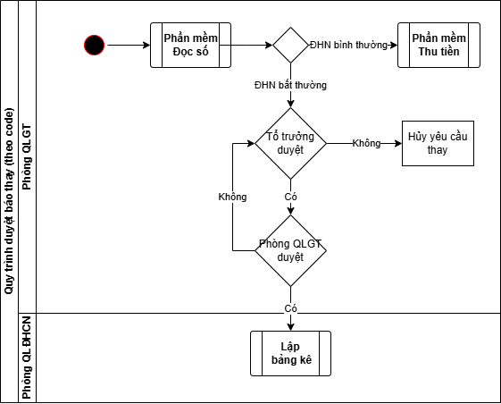
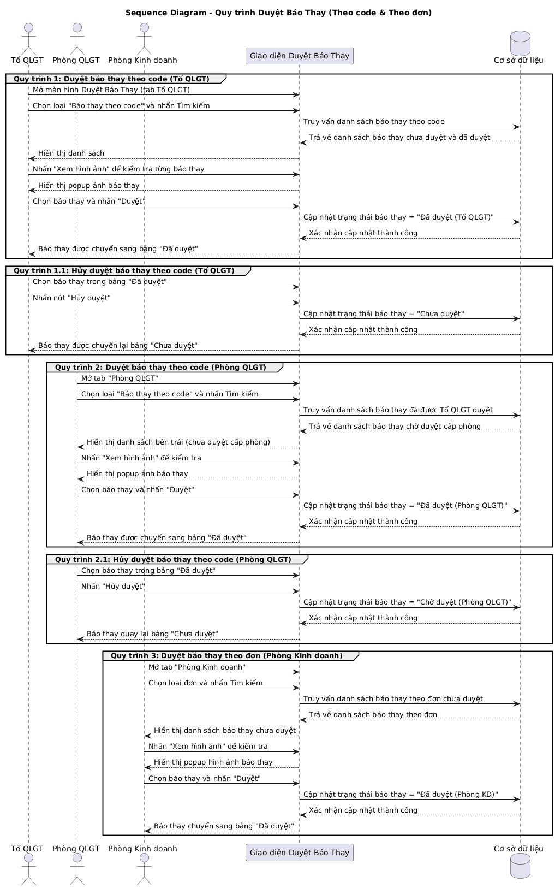
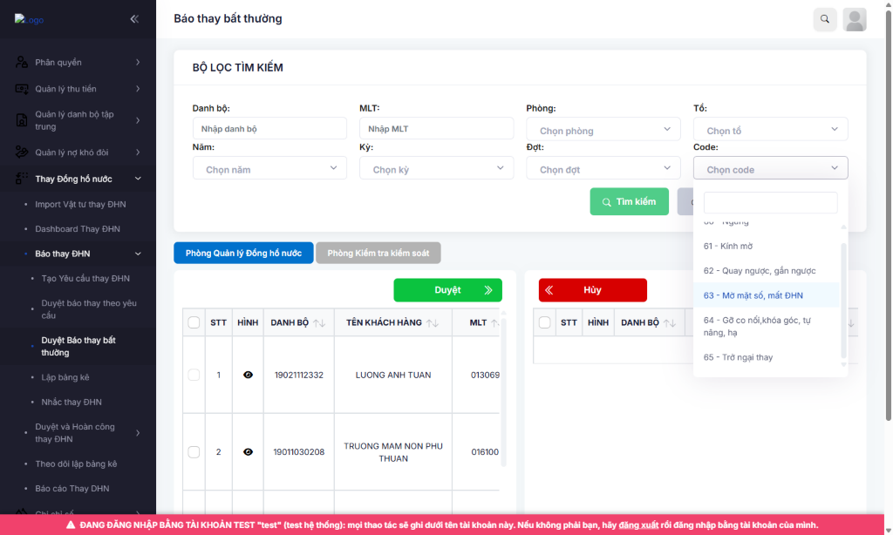

# 03. Duyệt báo thay bất thường (Theo Code đọc số)

> **Phiên bản hiện tại:** `v1.1` · **Cập nhật lần cuối:** 2026-11-23 · **Trạng thái:** Cập nhật theo phần mềm hiện tại (`As-Is` — chốt danh mục 6 Code `60–65`)

---

## 1. Mục tiêu & Tác nhân liên quan

- **Mục tiêu:** Duyệt 2 cấp đối với các đề xuất báo thay bất thường được sinh tự động từ **code đầu 6** của công tác đọc số, trước khi chuyển sang lập bảng kê.
- **Tác nhân liên quan:**
  - **Cấp duyệt 1:** Phòng Quản lý Đồng hồ nước (`Phòng ĐHN`).
  - **Cấp duyệt 2:** Phòng Kiểm tra kiểm soát (`Phòng KTKS`).
- **Route thực tế:** `/baothaybatthuong`.
- **Tham chiếu SRS V1.4:** Mục `4.2 Duyệt báo thay bất thường`.

---

## 2. Luồng nghiệp vụ (Flow & Diagrams)

### 2.1. Flowchart quy trình

### 2.2. Diễn giải luồng chính (`v1.1`)
1. Báo thay theo code được sinh tự động từ hệ thống Đọc số theo **6 mã code đầu 6 (`60–65`)** → không có màn hình tạo tay.
2. **Duyệt cấp 1 (Tab `Phòng Quản lý Đồng hồ nước`):** Kiểm tra danh bộ, hình ảnh đọc số, ghi chú trùng bảng kê → bấm `Duyệt` hoặc `Hủy` (hủy duyệt).
3. **Duyệt cấp 2 (Tab `Phòng Kiểm tra kiểm soát`):**
   - Nhận các báo thay đã được Phòng ĐHN duyệt.
   - **Bắt buộc có hình/file đính kèm trước khi duyệt cấp 2 (`BR-BT-06`):** Nếu chưa có ảnh, hệ thống chặn và yêu cầu upload qua `/BaoThayBatThuong/ViewImages`.
   - **Chống trùng bảng kê (`BR-BT-07`):** Các danh bộ đang nằm trong bảng kê khác (`nhap`, `chua_giao`, `da_giao`) hiển thị cảnh báo tại cột `GHI CHÚ`; không cho phép duyệt cấp 2 (KTKS) để lập bảng kê trùng khi chưa xử lý bảng kê hiện tại.

### 2.3. Sequence Diagram

---

## 3. Đặc tả màn hình & Trường dữ liệu (`/baothaybatthuong`)

- **Hành vi tải trang:** **Tự động load dữ liệu** vào 2 bảng song song (Trái: Chờ duyệt | Phải: Đã duyệt).
- **2 Tab phân cấp duyệt:** `Phòng Quản lý Đồng hồ nước` (mặc định) và `Phòng Kiểm tra kiểm soát`.
- **Bộ lọc tìm kiếm:**

| Trường | Kiểu | Mô tả (`v1.1`) |
|---|---|---|
| Danh bộ | Textbox | Tìm theo danh bộ |
| MLT | Textbox | Tìm theo mã lộ trình |
| Phòng | Select2 | `Phòng ban ghi thu 1`, `Phòng ban ghi thu 2` |
| Tổ | Select2 | 7 tổ quản lý ghi thu |
| Năm / Kỳ / Đợt | Select2 | `Năm` (`2021–2026`), `Kỳ` (`1–12`), `Đợt` (`1–12`) |
| Code | Select2 | **6 mã chính thức (`DEC-01` / đóng `TBD-03`):** • `60 - Ngưng` • `61 - Kính mờ` • `62 - Quay ngược, gắn ngược` • `63 - Mờ mặt số, mất ĐHN` • `64 - Gỡ co nối,khóa góc, tự nâng, hạ` • `65 - Trở ngại thay` |

*(Không có bộ lọc `Loại báo thay` trên màn hình này; bổ sung nút `Xuất Excel`.)*

- **Bảng dữ liệu (20 cột):** `Checkbox`, `STT`, `HÌNH` (icon mắt xem/upload ảnh), `DANH BỘ`, `TÊN KHÁCH HÀNG`, `MLT`, `CODE`, `TỔ`, `NHÂN VIÊN`, `NĂM`, `KỲ`, `ĐỢT`, `CS BÁO`, `NGƯỜI DUYỆT`, `NGÀY DUYỆT`, `PHÒNG BAN`, `GHI CHÚ`, `TRẠNG THÁI KTKS`, `LÝ DO TỪ CHỐI (KTKS)`, `KẾT QUẢ (KTKS)`.

---

## 4. Yêu cầu chức năng (Functional Requirements)

| Mã | Mô tả / Hành vi hệ thống (`v1.1`) |
|---|---|
| `FR-BT-01` – `FR-BT-06` | Duyệt 2 cấp (`Phòng ĐHN` → `Phòng KTKS`); xem/phóng to & upload hình ảnh (`/BaoThayBatThuong/ViewImages`); popup xác nhận khi Duyệt/Hủy duyệt; sắp xếp mới → cũ. |
| `FR-BT-07` | Hiển thị cảnh báo ở cột `GHI CHÚ` khi danh bộ đang nằm trong bảng kê khác (`Danh bộ đang nằm trong bảng kê <Số BK> (<trạng thái>)`). |
| `FR-BT-08` | Chặn duyệt Cấp 2 (`Phòng KTKS`) khi bản ghi chưa có ảnh/file upload (`"Không thể duyệt phòng: ... chưa có hình/file upload"`). |

---

## 5. Quy tắc nghiệp vụ (Business Rules)

| Mã | Mô tả chi tiết (`v1.1`) |
|---|---|
| `BR-BT-01` | Báo thay bất thường liên kết với **6 mã code đọc số `60, 61, 62, 63, 64, 65`** *(đóng `TBD-03` / `DEC-01`, không có code `66`)*. |
| `BR-BT-02`, `BR-BT-03` | Luồng duyệt 2 cấp: **Phòng ĐHN duyệt → Phòng KTKS duyệt → Lập bảng kê**. Chỉ báo thay duyệt đủ 2 cấp mới được lập bảng kê. |
| `BR-BT-04`, `BR-BT-05` | Chỉ hủy duyệt khi chưa lập bảng kê; phân quyền chặt theo cấp duyệt. |
| `BR-BT-06` | Duyệt Cấp 2 (`Phòng KTKS`) bắt buộc bản ghi phải có tối thiểu 01 hình ảnh/tệp đính kèm. |
| `BR-BT-07` | Danh bộ đang nằm trong bảng kê chưa hoàn tất (`nhap`, `chua_giao`, `da_giao`) không được phép duyệt Cấp 2 (KTKS) để lập bảng kê trùng. |

---

## 6. Tiêu chí nghiệm thu (Acceptance Criteria)

- [x] `AC-BT-01`: Dropdown `Code` hiển thị đúng 6 mã `60–65`.
- [x] `AC-BT-02`: Bản ghi duyệt ở Tab `Phòng ĐHN` chuyển sang bảng `Đã duyệt` của ĐHN và xuất hiện ở `Chờ duyệt` của Tab `Phòng KTKS`.
- [x] `AC-BT-03`: Bấm duyệt Cấp 2 khi chưa có hình bị chặn; sau khi upload hình ở `ViewImages` thì duyệt thành công.
- [ ] `AC-BT-04`: Danh bộ đang nằm trong bảng kê khác (`nhap`, `chua_giao`, `da_giao`) bị chặn duyệt lập bảng kê trùng ở Cấp 2 (`BR-BT-07`).

---

## 7. Giao diện (UI) & Lịch sử thay đổi

**Hình 1: Màn hình Duyệt Báo thay bất thường với danh mục 6 mã Code `60–65` (`v1.1`)**

| Phiên bản | Ngày | Người chốt | Tóm tắt thay đổi |
|---|---|---|---|
| `v1.0` | 2026-11-17 | nhanlt | Chuyển thể từ SRS V1.4 mục `4.2`; đánh dấu mâu thuẫn Code (`TBD-03`) và thiếu AC |
| `v1.1` | 2026-11-23 | nhanlt | Chốt `TBD-03` / `DEC-01` (6 mã Code `60–65`); bổ sung rule bắt buộc ảnh duyệt Cấp 2 (`BR-BT-06`), cảnh báo chống trùng BK (`BR-BT-07`), bộ lọc Năm/Kỳ/Đợt và 3 cột KTKS |
