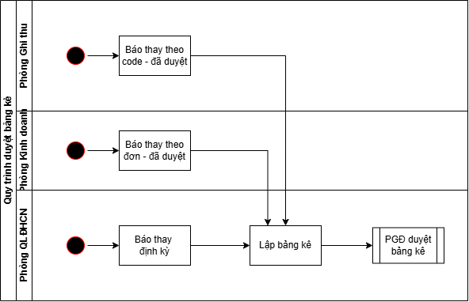
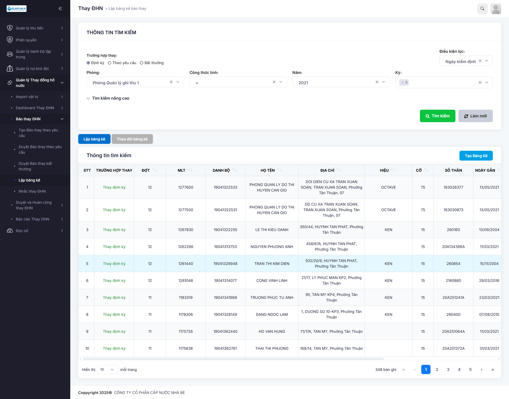
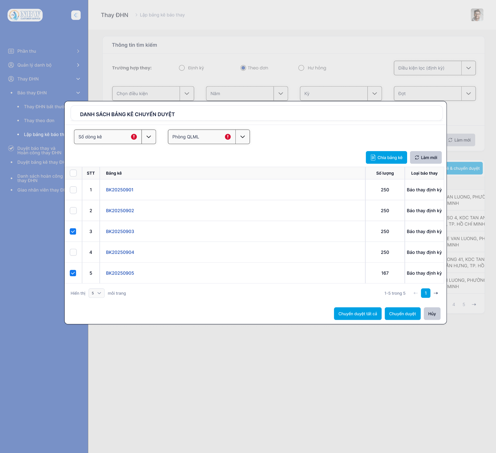
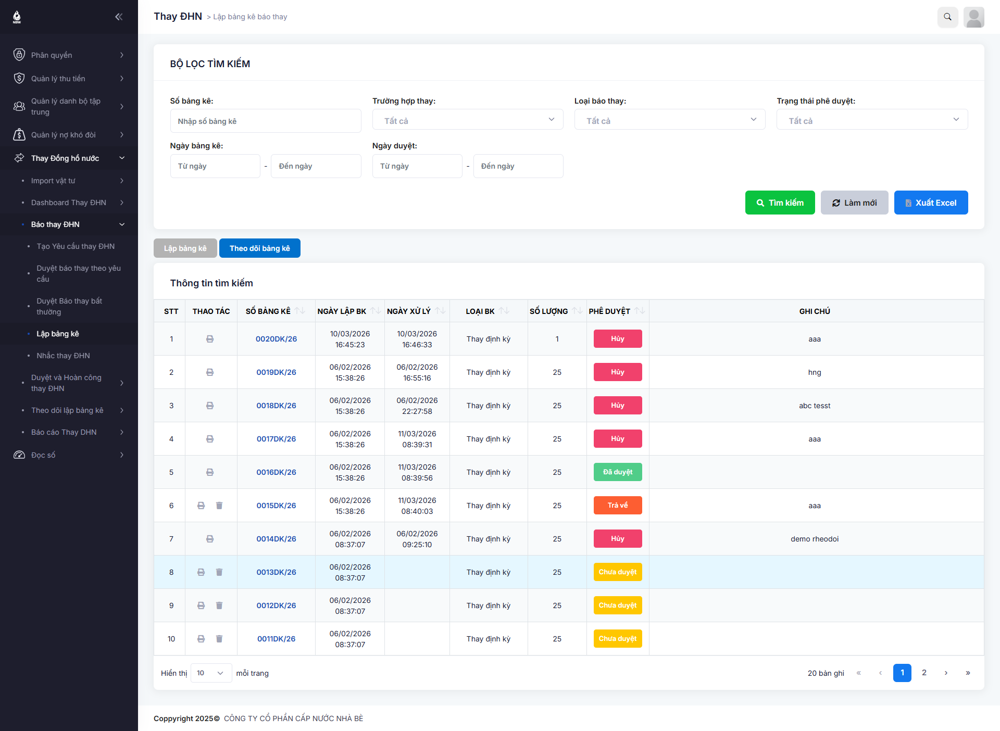

# 04. Lập & theo dõi bảng kê thay ĐHN

> **Phiên bản hiện tại:** `v1.0` · **Cập nhật lần cuối:** 2026-11-17 · **Trạng thái:** Baseline từ SRS V1.4

---

## 1. Mục tiêu & Tác nhân liên quan

- **Mục tiêu:** Lọc các báo thay đủ điều kiện (Định kỳ hoặc Đã duyệt đối với Theo yêu cầu / Bất thường), chia thành các bảng kê (tối đa 250 danh bộ/BK), chuyển Ban Lãnh đạo duyệt và theo dõi / in / hủy bảng kê trước khi duyệt.
- **Tác nhân liên quan:** Nhân viên Phòng QLĐHCN (`QLĐH`).
- **Tham chiếu SRS V1.4:** Mục `4.3 Lập & theo dõi bảng kê thay ĐHN`.

---

## 2. Luồng nghiệp vụ (Flow & Diagrams)

### 2.1. Flowchart quy trình

### 2.2. Diễn giải luồng chính & ngoại lệ
1. **Tìm kiếm báo thay:** Chọn **Trường hợp thay** (`Định kỳ` / `Theo yêu cầu` / `Bất thường`), **Phòng** (`QLĐHN 1` / `QLĐHN 2`) và các bộ lọc nâng cao để lấy danh sách báo thay đủ điều kiện (sắp xếp tăng dần theo `MLT`).
2. **Chia & Lập bảng kê:** Nhập/chọn số lượng tối đa mỗi bảng kê (≤ 250), hệ thống tự động chia thành một hoặc nhiều bảng kê và đánh số tự động theo công thức `[STT 4 số][viết tắt]/[2 số cuối năm]`.
3. **Chuyển duyệt:** Kiểm tra danh sách bảng kê vừa chia, bấm **Chuyển duyệt** từng bảng kê hoặc **Chuyển duyệt tất cả** lên Ban Lãnh đạo; bảng kê đồng thời gắn đích giao cho Phòng QLML tương ứng (`QLĐHN 1` → `QLML 1`, `QLĐHN 2` → `QLML 2`).
4. **Theo dõi / In / Hủy bảng kê:**
   - Chọn nhiều bảng kê để **In bảng kê**.
   - Click vào số bảng kê để xem chi tiết danh bộ bên trong.
   - **Hủy bảng kê** (chỉ khi chưa được Ban Lãnh đạo duyệt, bắt buộc nhập lý do): các báo thay bên trong được trả về trạng thái chưa lập bảng kê.

### 2.3. Sequence Diagram

---

## 3. Đặc tả màn hình & Trường dữ liệu

### 3.1. Bộ lọc tìm kiếm (Màn hình Lập bảng kê)

**Tìm kiếm cơ bản:**

| Trường | Kiểu | Bắt buộc | Mô tả (theo V1.4) | Điểm cần bổ sung / Đối chiếu |
|---|---|---|---|---|
| Trường hợp thay | Dropdown | **Có** | `Định kỳ`, `Theo yêu cầu`, `Bất thường` | — |
| Điều kiện lọc (định kỳ) | Dropdown | Khi chọn `Định kỳ` | `Ngày gắn`, `Ngày kiểm định`, `Danh bạ thiếu`, `Theo hiệu` | **Thiếu công thức/logic lọc chi tiết** cho từng option |
| Phòng | Dropdown | **Có** | `Phòng QLĐHN 1`, `Phòng QLĐHN 2` | — |
| *(Công thức tính)* | *(Không có trong bảng UI)* | *(Theo `FR-LBK-04`)* | `FR-LBK-04` yêu cầu bắt buộc chọn `Công thức tính` | > [!CAUTION] Lệch giữa bảng UI `4.3.3` và `FR-LBK-04` |
| *(Năm)* | *(Không có trong bảng UI)* | *(Theo `FR-LBK-04`)* | `FR-LBK-04` yêu cầu bắt buộc chọn `Năm` | > [!CAUTION] Lệch giữa bảng UI `4.3.3` và `FR-LBK-04` |

**Tìm kiếm nâng cao:**

| Trường | Kiểu | Mô tả (theo V1.4) |
|---|---|---|
| Tổ | Dropdown | Chọn tổ quản lý ĐHN |
| Loại báo thay | Dropdown | Chọn loại báo thay theo yêu cầu (22 loại) |
| Code | Dropdown | `60`, `61`, `62`, `63`, `64`, `66` *(lệch với `60, 61` ở mục `4.2.3`)* |
| Hiệu | Dropdown | Hiệu ĐHN hiện tại của danh bộ |
| Cỡ | Dropdown | Cỡ ĐHN hiện tại của danh bộ |

### 3.2. Màn hình Theo dõi trạng thái bảng kê đã chuyển

| Thành phần | Kiểu | Mô tả |
|---|---|---|
| In bảng kê | Button | Chọn 1 hoặc nhiều bảng kê và xuất/in *(V1.4 thiếu mẫu biểu In bảng kê)* |
| Hủy | Button | Hủy bảng kê đã chọn, bắt buộc nhập lý do (`BR-LBK-08`, `FR-LBK-05`) |
| Chọn bảng kê | Link | Nhấn vào số bảng kê để xem danh sách danh bộ thuộc bảng kê |

---

## 4. Yêu cầu chức năng (Functional Requirements)

| Mã | Mô tả / Hành vi hệ thống (theo SRS V1.4) |
|---|---|
| `FR-LBK-01` | Chỉ báo thay **đã được duyệt** mới được hiển thị và tìm kiếm tại màn hình Lập bảng kê, ngoại trừ báo thay **định kỳ** không yêu cầu duyệt. |
| `FR-LBK-02` | Danh sách báo thay sau khi tìm kiếm sắp xếp theo thứ tự **tăng dần của MLT**. |
| `FR-LBK-03` | Filter điều kiện lọc (định kỳ) gồm: `Ngày gắn`, `Ngày kiểm định`, `Danh bạ thiếu`, `Theo hiệu`. |
| `FR-LBK-04` | Bắt buộc chọn `Điều kiện lọc`, `Phòng`, `Công thức tính`, `Năm` trước khi lọc để lập bảng kê. *(Xem cảnh báo lệch UI ở mục 3.1)* |
| `FR-LBK-05` | Khi hủy bảng kê, bắt buộc nhập lý do hủy. |
| `FR-LBK-06` | Sau khi lập, cho phép nhấn vào số bảng kê để xem chi tiết các báo thay bên trong. |
| `FR-LBK-07` | Tự động tạo số bảng kê theo công thức: `[STT 4 chữ số][viết tắt trường hợp thay]/[2 số cuối năm lập BK]`. VD: `0001DK/26`. |
| `FR-LBK-08` | Cho phép chọn số lượng báo thay tối đa mỗi bảng kê khi chia; không được vượt quá **250 báo thay/bảng kê**. |
| `FR-LBK-09` | Khi hủy bảng kê, hiển thị popup xác nhận trước khi thực hiện. |

---

## 5. Quy tắc nghiệp vụ (Business Rules)

| Mã | Mô tả chi tiết (theo SRS V1.4) |
|---|---|
| `BR-LBK-01` | Chỉ báo thay đã được duyệt mới được phép lập bảng kê. Ngoại lệ: báo thay định kỳ không cần bước duyệt. |
| `BR-LBK-02` | Mỗi bảng kê chỉ bao gồm các báo thay thuộc **cùng một Phòng QLĐHN**. |
| `BR-LBK-03` | Khi bảng kê **đã được Ban lãnh đạo duyệt**, hệ thống không cho phép hủy bảng kê. |
| `BR-LBK-04` | Mỗi bảng kê chỉ bao gồm **một trường hợp thay duy nhất** (`Định kỳ`, `Theo yêu cầu` hoặc `Bất thường`). |
| `BR-LBK-05` | Đối với bảng kê thay theo yêu cầu, mỗi bảng kê chỉ bao gồm **một loại báo thay duy nhất**. |
| `BR-LBK-06` | Đối với bảng kê thay bất thường, mỗi bảng kê chỉ bao gồm **một code duy nhất**. |
| `BR-LBK-07` | Có thể tùy chỉnh số lượng chia bảng kê; số lượng tối đa của mỗi bảng kê là **250**. |
| `BR-LBK-08` | Khi hủy bảng kê, bắt buộc nhập lý do hủy. |

> [!WARNING] Thiếu đặc tả ở V1.4 — Các nghiệp vụ quan trọng chưa có
> 1. **Rút từng báo thay khỏi bảng kê:** V1.4 chỉ có thao tác hủy **cả** bảng kê, chưa có chức năng rút/bổ sung từng danh bộ khi bảng kê bị trả về hoặc trước khi giao thi công.
> 2. **Bảng kê bị BLĐ trả về (`Trả về`):** Ở mục `4.4` có trạng thái `Trả về` nhưng mục `4.3` không mô tả người lập bảng kê sửa và gửi duyệt lại bảng kê bị trả về bằng nút nào.
> 3. **Quy ước viết tắt mã BK (`FR-LBK-07`):** Chưa ghi rõ viết tắt của *Theo yêu cầu* và *Bất thường* (VD: `DK`, `YC`, `BT`?) và quy tắc reset STT sang năm mới.

---

## 6. Tiêu chí nghiệm thu (Acceptance Criteria)

> [!WARNING] Thiếu 100% ở V1.4 — Cần bổ sung `AC-*`
> - [ ] `AC-01` *(Đề xuất)*: Khi chia danh sách 600 danh bộ với định mức `250`, hệ thống tạo ra 3 bảng kê (`250 + 250 + 100`) và đánh số liên tiếp theo đúng format `FR-LBK-07`.
> - [ ] `AC-02` *(Đề xuất)*: Nhập số lượng chia `> 250` hoặc `<= 0` bị chặn và báo lỗi.
> - [ ] `AC-03` *(Đề xuất)*: Không thể chọn gộp báo thay thuộc 2 phòng khác nhau, 2 trường hợp thay khác nhau, 2 loại yêu cầu khác nhau hoặc 2 code khác nhau vào cùng 1 bảng kê (`BR-LBK-02`, `04`, `05`, `06`).
> - [ ] `AC-04` *(Đề xuất)*: Hủy bảng kê chưa duyệt khi chưa nhập lý do bị chặn; sau khi hủy thành công, các báo thay bên trong quay về danh sách chờ lập bảng kê.
> - [ ] `AC-05` *(Đề xuất)*: Bảng kê đã được BLĐ duyệt không hiển thị/vô hiệu hóa nút Hủy (`BR-LBK-03`).

---

## 7. Giao diện (UI) & Lịch sử thay đổi

**Hình 13: MH Lập bảng kê**

**Hình 14: Danh sách bảng kê chuyển duyệt**

**Hình 15: Màn hình theo dõi trạng thái duyệt bảng kê đã chuyển**

| Phiên bản | Ngày | Người chốt | Tóm tắt thay đổi |
|---|---|---|---|
| `v1.0` | 2026-11-17 | nhanlt | Chuyển thể từ SRS V1.4 mục `4.3`; gắn note lệch `FR-LBK-04` vs UI, thiếu công thức lọc & luồng sửa BK trả về |
