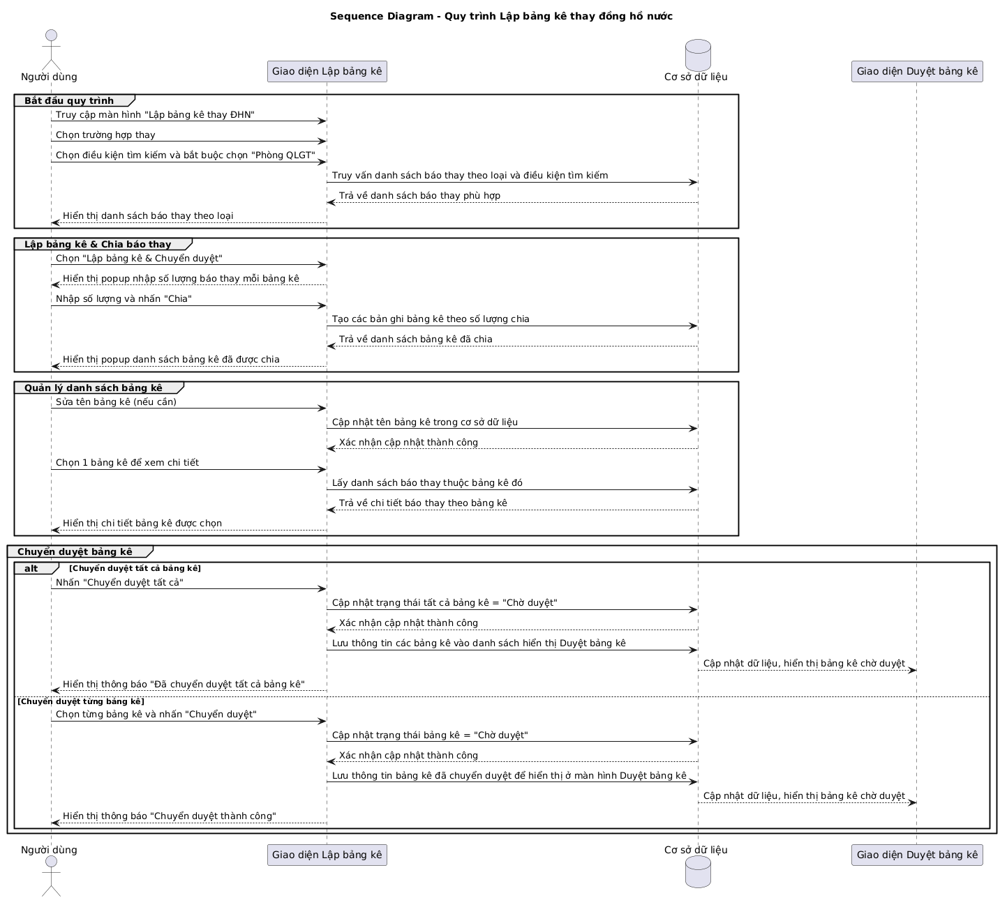
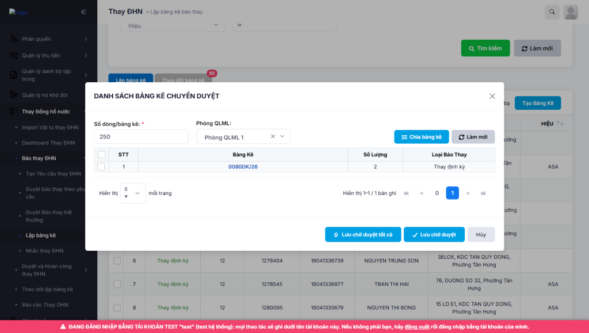
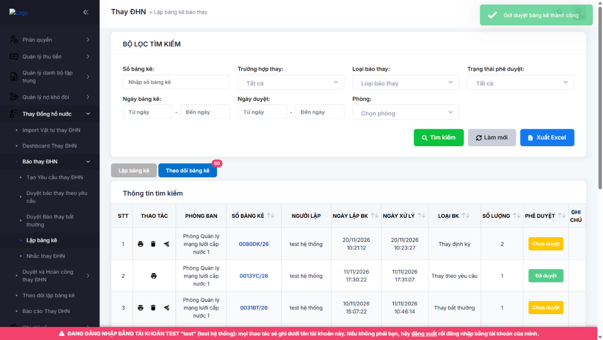
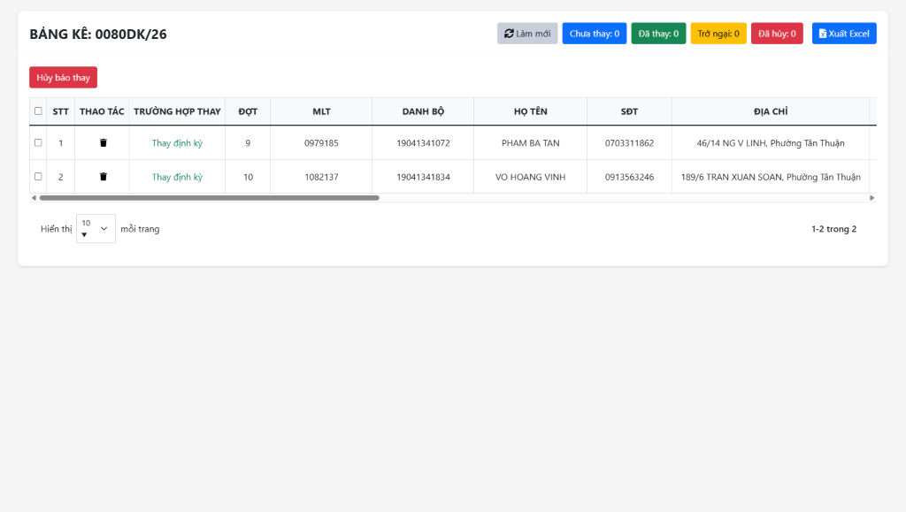

# 04. Lập, Gửi duyệt & Theo dõi bảng kê thay ĐHN

> **Phiên bản hiện tại:** `v1.1` · **Cập nhật lần cuối:** 2026-11-23 · **Trạng thái:** Cập nhật theo phần mềm hiện tại (`As-Is` — nâng giới hạn `300`/BK, thêm bước `Chờ gửi` & rút từng danh bộ)

---

## 1. Mục tiêu & Tác nhân liên quan

- **Mục tiêu:** Lọc các báo thay đủ điều kiện (`Định kỳ`, `Theo yêu cầu`, `Bất thường`), chia thành các bảng kê (tối đa **300 danh bộ/BK**), lưu nháp (`Chờ gửi`), gửi duyệt lên Ban Lãnh đạo, thu hồi gửi duyệt, rút từng danh bộ khỏi bảng kê và theo dõi tiến độ thi công / vật tư sử dụng.
- **Tác nhân liên quan:** Nhân viên Phòng QLĐHCN / Phòng Ghi thu.
- **Routes thực tế:** `/lapbangke` (2 tab: `Lập bảng kê` & `Theo dõi bảng kê` quản lý gửi duyệt) · `/theodoilapbangke` (menu cấp 2 riêng theo dõi tiến độ & vật tư).
- **Tham chiếu SRS V1.4:** Mục `4.3 Lập & theo dõi bảng kê thay ĐHN`.

---

## 2. Luồng nghiệp vụ (Flow & Diagrams)

### 2.1. Flowchart quy trình

### 2.2. Diễn giải luồng chính (`v1.1`)
1. **Tìm kiếm báo thay (`/lapbangke`):** Chọn Radio `Trường hợp thay` (`Định kỳ` / `Theo yêu cầu` / `Bất thường`), chọn `Phòng *` và các điều kiện lọc. Riêng `Định kỳ` mặc định sắp xếp **tăng dần theo `Ngày kiểm định`** (cũ nhất đi thay trước).
2. **Chia & Lưu bảng kê (`Chờ gửi`):** Chọn danh bộ → mở modal `Danh sách bảng kê chuyển duyệt`, nhập số dòng tối đa/BK (≤ **`300`**, `DEC-02`), `Phòng QLML` tự khóa tương ứng với `Phòng Ghi thu` → bấm `Chia Bảng Kê` để tự sinh mã BK (`XXXXDK/26`, `XXXXYC/26`, `XXXXBT/26`) → bấm `Lưu chờ duyệt` tạo bảng kê ở trạng thái **`Chờ gửi`**.
3. **Gửi duyệt & Thu hồi gửi duyệt (`/lapbangke` → tab `Theo dõi bảng kê`):**
   - Bấm **`Gửi duyệt bảng kê`** → bảng kê chuyển từ `Chờ gửi` sang **`Chưa duyệt`** (lên màn hình duyệt của Ban Lãnh đạo).
   - Khi BLĐ chưa duyệt, người lập có thể bấm **`Hủy gửi duyệt bảng kê`** để thu hồi về `Chờ gửi`, hoặc bấm **`Hủy bảng kê`**.
4. **Rút từng danh bộ & Theo dõi tiến độ (`/theodoilapbangke` & `/LapBangKe/xem-chi-tiet/<id>`):**
   - Click link `Số bảng kê` mở trang chi tiết có nút **`Hủy báo thay`** cho từng danh bộ (hoặc bulk) để rút khỏi bảng kê.
   - Bấm `Xem chi tiết` mở modal **`DANH SÁCH VẬT TƯ SỬ DỤNG`** của bảng kê; xem 6 cột tiến độ (`CHƯA GIAO`, `ĐÃ THAY`, `CHƯA THAY`, `TRỞ NGẠI`, `HỦY HOÀN CÔNG`, `TRỄ HẠN`), In bảng kê và Xuất Excel.

### 2.3. Sequence Diagram

---

## 3. Đặc tả màn hình & Trường dữ liệu

### 3.1. Bộ lọc tìm kiếm (`/lapbangke`)
- **`Định kỳ`:**
  - *Cơ bản:* `Phòng *` (`Phòng Quản lý ghi thu 1/2`), `Điều kiện lọc *` (`Ngày gắn`, `Ngày kiểm định` [mặc định], `Danh bạ thiếu`, `Theo hiệu`), `Tổ ghi thu` (7 tổ), `Công thức tính *` (`>`, `<`, `>=`, `<=` [mặc định], `=`), `Năm *` (`2017–2026`), `Kỳ` (`1–12`), `Đợt` (`01–12`), `Cỡ ĐH` (14 cỡ), `Danh bộ`.
  - *Nâng cao:* `Hiệu ĐH` (20 hiệu), `Số kỳ không tiêu thụ` (mặc định `6`).
- **`Theo yêu cầu`:** `Loại báo thay *` (multi-select 22 loại kèm badge số lượng tồn), `Phòng *`, `Tổ ghi thu`, `Thời gian tạo báo thay`, `Cỡ ĐH`, `Danh bộ`, `Hiệu ĐH`.
- **`Bất thường`:** `Code` (6 mã `60–65`), `Phòng *`, `Tổ ghi thu`, `Năm`, `Kỳ`, `Đợt`, `Cỡ`, `Danh bộ`, `Hiệu ĐH`.

### 3.2. Màn hình Theo dõi lập bảng kê (`/theodoilapbangke`)
- **Bộ lọc:** `Số bảng kê`, `Trường hợp thay` (`01 - Thay định kỳ`, `02 - Thay theo yêu cầu`, `03 - Thay bất thường`), `Loại báo thay`, `Trạng thái phê duyệt` (`Chờ gửi`, `Chưa duyệt`, `Đã duyệt`, `Đã hủy`, `Trả về`), `Ngày bảng kê`, `Ngày duyệt`, `Phòng` (`QLML 1/2`), `Danh bộ`.
- **18 cột:** `Checkbox`, `STT`, `THAO TÁC` (`In bảng kê`, `Xuất excel bảng kê`, `Xem chi tiết` vật tư), `PHÒNG BAN`, `SỐ BẢNG KÊ` (link chi tiết), `NGƯỜI LẬP`, `NGÀY LẬP BK`, `NGÀY XỬ LÝ`, `LOẠI BK`, `SỐ LƯỢNG`, `CHƯA GIAO`, `ĐÃ THAY`, `CHƯA THAY`, `TRỞ NGẠI`, `HỦY HOÀN CÔNG`, `TRỄ HẠN`, `PHÊ DUYỆT`, `GHI CHÚ`.

---

## 4. Yêu cầu chức năng (Functional Requirements)

| Mã | Mô tả / Hành vi hệ thống (`v1.1`) |
|---|---|
| `FR-LBK-01` | Chỉ báo thay đã duyệt đủ cấp mới hiển thị tại màn hình Lập bảng kê (ngoại trừ `Định kỳ` không cần duyệt). |
| `FR-LBK-02` | Danh sách `Định kỳ` sắp xếp mặc định theo **`Ngày kiểm định` tăng dần** (cũ nhất đi thay trước). |
| `FR-LBK-03`, `FR-LBK-04` | Bộ lọc `Định kỳ` bắt buộc `Phòng`, `Điều kiện lọc`, `Công thức tính`, `Năm`; hỗ trợ lọc loại trừ `Số kỳ không tiêu thụ`. |
| `FR-LBK-05`, `FR-LBK-09` | Hủy bảng kê (khi chưa duyệt) yêu cầu popup xác nhận và lý do hủy. |
| `FR-LBK-06` | Click `Số bảng kê` mở `/LapBangKe/xem-chi-tiet/<id>` xem danh bộ, lọc nhanh theo trạng thái, xuất Excel và **`Hủy báo thay`** từng danh bộ. |
| `FR-LBK-07`, `FR-LBK-08` | Tự động sinh số bảng kê (`[STT 4 số][DK/YC/BT]/[YY]`); giới hạn chia tối đa **`300` danh bộ/BK**. |
| `FR-LBK-10` | Lưu bảng kê ở trạng thái `Chờ gửi`, hỗ trợ `Gửi duyệt bảng kê` (→ `Chưa duyệt`) và `Hủy gửi duyệt bảng kê` (thu hồi về `Chờ gửi`). |
| `FR-LBK-11` | Xem tổng hợp `DANH SÁCH VẬT TƯ SỬ DỤNG` theo bảng kê từ màn hình `/theodoilapbangke`. |

---

## 5. Quy tắc nghiệp vụ (Business Rules)

| Mã | Mô tả chi tiết (`v1.1`) |
|---|---|
| `BR-LBK-01` – `BR-LBK-06` | Chỉ báo thay đã duyệt (trừ Định kỳ) mới lập BK; cùng 1 Phòng, cùng 1 Trường hợp thay, cùng 1 Loại báo thay/Code; BK đã duyệt không được hủy. |
| `BR-LBK-07` | Số lượng tối đa mỗi bảng kê là **`300` danh bộ** *(nâng từ `250` theo yêu cầu khách hàng — `DEC-02`)*. |
| `BR-LBK-08` | Khi hủy bảng kê, bắt buộc nhập lý do hủy. |
| `BR-LBK-09` | Khi lập bảng kê, hệ thống tự động khóa `Phòng QLML` tiếp nhận tương ứng với `Phòng Ghi thu` (`Phòng 1` → `QLML 1`, `Phòng 2` → `QLML 2`). |

---

## 6. Tiêu chí nghiệm thu (Acceptance Criteria)

- [x] `AC-LBK-01`: Lọc `Định kỳ` sắp xếp đúng theo `Ngày kiểm định` tăng dần.
- [x] `AC-LBK-02`: Chia bảng kê cho phép tối đa `300` dòng/BK và tự sinh mã `XXXXDK/26`.
- [x] `AC-LBK-03`: Lưu bảng kê vào trạng thái `Chờ gửi`; bấm `Gửi duyệt` chuyển sang `Chưa duyệt` và hiện nút `Hủy gửi duyệt bảng kê`.
- [x] `AC-LBK-04`: Trong màn chi tiết bảng kê, có thể rút/hủy từng danh bộ và xem tổng hợp vật tư sử dụng tại `/theodoilapbangke`.

---

## 7. Giao diện (UI) & Lịch sử thay đổi

**Hình 1: Modal chia bảng kê tối đa 300 dòng/BK (`v1.1`)**

**Hình 2: Tab Theo dõi bảng kê — Gửi duyệt & Hủy gửi duyệt (`v1.1`)**

**Hình 3: Chi tiết bảng kê — Rút từng danh bộ (`v1.1`)**

| Phiên bản | Ngày | Người chốt | Tóm tắt thay đổi |
|---|---|---|---|
| `v1.0` | 2026-11-17 | nhanlt | Chuyển thể từ SRS V1.4 mục `4.3`; gắn note lệch `FR-LBK-04` vs UI, thiếu công thức lọc & luồng sửa BK trả về |
| `v1.1` | 2026-11-23 | nhanlt | Nâng giới hạn lên `300` dòng/BK (`DEC-02`); cập nhật bước `Chờ gửi` → `Gửi duyệt` / `Hủy gửi duyệt`, sắp xếp `Ngày KĐ` tăng dần, chức năng rút từng danh bộ và tách màn `/theodoilapbangke` |
