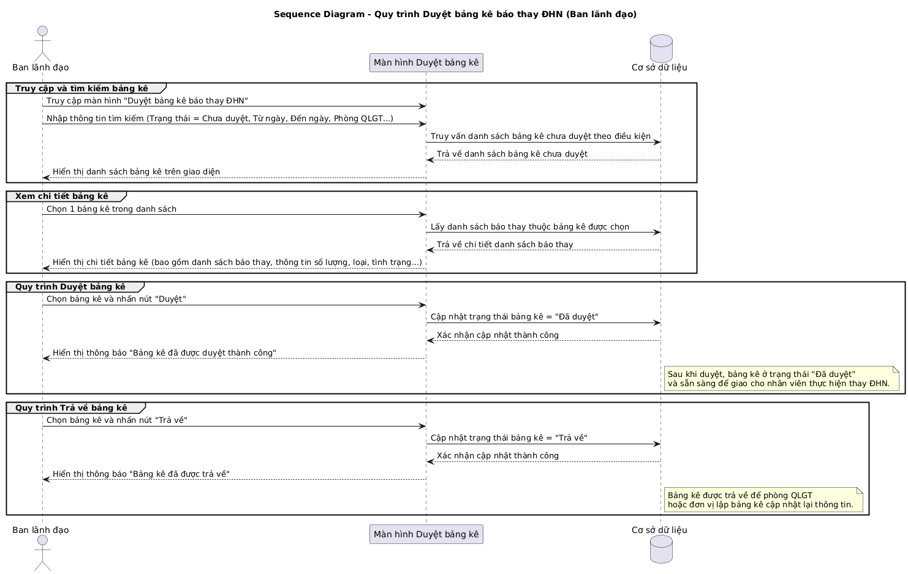
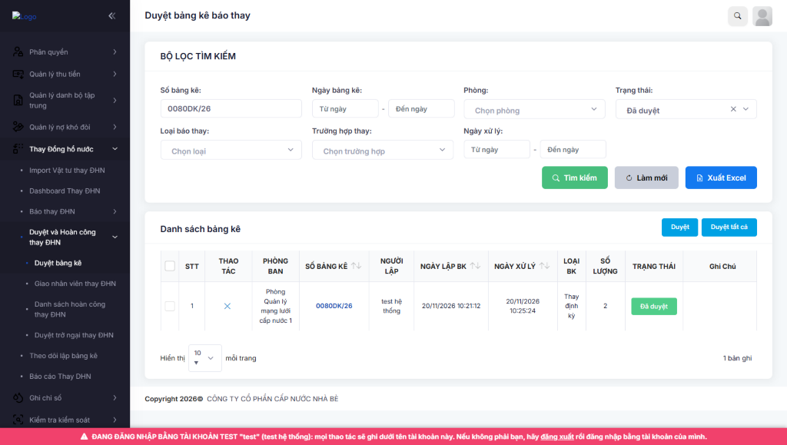

# 05. Duyệt bảng kê (Ban Lãnh đạo / PGĐ)

> **Phiên bản hiện tại:** `v1.1` · **Cập nhật lần cuối:** 2026-11-23 · **Trạng thái:** Cập nhật theo phần mềm hiện tại (`As-Is` — chốt 1 cấp duyệt, nút `Hủy duyệt` & 4 trường hợp thay)

---

## 1. Mục tiêu & Tác nhân liên quan

- **Mục tiêu:** Cho phép Ban Lãnh đạo (Phó Giám đốc) xem xét, phê duyệt, hủy duyệt hoặc trả về các bảng kê do Phòng QLĐHCN gửi lên.
- **Tác nhân liên quan:** Ban Lãnh đạo (PGĐ) — **1 cấp duyệt**.
- **Route thực tế:** `/duyetbangke`.
- **Tham chiếu SRS V1.4:** Mục `4.4 Duyệt bảng kê`.

---

## 2. Luồng nghiệp vụ (Flow & Diagrams)

### 2.1. Flowchart quy trình

### 2.2. Diễn giải luồng chính (`v1.1`)
1. Ban Lãnh đạo vào `/duyetbangke`: hệ thống tự động tải danh sách bảng kê với bộ lọc mặc định **`Trạng thái = Chưa duyệt`**.
2. Click vào **Số bảng kê** để xem chi tiết danh sách danh bộ bên trong (`/LapBangKe/xem-chi-tiet/<id>`).
3. **Duyệt:** Bấm icon `Duyệt` từng dòng (hoặc tick chọn nhiều dòng bấm `Duyệt` / `Duyệt tất cả`) → popup xác nhận → chuyển sang **`Đã duyệt`** và hiển thị sang màn hình `Giao NV thay ĐHN`.
4. **Trả về (khi `Chưa duyệt`):** Bấm icon `Trả về` → **bắt buộc nhập `Lý do trả về`** (`"Vui lòng nhập lý do trả về"`) → chuyển sang trạng thái **`Trả về`**, ghi lý do vào cột `Ghi chú`.
5. **Hủy duyệt (khi `Đã duyệt` và chưa giao NV):** Sau khi duyệt, nút `Trả về` biến mất và đổi thành nút **`Hủy duyệt` (`×`)** (checkbox dòng bị khóa).

### 2.3. Sequence Diagram

---

## 3. Đặc tả màn hình & Trường dữ liệu (`/duyetbangke`)

- **Bộ lọc tìm kiếm:**
  - `Số bảng kê` (text), `Ngày bảng kê` (`Từ ngày – Đến ngày`), `Ngày xử lý` (`Từ ngày – Đến ngày`).
  - `Phòng` (`QLML 1`, `QLML 2`).
  - `Trạng thái` (mặc định `Chưa duyệt`): `Chưa duyệt`, `Đã duyệt`, `Đã hủy`, `Trả về`.
  - `Loại báo thay`: 22 loại (nhóm `Không bồi thường` & `Bồi thường`).
  - **`Trường hợp thay` (4 giá trị):** `01 - Thay định kỳ`, `02 - Thay theo yêu cầu`, **`03 - Thay theo yêu cầu bồi thường`**, `04 - Thay bất thường`.
- **Nút chức năng:** `Tìm kiếm`, `Làm mới`, `Xuất Excel`, `Duyệt`, `Duyệt tất cả`.
- **12 cột bảng:** `Checkbox`, `STT`, `THAO TÁC`, `PHÒNG BAN`, `SỐ BẢNG KÊ` (link chi tiết), `NGƯỜI LẬP`, `NGÀY LẬP BK`, `NGÀY XỬ LÝ`, `LOẠI BK`, `SỐ LƯỢNG`, `TRẠNG THÁI`, `Ghi chú`.

---

## 4. Yêu cầu chức năng (Functional Requirements)

| Mã | Mô tả / Hành vi hệ thống (`v1.1`) |
|---|---|
| `FR-DBK-01`, `FR-DBK-02` | Cho phép `Duyệt` bảng kê `Chưa duyệt` / `Trả về`; khóa `Duyệt` đối với `Đã duyệt` / `Đã hủy`. |
| `FR-DBK-03`, `FR-DBK-04` | Khi `Trả về` bảng kê `Chưa duyệt`, bắt buộc nhập `Lý do trả về` (`"Vui lòng nhập lý do trả về"`) và lưu vào cột `Ghi chú`. |
| `FR-DBK-05`, `FR-DBK-06` | Click `Số bảng kê` xem chi tiết; mặc định load `Trạng thái = Chưa duyệt`. |
| `FR-DBK-07` | Bảng kê `Đã duyệt` (chưa giao NV) hiển thị nút **`Hủy duyệt`** (`×`) thay vì `Trả về`. |

---

## 5. Quy tắc nghiệp vụ (Business Rules)

| Mã | Mô tả chi tiết (`v1.1`) |
|---|---|
| `BR-DBK-01`, `BR-DBK-02` | **1 cấp duyệt** bởi Ban Lãnh đạo; `Chưa duyệt` → duyệt → `Đã duyệt`. |
| `BR-DBK-03`, `BR-DBK-05` | Bảng kê `Đã duyệt` nhưng **chưa giao NV** được phép **`Hủy duyệt`**; bảng kê **đã giao NV** không được hủy duyệt / trả về. |
| `BR-DBK-04`, `BR-DBK-06`, `BR-DBK-08` | Bảng kê `Đã hủy` không được duyệt; `Trả về` bắt buộc nhập lý do; bảng kê `Trả về` có thể được gửi lại và duyệt lại. |

---

## 6. Tiêu chí nghiệm thu (Acceptance Criteria)

- [x] `AC-01`: Mặc định tải danh sách `Chưa duyệt`; duyệt thành công chuyển sang `Đã duyệt` và đổi nút thao tác thành `Hủy duyệt`.
- [x] `AC-02`: Bấm `Trả về` khi để trống lý do bị chặn với thông báo `"Vui lòng nhập lý do trả về"`.
- [x] `AC-03`: Bảng kê đã duyệt xuất hiện ngay tại màn hình `/giaonvthaydhn`.

---

## 7. Giao diện (UI) & Lịch sử thay đổi

**Hình 1: Màn hình Duyệt bảng kê (`v1.1` — 1 cấp duyệt, nút `Hủy duyệt`)**

| Phiên bản | Ngày | Người chốt | Tóm tắt thay đổi |
|---|---|---|---|
| `v1.0` | 2026-11-17 | nhanlt | Chuyển thể từ SRS V1.4 mục `4.4`; ghi nhận mâu thuẫn trạng thái `Trả về` vs `Chưa duyệt` và ghi đè `Ghi chú` |
| `v1.1` | 2026-11-23 | nhanlt | Chốt 1 cấp duyệt; cập nhật nút `Hủy duyệt` sau khi duyệt, bộ lọc 4 trường hợp thay (tách `03 - Thay theo yêu cầu bồi thường`), `Ngày xử lý` và `Xuất Excel` |
