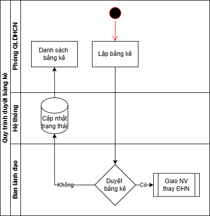

# 05. Duyệt bảng kê (Ban Lãnh đạo / PGĐ)

> **Phiên bản hiện tại:** `v1.0` · **Cập nhật lần cuối:** 2026-11-17 · **Trạng thái:** Baseline từ SRS V1.4

---

## 1. Mục tiêu & Tác nhân liên quan

- **Mục tiêu:** Cho phép Ban Lãnh đạo (Phó Giám đốc) xem xét, phê duyệt hoặc trả về các bảng kê do Phòng QLĐHCN trình lên.
- **Tác nhân liên quan:** Ban Lãnh đạo (PGĐ).
- **Tham chiếu SRS V1.4:** Mục `4.4 Duyệt bảng kê`.

---

## 2. Luồng nghiệp vụ (Flow & Diagrams)

### 2.1. Flowchart quy trình

### 2.2. Diễn giải luồng chính
1. Ban Lãnh đạo tìm kiếm danh sách bảng kê (mặc định hiển thị các bảng kê `Chưa duyệt` đầu tiên).
2. Click vào **Số bảng kê** để mở popup xem chi tiết danh sách danh bộ trong bảng kê (có thể lọc nhanh theo trạng thái `Chưa thay`, `Đã thay`, `Trở ngại`, `Hủy hoàn công`).
3. **Duyệt:** Chuyển bảng kê sang trạng thái `Đã duyệt` → hiển thị tại màn hình *Giao NV thay ĐHN* của Phòng QLML.
4. **Trả về:** Nếu không duyệt, bắt buộc nhập lý do trả về → bảng kê chuyển sang trạng thái `Trả về` (lưu lý do vào cột Ghi chú) để Phòng QLĐHCN theo dõi và xử lý lại.
5. **Trả về sau khi đã duyệt:** Bảng kê đã duyệt nhưng **chưa giao cho nhân viên** vẫn có thể được trả về (`BR-DBK-03`, `BR-DBK-05`).

### 2.3. Sequence Diagram

---

## 3. Đặc tả màn hình & Trường dữ liệu

**Bộ lọc tìm kiếm:**

| Trường | Kiểu | Mô tả (theo V1.4) |
|---|---|---|
| Số BK | Textbox | Tìm theo số bảng kê |
| Ngày BK | Date | Lọc theo ngày lập bảng kê |
| Phòng | Dropdown | `QLĐHN 1`, `QLĐHN 2` |
| Tổ | Dropdown | Tổ quản lý hóa đơn theo số cuốn/máy trong MLT |
| Trạng thái | Dropdown | `Chưa duyệt`, `Đã duyệt`, `Đã hủy`, `Trả về` |
| Loại bảng kê | Dropdown | Áp dụng cho trường hợp thay theo yêu cầu |
| Trường hợp thay | Dropdown | `Định kỳ`, `Theo yêu cầu`, `Theo code` |

**Popup xem chi tiết bảng kê:**
- Hiển thị các danh bộ thuộc bảng kê.
- Cho phép lọc theo các badge/tab trạng thái: `Chưa thay`, `Đã thay`, `Trở ngại`, `Hủy hoàn công`, và nút `Làm mới`.

---

## 4. Yêu cầu chức năng (Functional Requirements)

| Mã | Mô tả / Hành vi hệ thống (theo SRS V1.4) |
|---|---|
| `FR-DBK-01` | Chỉ cho phép thực hiện thao tác **Duyệt** đối với các bảng kê có trạng thái `Chưa duyệt` hoặc `Trả về`. |
| `FR-DBK-02` | Không cho phép thực hiện thao tác **Duyệt** đối với các bảng kê có trạng thái `Đã duyệt` hoặc `Hủy`. |
| `FR-DBK-03` | Khi thực hiện thao tác **Trả về** bảng kê, bắt buộc nhập lý do trả về. |
| `FR-DBK-04` | Lý do trả về được lưu vào cột `Ghi chú` của bảng kê và **ghi đè nội dung ghi chú trước đó** (nếu có). |
| `FR-DBK-05` | Cho phép xem chi tiết các báo thay thuộc bảng kê từ danh sách bảng kê. |
| `FR-DBK-06` | Danh sách bảng kê chờ duyệt mặc định hiển thị các bảng kê ở trạng thái `Chưa duyệt`. |

---

## 5. Quy tắc nghiệp vụ (Business Rules)

| Mã | Mô tả chi tiết (theo SRS V1.4) |
|---|---|
| `BR-DBK-01` | Chỉ Ban lãnh đạo mới có quyền thực hiện các thao tác **Duyệt** và **Trả về** bảng kê. |
| `BR-DBK-02` | Chỉ các bảng kê ở trạng thái `Chưa duyệt` mới được phép Duyệt; sau khi duyệt chuyển sang `Đã duyệt`. |
| `BR-DBK-03` | Các bảng kê đã duyệt nhưng **chưa giao cho nhân viên thay ĐHN** vẫn có thể Trả về; sau khi trả về chuyển về trạng thái `Chưa duyệt` *(xem mâu thuẫn với `FR-DBK-01` bên dưới)*. |
| `BR-DBK-04` | Các bảng kê ở trạng thái `Đã hủy` không được phép Duyệt. |
| `BR-DBK-05` | Các bảng kê **đã giao** cho nhân viên thay ĐHN không được phép Trả về. |
| `BR-DBK-06` | Khi Trả về bảng kê, bắt buộc nhập lý do trả về. |
| `BR-DBK-07` | Bảng kê chỉ được duyệt khi chưa bị hủy và chưa được giao cho nhân viên thay. |
| `BR-DBK-08` | Bảng kê đã `Trả về` vẫn có thể được Duyệt lại. |

> [!CAUTION] Mâu thuẫn nhỏ & Điểm cần cải thiện trong V1.4
> 1. **Tên trạng thái sau khi Trả về:** `BR-DBK-03` ghi chuyển về `"Chưa duyệt"`, trong khi bộ lọc mục `4.4.3`, `BR-DBK-08` và `FR-DBK-01` đều dùng trạng thái riêng là `"Trả về"`.
> 2. **Mất lịch sử trả về (`FR-DBK-04`):** Ghi đè lý do vào cột `Ghi chú` làm mất vết các lần trả về trước đó (`OPEN-07`).
> 3. **Số cấp duyệt bảng kê:** V1.4 chỉ có **1 cấp (PGĐ/BLĐ)**. Nếu phần mềm thực tế có 2 cấp (Trưởng phòng → PGĐ) thì cần cập nhật ở bản `v1.x`.

---

## 6. Tiêu chí nghiệm thu (Acceptance Criteria)

> [!WARNING] Thiếu 100% ở V1.4 — Cần bổ sung `AC-*`
> - [ ] `AC-01` *(Đề xuất)*: Chỉ tài khoản thuộc vai trò Ban Lãnh đạo nhìn thấy và sử dụng được nút Duyệt / Trả về (`BR-DBK-01`).
> - [ ] `AC-02` *(Đề xuất)*: Bấm Trả về mà để trống lý do bị chặn và báo lỗi bắt buộc nhập (`BR-DBK-06`).
> - [ ] `AC-03` *(Đề xuất)*: Bảng kê đã giao cho dù chỉ 1 nhân viên thi công thì không còn phép Trả về (`BR-DBK-05`).
> - [ ] `AC-04` *(Đề xuất)*: Bảng kê ở trạng thái `Đã hủy` bị khóa nút Duyệt và Trả về (`BR-DBK-04`).

---

## 7. Giao diện (UI) & Lịch sử thay đổi

> Ảnh màn hình Figma (`Hình 17`, `Hình 18` trong SRS V1.4) sẽ được bổ sung sau.

| Phiên bản | Ngày | Người chốt | Tóm tắt thay đổi |
|---|---|---|---|
| `v1.0` | 2026-11-17 | Lê Nhân | Chuyển thể từ SRS V1.4 mục `4.4`; ghi nhận mâu thuẫn trạng thái `Trả về` vs `Chưa duyệt` và ghi đè `Ghi chú` |
