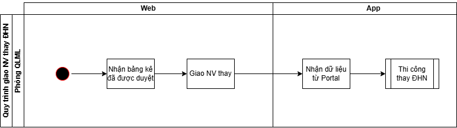
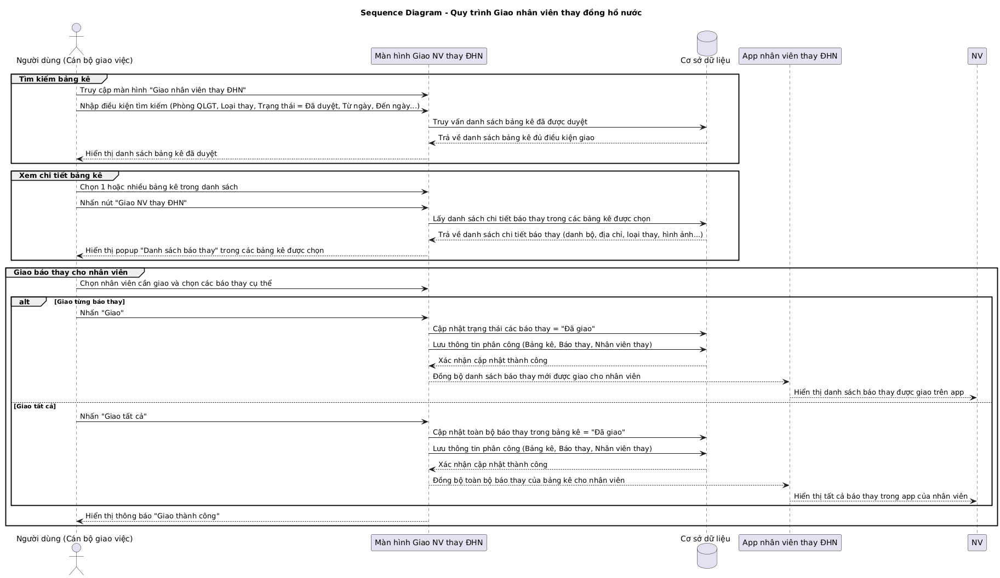
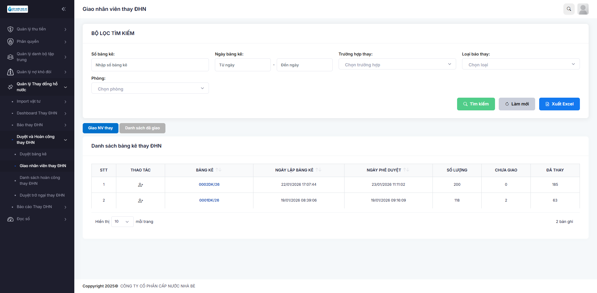
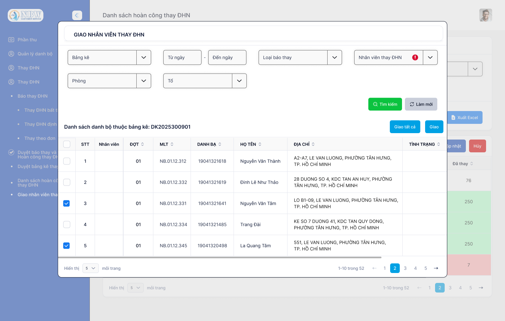

# 06. Giao nhân viên thay ĐHN

> **Phiên bản hiện tại:** `v1.0` · **Cập nhật lần cuối:** 2026-11-17 · **Trạng thái:** Baseline từ SRS V1.4

---

## 1. Mục tiêu & Tác nhân liên quan

- **Mục tiêu:** Cho phép Phòng Quản lý mạng lưới (QLML) tiếp nhận các bảng kê đã được Ban Lãnh đạo duyệt và phân công nhân viên thi công thực hiện ngoài hiện trường (đẩy xuống Mobile App).
- **Tác nhân liên quan:** Tổ trưởng / Nhân viên điều phối Phòng QLML (`QLML 1`, `QLML 2`).
- **Tham chiếu SRS V1.4:** Mục `4.5 Giao NV thay ĐHN`.

---

## 2. Luồng nghiệp vụ (Flow & Diagrams)

### 2.1. Flowchart quy trình

### 2.2. Diễn giải luồng chính
1. Chọn một hoặc nhiều bảng kê đã được Ban Lãnh đạo duyệt từ danh sách.
2. Mở popup Giao nhân viên thay ĐHN: hệ thống tổng hợp (hợp) toàn bộ các danh bộ chưa giao từ các bảng kê đã chọn, sắp xếp tăng dần theo `MLT`.
3. Tìm kiếm/chọn một hoặc nhiều danh bộ (hoặc chọn tất cả), chọn **Nhân viên thay ĐHN** (bắt buộc) và xác nhận giao.
4. Các danh bộ đã giao biến mất khỏi danh sách chưa giao và được đồng bộ xuống **Mobile App** của nhân viên được chọn (`BR-GNV-05`, `FR-32`).

### 2.3. Sequence Diagram

---

## 3. Đặc tả màn hình & Trường dữ liệu

- **Màn hình chính Giao NV thay ĐHN:**
  - Bộ lọc tìm kiếm bảng kê đã được BLĐ duyệt *(V1.4 chưa liệt kê chi tiết các field lọc ở màn hình này)*.
  - Bảng danh sách bảng kê: cho phép chọn 1 hoặc nhiều bảng kê để giao cùng lúc.
- **Popup Giao nhân viên thay ĐHN:**
  - Tìm kiếm cụ thể danh bộ cần giao (mặc định load tất cả danh bộ chưa giao thuộc các bảng kê đã chọn).
  - Dropdown **Nhân viên thay ĐHN** *(bắt buộc chọn)*.
  - Nút thao tác: Giao danh bộ đã chọn / Giao tất cả danh bộ thuộc bảng kê đã chọn.

> [!WARNING] Thiếu đặc tả ở V1.4 — Bộ lọc & Danh sách nhân viên
> Chưa liệt kê chi tiết các trường tìm kiếm trên màn hình chính `4.5.3` và chưa quy định danh sách dropdown *Nhân viên thay ĐHN* lọc theo `QLML 1` / `QLML 2` hay hiển thị toàn bộ nhân viên.

---

## 4. Yêu cầu chức năng (Functional Requirements)

| Mã | Mô tả / Hành vi hệ thống (theo SRS V1.4) |
|---|---|
| `FR-29` | Có thể chọn nhiều bảng kê để giao nhân viên; danh sách danh bộ hiển thị là **hợp (union)** của tất cả bảng kê được chọn, sắp xếp tăng dần theo `MLT`. |
| `FR-30` | Trong danh sách giao NV thay ĐHN, sắp xếp danh bộ theo chiều tăng dần của `MLT`. |
| `FR-31` | Có thể giao nhiều danh bộ trong một lần cho nhân viên được chọn. |
| `FR-32` | Khi danh bộ đã được giao, không hiển thị lại trong danh sách chưa giao. |

---

## 5. Quy tắc nghiệp vụ (Business Rules)

| Mã | Mô tả chi tiết (theo SRS V1.4) |
|---|---|
| `BR-GNV-01` | Một bảng kê có thể giao cho nhiều nhân viên thay. |
| `BR-GNV-02` | Một nhân viên có thể được giao nhiều danh bộ thay ĐHN từ nhiều bảng kê khác nhau. |
| `BR-GNV-03` | Phạm vi giao nhận theo khu vực: **Phòng QLML 1** nhận danh bộ do **Phòng QLĐHN 1** quản lý (Quận 7); **Phòng QLML 2** nhận danh bộ do **Phòng QLĐHN 2** quản lý (Quận 4 & Nhà Bè). |
| `BR-GNV-04` | Chỉ bảng kê **đã được Ban lãnh đạo duyệt** mới được giao cho nhân viên thay ĐHN. |
| `BR-GNV-05` | Sau khi giao nhân viên, hệ thống hiển thị báo thay tương ứng trên Mobile App của nhân viên được giao. |

> [!WARNING] Thiếu đặc tả ở V1.4 — Đổi / Thu hồi phân công & Phân vùng cứng
> 1. Chưa có luồng **thu hồi hoặc chuyển giao** cho nhân viên khác nếu nhân viên ban đầu nghỉ phép/bận khi chưa hoàn công.
> 2. `BR-GNV-03` gắn cứng tên quận/phòng — nên cấu hình mapping `QLĐHN ↔ QLML` bằng Master Data nếu mở rộng.

---

## 6. Tiêu chí nghiệm thu (Acceptance Criteria)

> [!WARNING] Thiếu 100% ở V1.4 — Cần bổ sung `AC-*`
> - [ ] `AC-01` *(Đề xuất)*: Bảng kê chưa được BLĐ duyệt hoặc đã hủy không xuất hiện tại màn hình Giao NV thay ĐHN (`BR-GNV-04`).
> - [ ] `AC-02` *(Đề xuất)*: Người dùng thuộc `QLML 1` chỉ thấy và giao được bảng kê của `QLĐHN 1`; tương tự với `QLML 2` và `QLĐHN 2` (`BR-GNV-03`).
> - [ ] `AC-03` *(Đề xuất)*: Sau khi bấm Giao cho nhân viên A mà chưa chọn nhân viên, hệ thống báo lỗi; sau khi giao thành công, danh bộ biến mất khỏi danh sách chờ giao (`FR-32`) và hiển thị trên Mobile App của nhân viên A (`BR-GNV-05`).

---

## 7. Giao diện (UI) & Lịch sử thay đổi

**Hình 20: MH Giao NV thay ĐHN**

**Hình 21: Popup giao nhân viên thay ĐHN**

| Phiên bản | Ngày | Người chốt | Tóm tắt thay đổi |
|---|---|---|---|
| `v1.0` | 2026-11-17 | nhanlt | Chuyển thể từ SRS V1.4 mục `4.5`; ghi nhận thiếu luồng đổi/thu hồi phân công và bộ lọc chi tiết |
