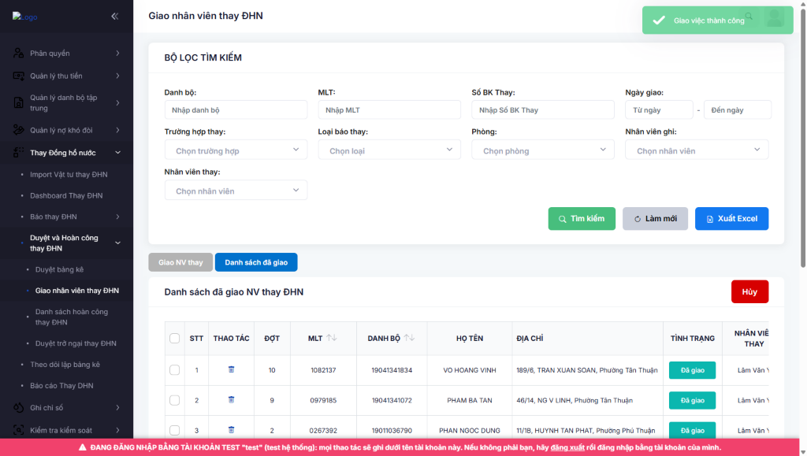

# 06. Giao nhân viên thay ĐHN & Thu hồi phân công

> **Phiên bản hiện tại:** `v1.1` · **Cập nhật lần cuối:** 2026-11-23 · **Trạng thái:** Cập nhật theo phần mềm hiện tại (`As-Is` — bổ sung tab `Danh sách đã giao` & Thu hồi phân công)

---

## 1. Mục tiêu & Tác nhân liên quan

- **Mục tiêu:** Cho phép Phòng Quản lý mạng lưới (QLML) tiếp nhận bảng kê đã được BLĐ duyệt, phân công nhân viên thi công (đẩy xuống Mobile App) và **thu hồi / hủy phân công** khi cần điều phối lại.
- **Tác nhân liên quan:** Tổ trưởng / Nhân viên điều phối Phòng QLML (`QLML 1`, `QLML 2`).
- **Route thực tế:** `/giaonvthaydhn` (gồm 2 tab: `Giao NV thay` & `Danh sách đã giao`).
- **Tham chiếu SRS V1.4:** Mục `4.5 Giao NV thay ĐHN`.

---

## 2. Luồng nghiệp vụ (Flow & Diagrams)

### 2.1. Flowchart quy trình

### 2.2. Diễn giải luồng chính (`v1.1`)
1. **Giao nhân viên (Tab `Giao NV thay`):** Chọn nút mở popup `GIAO NHÂN VIÊN THAY ĐHN` trên dòng bảng kê đã duyệt.
2. Trong popup, chọn **Nhân viên thay ĐHN \*** (dropdown tự lọc đúng nhân viên thuộc Phòng QLML của bảng kê), chọn 1 hoặc nhiều danh bộ (hoặc bấm `Giao tất cả`) → xác nhận giao.
3. Các danh bộ đã giao biến mất khỏi danh sách chưa giao và **đồng bộ tức thì xuống Mobile App** của nhân viên được giao.
4. **Thu hồi / Hủy phân công (Tab `Danh sách đã giao`):**
   - Tìm kiếm danh bộ đã giao → bấm nút `Hủy` từng dòng hoặc bulk `Hủy` để thu hồi phân công (sau đó giao lại cho nhân viên khác nếu cần).
   - Hệ thống **khóa checkbox và ẩn nút `Hủy giao`** đối với các danh bộ **đã báo trở ngại**, **đã hoàn công**, hoặc thuộc **bảng kê đã chốt**.

### 2.3. Sequence Diagram

---

## 3. Đặc tả màn hình & Trường dữ liệu (`/giaonvthaydhn`)

### 3.1. Tab 1 — `Giao NV thay` (mặc định auto-load bảng kê `Đã duyệt`)
- **Bộ lọc:** `Số bảng kê`, `Ngày bảng kê (Từ–Đến)`, `Trường hợp thay` (4 loại), `Loại báo thay` (22 loại), `Phòng` (`QLML 1`, `QLML 2`).
- **8 cột:** `STT`, `THAO TÁC` (nút mở popup giao NV), `BẢNG KÊ` (link chi tiết), `NGÀY LẬP BẢNG KÊ`, `NGÀY PHÊ DUYỆT`, `SỐ LƯỢNG`, `CHƯA GIAO`, `ĐÃ THAY`.
- **Popup `GIAO NHÂN VIÊN THAY ĐHN`:** Lọc theo `Danh bộ`, `MLT`, `Địa chỉ`; dropdown `Nhân viên thay ĐHN *` (lọc theo Phòng QLML); nút `Giao tất cả`, `Giao`, `Đóng`; 9 cột (`Checkbox`, `STT`, `NHÂN VIÊN QUẢN LÝ HĐ`, `ĐỢT`, `MLT`, `DANH BẠ`, `TRƯỜNG HỢP THAY`, `HỌ TÊN KH`, `ĐỊA CHỈ`).

### 3.2. Tab 2 — `Danh sách đã giao` (Thu hồi / Hủy phân công)
- **Bộ lọc:** `Danh bộ`, `MLT`, `Số BK Thay`, `Ngày giao (Từ–Đến)`, `Trường hợp thay`, `Loại báo thay`, `Phòng`, `Nhân viên ghi`, `Nhân viên thay`.
- **Thao tác:** Bulk `Hủy` và icon thùng rác từng dòng (tự khóa khi danh bộ đã trở ngại / hoàn công / chốt BK).
- **14 cột:** `Checkbox`, `STT`, `THAO TÁC`, `ĐỢT`, `MLT`, `DANH BỘ`, `HỌ TÊN`, `ĐỊA CHỈ`, `TÌNH TRẠNG`, `NHÂN VIÊN THAY`, `TRƯỜNG HỢP THAY`, `LOẠI BÁO THAY`, `NHÂN VIÊN GHI`, `NGÀY CẬP NHẬT`.

---

## 4. Yêu cầu chức năng (Functional Requirements)

| Mã | Mô tả / Hành vi hệ thống (`v1.1`) |
|---|---|
| `FR-29` – `FR-32` | Mở popup giao NV cho bảng kê đã duyệt (sắp xếp theo `MLT` tăng dần); giao nhiều danh bộ cùng lúc; danh bộ đã giao không còn ở danh sách chưa giao. |
| `FR-32A` | Tự động lọc dropdown `Nhân viên thay ĐHN` theo đúng Phòng QLML của bảng kê. |
| `FR-32B` | Cung cấp tab **`Danh sách đã giao`** cho phép tra cứu và **Hủy / Thu hồi phân công** đối với danh bộ chưa thi công. |

---

## 5. Quy tắc nghiệp vụ (Business Rules)

| Mã | Mô tả chi tiết (`v1.1`) |
|---|---|
| `BR-GNV-01` – `BR-GNV-05` | 1 BK giao được cho nhiều NV; 1 NV nhận từ nhiều BK; phân vùng `QLĐHN 1 ↔ QLML 1` (Quận 7) và `QLĐHN 2 ↔ QLML 2` (Quận 4 & Nhà Bè); chỉ giao BK đã duyệt; đồng bộ ngay xuống Mobile App. |
| `BR-GNV-06` | Không cho phép **Hủy / Thu hồi phân công** khi danh bộ đã có báo cáo **Trở ngại**, đã **Hoàn công**, hoặc bảng kê đã **Chốt**. |

---

## 6. Tiêu chí nghiệm thu (Acceptance Criteria)

- [x] `AC-01`: Popup giao NV của bảng kê thuộc Phòng QLML 1 chỉ hiển thị nhân viên thuộc QLML 1.
- [x] `AC-02`: Giao thành công → `CHƯA GIAO` giảm tương ứng, bản ghi xuất hiện ở tab `Danh sách đã giao` và đồng bộ lên Mobile App của nhân viên được giao.
- [x] `AC-03`: Danh bộ đã báo trở ngại hoặc thuộc bảng kê `Đã chốt` bị khóa checkbox và ẩn icon `Hủy giao` (`BR-GNV-06`).

---

## 7. Giao diện (UI) & Lịch sử thay đổi

**Hình 1: Tab `Danh sách đã giao` hỗ trợ tra cứu & Thu hồi phân công (`v1.1`)**

| Phiên bản | Ngày | Người chốt | Tóm tắt thay đổi |
|---|---|---|---|
| `v1.0` | 2026-11-17 | nhanlt | Chuyển thể từ SRS V1.4 mục `4.5`; ghi nhận thiếu luồng đổi/thu hồi phân công và bộ lọc chi tiết |
| `v1.1` | 2026-11-23 | nhanlt | Bổ sung tab `Danh sách đã giao` & quy tắc khóa thu hồi phân công khi đã trở ngại/chốt BK (`BR-GNV-06`); cập nhật bộ lọc chi tiết & lọc NV theo Phòng QLML |
