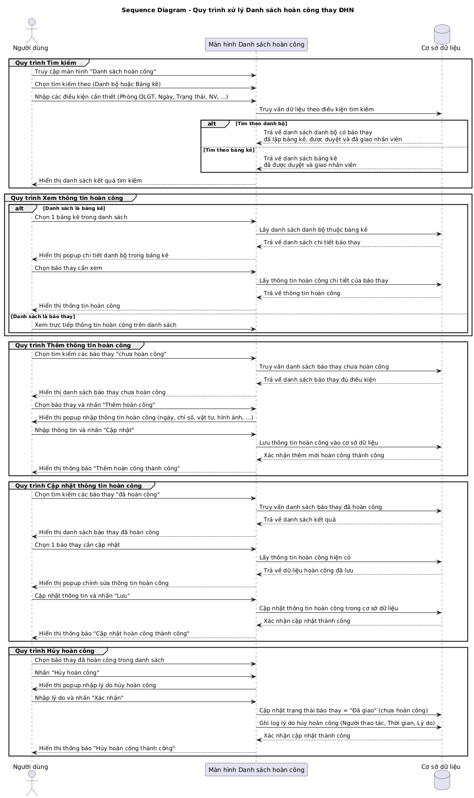
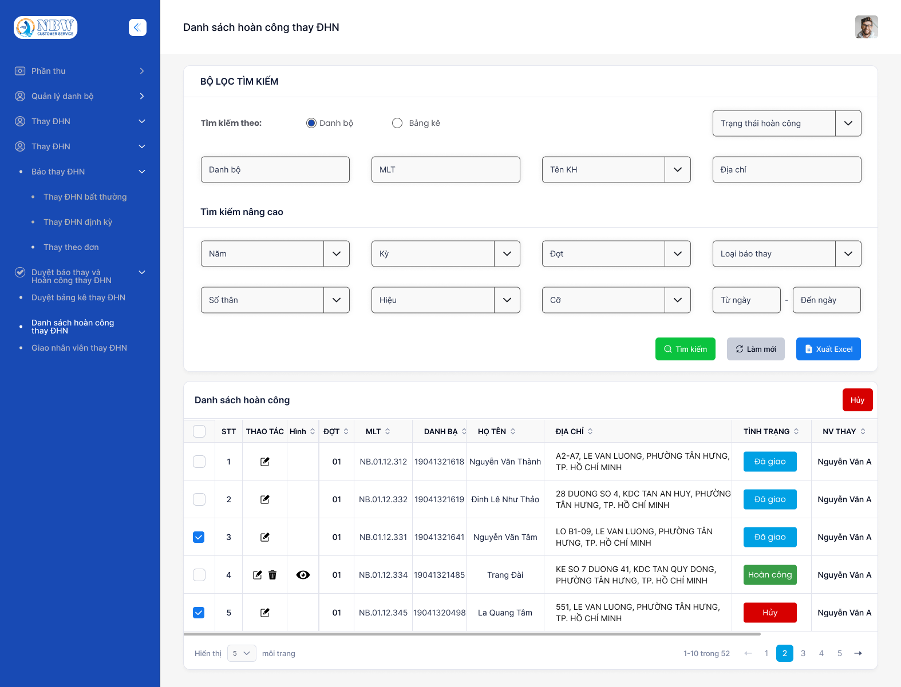
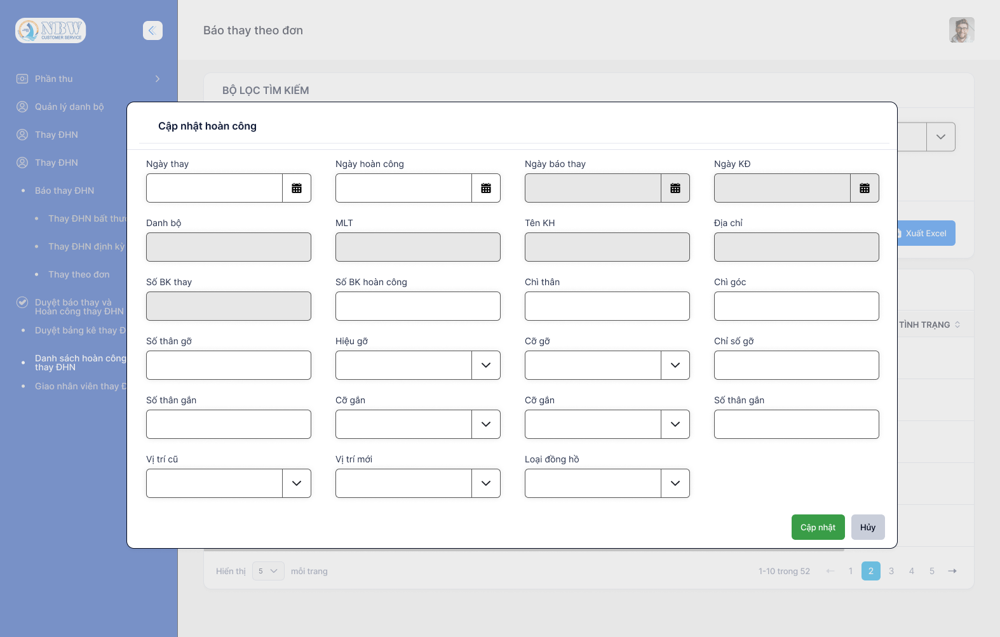
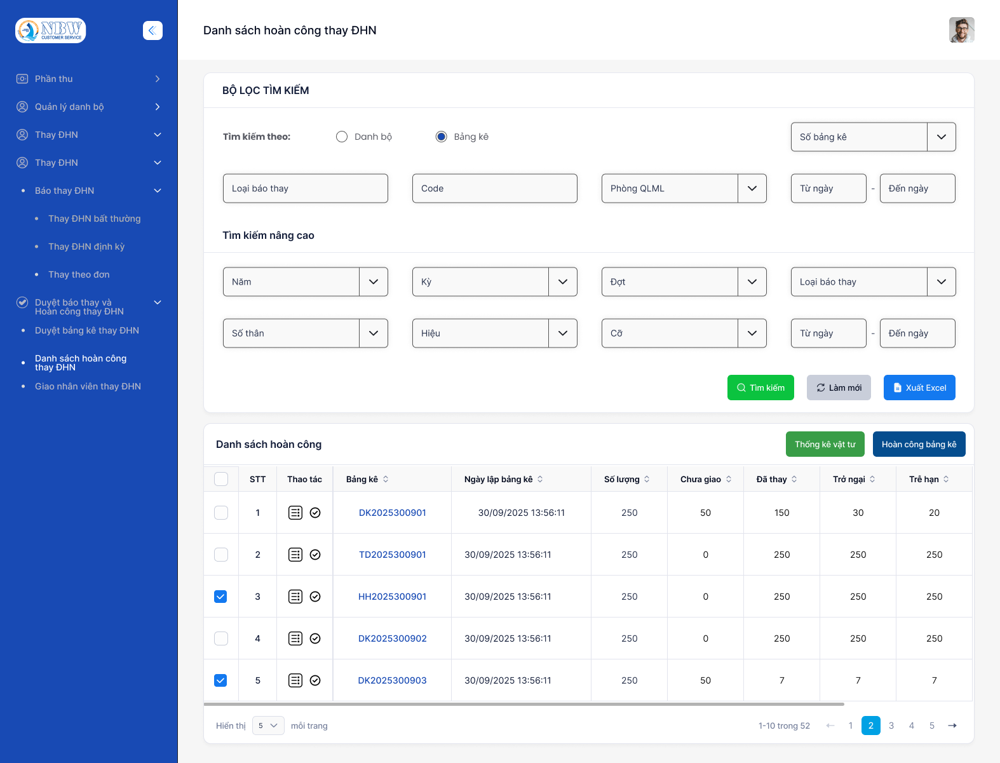

# 07. Danh sách hoàn công, Thống kê vật tư & Chốt bảng kê

> **Phiên bản hiện tại:** `v1.0` · **Cập nhật lần cuối:** 2026-11-17 · **Trạng thái:** Baseline từ SRS V1.4 (thiếu đặc tả Chốt BK & Vật tư)

---

## 1. Mục tiêu & Tác nhân liên quan

- **Mục tiêu:** Cho phép Phòng QLML tra cứu tình trạng thi công, nhập hoàn công thủ công (khi không thao tác được trên Mobile), chỉnh sửa hoặc hủy hoàn công, xuất thống kê vật tư và chốt hoàn công bảng kê.
- **Tác nhân liên quan:** Nhân viên / Tổ trưởng Phòng QLML.
- **Tham chiếu SRS V1.4:** Mục `4.6 Danh sách hoàn công thay ĐHN`.

---

## 2. Luồng nghiệp vụ (Flow & Diagrams)

### 2.1. Flowchart quy trình

### 2.2. Diễn giải 3 thao tác hoàn công & chốt bảng kê
1. **Hoàn công thủ công:** Khi không thể hoàn công trên Mobile App tại hiện trường, NV Phòng QLML tìm danh bộ/bảng kê trên Portal và nhập thông tin hoàn công (`BR-26`).
2. **Cập nhật hoàn công:** Điều chỉnh lại thông tin hoàn công đã nhập trước đó (khi bảng kê chưa chốt).
3. **Hủy hoàn công:** Hủy ghi nhận hoàn công cho danh bộ được chọn (bắt buộc nhập lý do, `BR-25`), trả danh bộ về trạng thái chưa hoàn công.
4. **Thống kê vật tư & Chốt bảng kê:** Xuất Excel vật tư đã dùng trong bảng kê; bấm **Hoàn công bảng kê** để chốt bảng kê — sau khi chốt, các báo thay bên trong không thể điều chỉnh nữa.

### 2.3. Sequence Diagram

---

## 3. Đặc tả màn hình & Trường dữ liệu

- **Màn hình Danh sách hoàn công:**
  - Tìm kiếm theo **Danh bộ** hoặc **Bảng kê** (hiển thị mọi báo thay thuộc bảng kê đã được BLĐ duyệt, không phân biệt trạng thái hoàn công; kết quả luôn trả về danh sách danh bộ).
- **Popup Cập nhật hoàn công:**
  - Các trường xám tự động load theo danh bộ báo thay; các trường trắng cho phép chỉnh sửa.
  - Nhóm dữ liệu gồm: Thông tin ĐHN gỡ (tự load ĐHN hiện tại), Thông tin ĐHN gắn (bắt buộc: `Số thân`, `Cỡ ĐHN`, `Số giấy kiểm định`, `Hiệu ĐHN`, `Chì góc`, `Chỉ số`, `Ngày kiểm định`), **Vật tư sử dụng**, và **Hình ảnh hoàn công** (tối thiểu 1 ảnh trước + 1 ảnh sau, tối đa 5 ảnh).
- **Màn hình Thống kê vật tư và Chốt bảng kê (`Hình 25`):**
  - Hiển thị danh sách bảng kê đã giao nhân viên thay ĐHN.
  - Nút **Thống kê vật tư**: xuất Excel danh sách vật tư đã sử dụng trong bảng kê.
  - Nút **Hoàn công bảng kê**: chốt bảng kê (khóa chỉnh sửa các báo thay trong bảng kê).

---

## 4. Yêu cầu chức năng (Functional Requirements)

| Mã | Mô tả / Hành vi hệ thống (theo SRS V1.4) |
|---|---|
| `FR-33` | Bắt buộc nhập lý do hủy khi hủy hoàn công. |
| `FR-34` | Hoàn công thay ĐHN tối thiểu phải có **1 hình trước** và **1 hình sau** hoàn công, tối đa **5 hình**. |
| `FR-35` | Thông tin hoàn công bắt buộc nhập thông tin ĐHN gắn: `Số thân`, `Cỡ ĐHN`, `Số giấy kiểm định`, `Hiệu ĐHN`, `Chì góc`, `Chỉ số`, `Ngày kiểm định`, `Vật tư sử dụng`. |
| `FR-36` | Thông tin ĐHN gỡ tự động load thông tin ĐHN hiện tại của danh bộ, cho phép sửa đổi. |
| `FR-37` | Trạng thái hoàn công của một danh bộ gồm: `Đã giao`, `Hoàn công`, `Hủy`. |

---

## 5. Quy tắc nghiệp vụ (Business Rules)

| Mã | Mô tả chi tiết (theo SRS V1.4) |
|---|---|
| `BR-25` | Khi hủy hoàn công phải có lý do hủy. |
| `BR-26` | Chỉ cập nhật hoàn công thủ công trên Portal khi không thể hoàn công trên Mobile. |
| `BR-27` | Khi hoàn công, bắt buộc phải ghi đầy đủ thông tin kỹ thuật ĐHN gỡ/gắn và vật tư sử dụng. |
| `BR-28` | Hoàn công thay ĐHN tối thiểu phải có 1 hình trước và 1 hình sau hoàn công, tối đa 5 hình. |

> [!CAUTION] Thiếu & Mâu thuẫn nghiêm trọng ở V1.4 — Cần rà soát (`OPEN-02`, `OPEN-05`)
> 1. **Thiếu 100% BR/FR cho Chốt bảng kê & Thống kê vật tư:** Mục `4.6.3 (Hình 25)` có nút *Hoàn công bảng kê (Chốt bảng kê)* và *Thống kê vật tư*, nhưng không có bất kỳ `BR` hay `FR` nào quy định **điều kiện được phép chốt bảng kê** (nếu bảng kê còn dòng `Chưa thay` hoặc `Trở ngại` thì có cho chốt không? Ai có quyền chốt? Có được mở chốt không?).
> 2. **Mâu thuẫn bắt buộc nhập ĐHN gỡ:** `BR-27` nói *bắt buộc ghi đầy đủ thông tin ĐHN gỡ/gắn*, trong khi mục `5.3` (Mobile App) lại ghi ĐHN gỡ *"có thể không điền"*.
> 3. **Thiếu validation chỉ số & vật tư:** Chưa có rule kiểm tra `Chỉ số gỡ` (có cho nhỏ hơn chỉ số kỳ trước không?), `Chỉ số gắn` (mặc định = 0 hay cho sửa?), và kiểm tra đối chiếu `Số thân` / `Chì góc` với kho vật tư đã import.
> 4. **Không nhất quán trạng thái `FR-37` vs mục `4.4.3`:** `FR-37` ghi 3 trạng thái (`Đã giao`, `Hoàn công`, `Hủy`), còn popup chi tiết BK ở `4.4.3` lại ghi `Chưa thay`, `Đã thay`, `Trở ngại`, `Hủy hoàn công`.

---

## 6. Tiêu chí nghiệm thu (Acceptance Criteria)

> [!WARNING] Thiếu 100% ở V1.4 — Cần bổ sung `AC-*`
> - [ ] `AC-01` *(Đề xuất)*: Hoàn công thiếu bất kỳ trường bắt buộc nào của ĐHN gắn hoặc thiếu ảnh trước/sau đều bị chặn lưu (`FR-34`, `FR-35`).
> - [ ] `AC-02` *(Đề xuất)*: Hủy hoàn công khi không nhập lý do bị chặn; sau khi hủy thành công, danh bộ quay lại trạng thái chưa hoàn công (`FR-33`, `BR-25`).
> - [ ] `AC-03` *(Đề xuất)*: Sau khi chốt bảng kê (`Hình 25`), mọi thao tác cập nhật/hủy hoàn công trong bảng kê đó bị khóa.
> - [ ] `AC-04` *(Đề xuất)*: Xuất Excel Thống kê vật tư tổng hợp đúng số lượng vật tư của các danh bộ đã hoàn công trong bảng kê.

---

## 7. Giao diện (UI) & Lịch sử thay đổi

**Hình 23: MH Danh sách hoàn công**

**Hình 24: Popup cập nhật hoàn công**

**Hình 25: Thống kê vật tư và chốt bảng kê**

| Phiên bản | Ngày | Người chốt | Tóm tắt thay đổi |
|---|---|---|---|
| `v1.0` | 2026-11-17 | nhanlt | Chuyển thể từ SRS V1.4 mục `4.6`; đánh dấu thiếu toàn bộ BR/FR Chốt bảng kê & Thống kê vật tư (`OPEN-02`, `OPEN-05`) |
