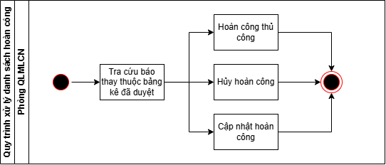
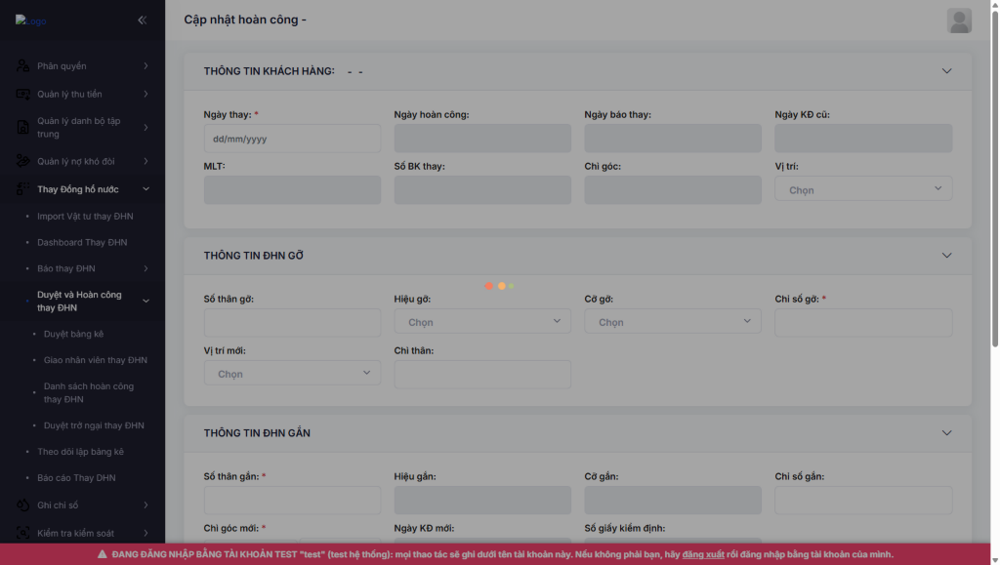
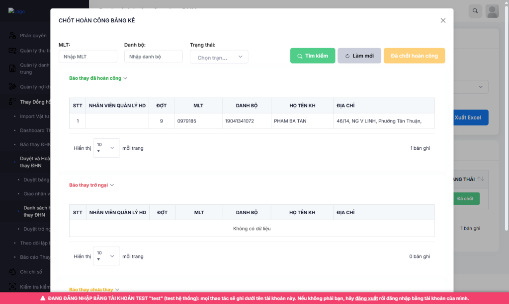

# 07. Danh sách hoàn công, Thống kê vật tư & Chốt bảng kê

> **Phiên bản hiện tại:** `v1.1` · **Cập nhật lần cuối:** 2026-11-23 · **Trạng thái:** Cập nhật theo phần mềm hiện tại (`As-Is` — chốt `TBD-02`, `TBD-05`, `DEC-05` & khóa sửa 5 ngày)

---

## 1. Mục tiêu & Tác nhân liên quan

- **Mục tiêu:** Tra cứu tình trạng thi công theo `Danh bộ` hoặc `Bảng kê`, cập nhật hoàn công thủ công trên Portal, hủy hoàn công, xem/in thống kê vật tư sử dụng và **Chốt hoàn công bảng kê**.
- **Tác nhân liên quan:** Nhân viên / Tổ trưởng Phòng QLML.
- **Routes thực tế:** `/hoancongthaydhn` (2 chế độ Radio: `Danh bộ` & `Bảng kê`) · `/HoanCongThayDHN/CapNhat/<id>` (Form cập nhật hoàn công).
- **Tham chiếu SRS V1.4:** Mục `4.6 Danh sách hoàn công thay ĐHN`.

---

## 2. Luồng nghiệp vụ (Flow & Diagrams)

### 2.1. Flowchart quy trình

### 2.2. Diễn giải luồng chính (`v1.1`)
1. **Tra cứu & Cập nhật hoàn công (`/hoancongthaydhn` — chế độ `Danh bộ`):**
   - Tìm kiếm theo `Danh bộ`, `MLT`, `Bảng kê`, `Số thân`, `Số chì`, `Trạng thái hoàn công`, `Trạng thái chốt BK`...
   - Mở form `/HoanCongThayDHN/CapNhat/<id>` để nhập/sửa hoàn công: nhập `Ngày thay *`, `Chỉ số gỡ *`, `Số thân gắn *` (tra kho vật tư `Chưa sử dụng` → tự fill thông số ĐHN gắn & tự động điền combo định mức vật tư theo cỡ), `Chì góc mới *`, và hình ảnh trước/sau thay.
   - Sau khi lưu hoàn công, kho `/ImportVatTu` tự động đổi trạng thái ĐHN gắn & Chì góc sang **`Đã sử dụng`**.
2. **Hủy hoàn công:**
   - Bấm `Hủy hoàn công` → hiển thị popup xác nhận *"Bạn có chắc chắn muốn hủy hoàn công báo thay này?"* (hiện tại **chưa bắt buộc nhập lý do**; yêu cầu bổ sung ô lý do hủy đưa vào **Roadmap `v2.0`**).
   - Sau khi hủy: danh bộ quay về trạng thái **`Đã giao`**, vật tư ĐHN & Chì góc trả lại trạng thái **`Chưa sử dụng`** (xóa sạch thông tin sử dụng cũ).
3. **Thống kê vật tư & Chốt bảng kê (`/hoancongthaydhn` — chế độ `Bảng kê`):**
   - Bấm `Xem chi tiết` → mở modal **`DANH SÁCH VẬT TƯ SỬ DỤNG`** kèm nút `In thống kê vật tư`.
   - Bấm `Xem` → mở modal **`CHỐT HOÀN CÔNG BẢNG KÊ`** (chia 3 nhóm: *Đã hoàn công*, *Trở ngại*, *Chưa thay*) → bấm **`Hoàn công bảng kê`** để chốt sang trạng thái **`Đã chốt`**.
   - **Quy tắc chốt bảng kê (`TBD-02` / `DEC-05` đã chốt):** Hệ thống **cho phép chốt bảng kê ngay cả khi vẫn còn danh bộ `Chưa thay` / `Trở ngại`**; các danh bộ chưa thay sau khi chốt sẽ tự động đổ sang màn hình **`Nhắc thay tự động`** (`/nhacthaytudong`) để lập bảng kê đợt sau. Không có nút `Mở chốt`, và **mọi thao tác sửa/hủy hoàn công (cả icon dòng lẫn nút bulk) đều phải bị khóa** sau khi chốt.

### 2.3. Sequence Diagram

---

## 3. Đặc tả màn hình & Trường dữ liệu

### 3.1. Chế độ `Danh bộ` (`/hoancongthaydhn`)
- **Bộ lọc cơ bản:** `Trạng thái hoàn công` (`Đã giao`, `Chưa giao`, `Hoàn công`, `Đã hủy`), `Danh bộ`, `MLT`, `Tên KH`, `Địa chỉ`.
- **Bộ lọc nâng cao:** `Nhân viên thay`, `Nhân viên ghi`, `Trường hợp thay` (4 loại), `Loại báo thay`, `Ngày giao`, `Ngày hoàn công`, `Ngày thay`, `Phòng` (`QLML 1/2`), `Bảng kê`, `Số thân`, `Số chì`, `Trạng thái chốt BK` (`Đã chốt`, `Chưa chốt`).
- **24 cột:** `STT`, `THAO TÁC`, `CHI TIẾT`, `ĐỢT`, `MLT`, `DANH BỘ`, `HỌ TÊN`, `ĐỊA CHỈ`, `TÌNH TRẠNG`, `NGÀY HOÀN CÔNG`, `NV THAY`, `BẢNG KÊ`, `TRỄ HẠN`, `TRỞ NGẠI`, `CS BÁO`, `CS GẮN`, `CS GỠ`, `HIỆU GẮN`, `CỠ GẮN`, `ST GẮN`, `NGÀY THAY`, `CHÌ GÓC`, `VỊ TRÍ`, `NGÀY KĐ`.

### 3.2. Form `Cập nhật hoàn công` (`/HoanCongThayDHN/CapNhat/<id>`)
- **Phần 1 — Thông tin khách hàng:** Read-only (`Ngày hoàn công`, `Ngày báo thay`, `Ngày KĐ cũ`, `MLT`, `Số BK thay`, `Chì góc`); Editable: **`Ngày thay *`** (bắt buộc), `Vị trí`.
- **Phần 2 — Thông tin ĐHN gỡ (chốt `TBD-05` / `DEC-05`):** **`Chỉ số gỡ *`** (bắt buộc); các trường `Số thân gỡ`, `Hiệu gỡ`, `Cỡ gỡ`, `Vị trí mới`, `Chì thân` cho phép sửa và **không bắt buộc**.
- **Phần 3 — Thông tin ĐHN gắn (`DEC-05`):**
  - **`Số thân gắn *`** (bắt buộc): gọi `POST /HoanCongThayDHN/LayThongTinSoThanSoChi` tra kho vật tư **`Chưa sử dụng`**. Nhập đúng → dấu `✓` xanh + tự fill `Hiệu gắn`, `Cỡ gắn`, `Ngày KĐ mới`, `Số giấy kiểm định` và tự bung combo vật tư theo cỡ; sửa sang mã khác → load lại phần ĐHN gắn vừa fill (không mất `Ngày thay`/`Chỉ số gỡ`); không tồn tại / đã sử dụng / `Tồn kho` → xóa trống phần ĐHN gắn và báo dấu `✕` đỏ.
  - `Chỉ số gắn` (editable); **`Chì góc mới *`** (bắt buộc — tiền tố mã chì thống nhất với kho như `NBW` + số chì).
- **Phần 4 — Vật tư sử dụng:** Tra cứu & chọn từ **29 vật tư** (tự động điền sẵn combo theo cỡ ĐHN gắn), điều chỉnh số lượng `+`/`-`.
- **Phần 5 — Hình ảnh hoàn công:** 2 vùng riêng `Hình ảnh trước thay (0/5)` và `Hình ảnh sau thay (0/5)` (tối thiểu 1 ảnh trước + 1 ảnh sau, mỗi vùng tối đa 5 ảnh).

### 3.3. Chế độ `Bảng kê` (`/hoancongthaydhn`)
- **10 cột:** `STT`, `THAO TÁC` (`Xem chi tiết` vật tư, `Xem` chốt BK), `BẢNG KÊ`, `NGÀY LẬP BẢNG KÊ`, `SỐ LƯỢNG`, `CHƯA GIAO`, `ĐÃ THAY`, `TRỞ NGẠI`, `TRỄ HẠN`, `TRẠNG THÁI` (`Đã chốt` / `Chưa chốt`).

---

## 4. Yêu cầu chức năng (Functional Requirements)

| Mã | Mô tả / Hành vi hệ thống (`v1.1`) |
|---|---|
| `FR-33` | Hủy hoàn công hiển thị popup xác nhận, chuyển trạng thái về `Đã giao` và hoàn trả vật tư về `Chưa sử dụng` *(ô nhập lý do hủy chuyển sang Roadmap `v2.0`)*. |
| `FR-34` | Hoàn công bắt buộc tối thiểu **1 ảnh trước thay** và **1 ảnh sau thay** (mỗi vùng tối đa **5 ảnh**). |
| `FR-35` | Bắt buộc nhập `Ngày thay *`, `Chỉ số gỡ *`, `Số thân gắn *` (khớp kho `Chưa sử dụng`), `Chì góc mới *` và `Vật tư sử dụng`. |
| `FR-36` | Tự động load thông tin ĐHN gỡ, tự động fill ĐHN gắn & combo định mức vật tư khi nhập đúng `Số thân gắn` (`DEC-05`). |
| `FR-37` | 4 trạng thái hoàn công: `Chưa giao`, `Đã giao`, `Hoàn công`, `Đã hủy`. |
| `FR-37A` | Chế độ `Bảng kê` hỗ trợ `In thống kê vật tư` và `Hoàn công bảng kê` (Chốt BK). |

---

## 5. Quy tắc nghiệp vụ (Business Rules)

| Mã | Mô tả chi tiết (`v1.1`) |
|---|---|
| `BR-26` | Cập nhật hoàn công thủ công trên Portal khi không thao tác được trên Mobile. |
| `BR-27` | *(Cập nhật chốt `TBD-05`)* Bắt buộc nhập `Ngày thay`, `Chỉ số gỡ`, `Số thân gắn` (phải ở trạng thái **`Chưa sử dụng`**, không chấp nhận `Tồn kho` hoặc `Đã sử dụng` — `DEC-03`), `Chì góc mới` và `Vật tư sử dụng`. |
| `BR-28` | Bắt buộc tối thiểu 1 ảnh trước và 1 ảnh sau hoàn công (mỗi vùng tối đa 5 ảnh). |
| `BR-28A` | **Thời hạn chỉnh sửa hoàn công (`86exxta86`):** Chỉ Tổ trưởng mới được sửa sau khi NV hoàn công, và **khóa chỉnh sửa sau 5 ngày kể từ ngày hoàn công**. |
| `BR-28B` | **Chốt bảng kê (`TBD-02` / `DEC-05`):** Cho phép chốt bảng kê dù còn dòng `Chưa thay`/`Trở ngại` (các dòng đó tự chuyển sang `Nhắc thay tự động`). Sau khi `Đã chốt`, **khóa tuyệt đối mọi thao tác sửa/hủy hoàn công ở cả UI (icon dòng + checkbox/nút bulk) lẫn Backend**; không có chức năng Mở chốt. |

---

## 6. Tiêu chí nghiệm thu (Acceptance Criteria)

- [x] `AC-HC-01`: Tìm theo `Số thân` và `Số chì` ở Tìm kiếm nâng cao trả đúng danh bộ đã hoàn công.
- [ ] `AC-HC-02`: Nhập `Số thân gắn` ở trạng thái `Tồn kho` hoặc `Đã sử dụng` bị từ chối (dấu `✕` đỏ, không fill thông số); nhập `Chưa sử dụng` hiện `✓` xanh + tự fill thông số & 5 vật tư combo (`DEC-03`, `DEC-05`).
- [ ] `AC-HC-03`: Bản ghi hoàn công quá 5 ngày bị khóa nút Sửa/Cập nhật (`BR-28A`).
- [ ] `AC-HC-04`: Sau khi Chốt bảng kê (`Đã chốt`), cả icon dòng, checkbox, nút bulk `Hủy` lẫn API Backend đều khóa chỉnh sửa/hủy (`BR-28B`), và dòng chưa thay xuất hiện ở `/nhacthaytudong`.

---

## 7. Giao diện (UI) & Lịch sử thay đổi

**Hình 1: Form Cập nhật hoàn công thay ĐHN trên Web (`v1.1`)**

**Hình 2: Modal Chốt hoàn công bảng kê (`v1.1` — `Đã chốt hoàn công`)**

| Phiên bản | Ngày | Người chốt | Tóm tắt thay đổi |
|---|---|---|---|
| `v1.0` | 2026-11-17 | nhanlt | Chuyển thể từ SRS V1.4 mục `4.6`; đánh dấu thiếu toàn bộ BR/FR Chốt bảng kê & Thống kê vật tư (`TBD-02`, `TBD-05`) |
| `v1.1` | 2026-11-23 | nhanlt | Chốt `TBD-02` (điều kiện Chốt BK & đổ sang Nhắc thay), `TBD-05` (bắt buộc `Chỉ số gỡ *`), `DEC-05` (rule tra cứu `Số thân gắn` & auto-fill combo vật tư), khóa sửa sau 5 ngày (`BR-28A`); đưa lý do hủy hoàn công vào Roadmap `v2.0` |
