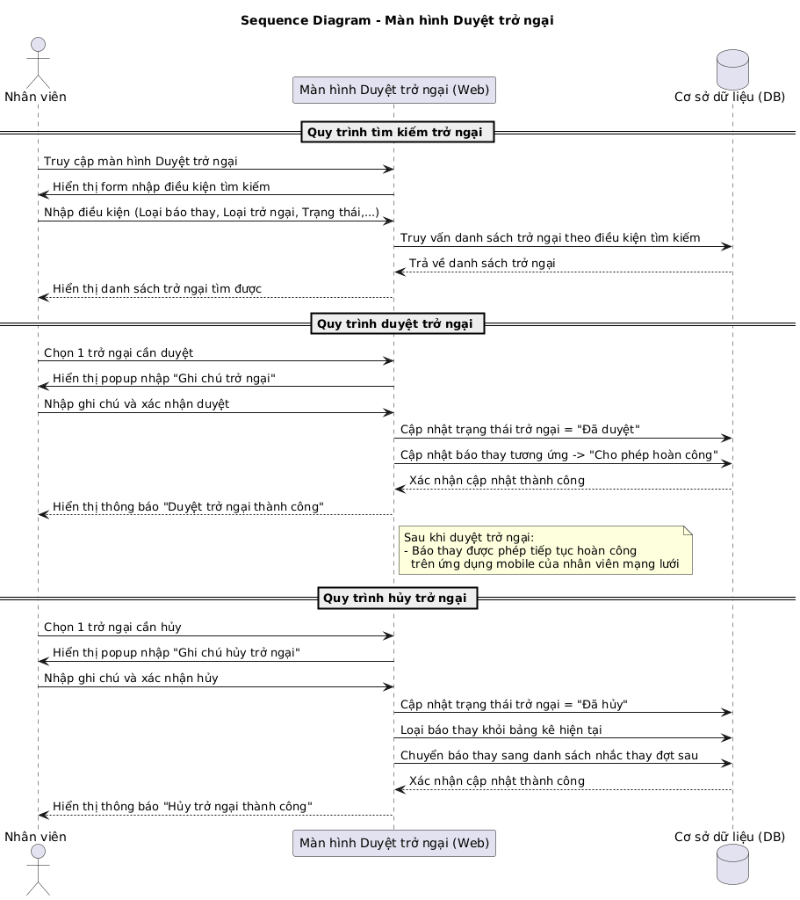

# 08. Xử lý trở ngại

> **Phiên bản hiện tại:** `v1.0` · **Cập nhật lần cuối:** 2026-11-17 · **Trạng thái:** Baseline từ SRS V1.4 (có mâu thuẫn nghiêm trọng ở loại 1–3)

---

## 1. Mục tiêu & Tác nhân liên quan

- **Mục tiêu:** Tiếp nhận báo cáo trở ngại từ nhân viên thi công trên Mobile App và phân tuyến cho các phòng chuyên môn xử lý (Duyệt để thi công tiếp hoặc Hủy để đưa ra khỏi bảng kê / xử lý kỳ sau).
- **Tác nhân liên quan:**
  - **Phòng QLĐHN:** Xử lý trở ngại loại `4`.
  - **Phòng KTKS:** Xử lý trở ngại loại `5 → 10`.
  - **Hệ thống / Phòng xử lý loại 1, 2, 3:** *(Xem cảnh báo mâu thuẫn bên dưới)*.
- **Tham chiếu SRS V1.4:** Mục `4.7 Xử lý trở ngại`.

---

## 2. Luồng nghiệp vụ (Flow & Diagrams)

### 2.1. Flowchart quy trình

### 2.2. Diễn giải luồng xử lý
1. Nhân viên thi công báo cáo trở ngại trên Mobile App, chọn 1 trong **10 loại trở ngại**.
2. Dữ liệu chuyển về màn hình *Xử lý trở ngại* trên Web Portal (mặc định sắp xếp giảm dần theo `Ngày trở ngại`).
3. Phân tuyến theo loại trở ngại:
   - **Loại 1, 2, 3:** *(Có mâu thuẫn giữa Hủy luôn và Chuyển Nhắc thay — xem mục 5)*.
   - **Loại 4:** Phòng QLĐHN tiếp nhận xử lý.
   - **Loại 5 → 10:** Phòng KTKS tiếp nhận xử lý.
4. Thao tác xử lý (bắt buộc nhập lý do / ghi chú trở ngại):
   - **Duyệt:** Phòng chuyên môn đã giải quyết được trở ngại → cho phép tiếp tục hoàn công trên Mobile App (`BR-30`, `FR-40`) hoặc mở popup hoàn công trên Web (`4.7.4`).
   - **Hủy (Không duyệt):** Chưa giải quyết được ở thời điểm hiện tại → loại danh bộ khỏi bảng kê hiện tại, lưu trạng thái trở ngại để báo thay ở đợt sau (`BR-31`).
5. **Giới hạn số lần trở ngại:** Một danh bộ gặp trở ngại tối đa **3 lần**; đến lần thứ 3 sẽ loại khỏi bảng kê và chuyển sang màn hình Nhắc thay (`BR-32`, `FR-41`).

### 2.3. Sequence Diagram

---

## 3. Đặc tả màn hình & Trường dữ liệu

### 3.1. Màn hình Xử lý trở ngại (`4.7.4`)
- **Bộ lọc tìm kiếm:** *(V1.4 chỉ ghi chung "bộ lọc tìm kiếm thông tin liên quan đến danh bộ trở ngại", chưa liệt kê danh sách các trường lọc)*.
- **Danh sách trở ngại:** Mặc định load theo thứ tự giảm dần của `Ngày trở ngại` (`FR-39`).
- **Thao tác:**
  - **Duyệt:** Nhập ghi chú trở ngại → xác nhận giải quyết xong trở ngại (mô tả màn hình ghi *hiển thị popup hoàn công thay ĐHN*, trong khi `FR-40` & `BR-30` ghi *tiếp tục hoàn công trên Mobile App*).
  - **Hủy:** Nhập ghi chú trở ngại → xác nhận không giải quyết được ở hiện tại, loại khỏi bảng kê và chuyển sang đợt sau.

### 3.2. Danh mục 10 loại trở ngại (`4.7.2`)

| STT | Loại trở ngại | Đơn vị xử lý (theo V1.4) |
|---|---|---|
| 1 | Khách hàng không ở nhiều kỳ, nhà bỏ hoang. | *(Mâu thuẫn: Hủy vs Nhắc thay)* |
| 2 | Đồng hồ nước đã cắt tạm. | *(Mâu thuẫn: Hủy vs Nhắc thay)* |
| 3 | Đồng hồ nước không sử dụng, tiêu thụ = 0 m³ nhiều kỳ. | *(Mâu thuẫn: Hủy vs Nhắc thay)* |
| 4 | Khách hàng vắng nhà, số điện thoại không liên hệ được. | Phòng QLĐHN |
| 5 | Khách hàng không đồng ý thay đồng hồ nước. | Phòng KTKS |
| 6 | Đồng hồ nước bị tráng lấp/âm tường. Khách hàng không cho đào. | Phòng KTKS |
| 7 | Chỉ số nước tăng cao bất thường, sai số. | Phòng KTKS |
| 8 | Đồng hồ nước âm sâu. | Phòng KTKS |
| 9 | Đồng hồ nước có dấu hiệu gian lận, đấu nối sai qui cách. | Phòng KTKS |
| 10 | Đồng hồ nước chưa đủ niên hạn 5 năm bị đứt chì thân (trường hợp: ngưng, kiếng mờ, lệch số…). | Phòng KTKS |

---

## 4. Yêu cầu chức năng (Functional Requirements)

| Mã | Mô tả / Hành vi hệ thống (theo SRS V1.4) |
|---|---|
| `FR-38` | Khi thực hiện **Duyệt** hoặc **Hủy** phải nhập **Ghi chú trở ngại**. |
| `FR-39` | Mặc định danh sách trở ngại load theo thứ tự giảm dần của `Ngày trở ngại` (mới nhất trước). |
| `FR-40` | Khi trở ngại được duyệt, trên Mobile App của nhân viên thay có thể tiếp tục hoàn công. |
| `FR-41` | Khi báo cáo trở ngại lần 3, báo thay lúc này có thể tìm kiếm được ở màn hình **Nhắc thay** với trạng thái `Trở ngại`. |

---

## 5. Quy tắc nghiệp vụ (Business Rules)

| Mã | Mô tả chi tiết (theo SRS V1.4) |
|---|---|
| `BR-29` | Trường hợp 1, 2, 3: Yêu cầu báo thay được **chuyển qua nhắc thay luôn**, không quan trọng đang ở lần trở ngại nào. Trường hợp 4: Phòng QLĐHN xử lý (duyệt). Trường hợp 5 → 10: Phòng KTKS xử lý (duyệt). |
| `BR-30` | Việc duyệt trở ngại đồng nghĩa phòng ban đảm nhận có thể giải quyết trở ngại; sau khi duyệt, nhân viên được giao tiếp tục thực hiện thay ĐHN trên App. |
| `BR-31` | Việc không duyệt trở ngại đồng nghĩa không thể xử lý ở thời điểm hiện tại; yêu cầu thay bị loại khỏi bảng kê hiện tại và báo thay đợt sau. |
| `BR-32` | Một danh bộ được trở ngại tối đa **3 lần**; trở ngại đến lần 3 loại khỏi bảng kê và vào nhắc thay kỳ sau. |
| `BR-33` | Khi duyệt/không duyệt trở ngại cần điền lý do. |

> [!CAUTION] Mâu thuẫn nghiêm trọng trong V1.4 — Bắt buộc đối chiếu (`OPEN-01`)
> 1. **Trở ngại loại 1, 2, 3 đá nhau trực tiếp:**
>    - Mục `4.7.1` ghi: *"Trường hợp 1, 2, 3: Hủy yêu cầu thay."*
>    - `BR-37` (mục `4.8.2`) ghi: *"Báo thay gặp trở ngại vào diện 1, 2, 3 được tính là **Hủy báo thay, không thuộc trường hợp nhắc thay**."*
>    - Nhưng `BR-29` (mục `4.7.3`) lại ghi: *"Trường hợp 1, 2, 3: Yêu cầu báo thay được **chuyển qua nhắc thay luôn**."*
> 2. **Hành động sau khi bấm Duyệt:** Mục `4.7.4` mô tả bấm Duyệt thì *"hiển thị popup hoàn công thay ĐHN"* (trên Web), còn `BR-30` và `FR-40` nói *nhân viên tiếp tục thực hiện thay ĐHN trên App*.
> 3. **Thiếu cơ chế Audit Trail & Bộ lọc:** Chưa mô tả cách xem lịch sử các lần trở ngại trước (lần 1, 2, 3) và danh sách trường lọc trên màn hình `4.7.4`.

---

## 6. Tiêu chí nghiệm thu (Acceptance Criteria)

> [!WARNING] Thiếu 100% ở V1.4 — Cần bổ sung `AC-*`
> - [ ] `AC-01` *(Đề xuất)*: Khi nhân viên Mobile gửi báo cáo trở ngại loại 4, chỉ Phòng QLĐHN được xử lý; loại 5–10 chỉ Phòng KTKS được xử lý (`BR-29`).
> - [ ] `AC-02` *(Đề xuất)*: Bấm Duyệt hoặc Hủy trở ngại khi để trống `Ghi chú trở ngại` bị chặn (`FR-38`, `BR-33`).
> - [ ] `AC-03` *(Đề xuất)*: Khi danh bộ gặp trở ngại đến lần thứ 3, báo thay bị loại khỏi bảng kê hiện tại và tìm thấy ở màn hình Nhắc thay với trạng thái `Trở ngại` (`BR-32`, `FR-41`).
> - [ ] `AC-04` *(TODO — phụ thuộc `OPEN-01`)*: Xác nhận kết quả đúng cho trở ngại loại 1, 2, 3 (Hủy hẳn hay vào Nhắc thay).

---

## 7. Giao diện (UI) & Lịch sử thay đổi

> Ảnh màn hình Figma (`Hình 27` trong SRS V1.4) sẽ được bổ sung sau.

| Phiên bản | Ngày | Người chốt | Tóm tắt thay đổi |
|---|---|---|---|
| `v1.0` | 2026-11-17 | Lê Nhân | Chuyển thể từ SRS V1.4 mục `4.7`; cảnh báo mâu thuẫn `BR-29` vs `4.7.1 & BR-37` (`OPEN-01`) |
