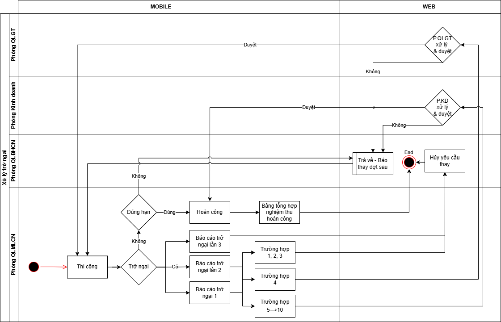
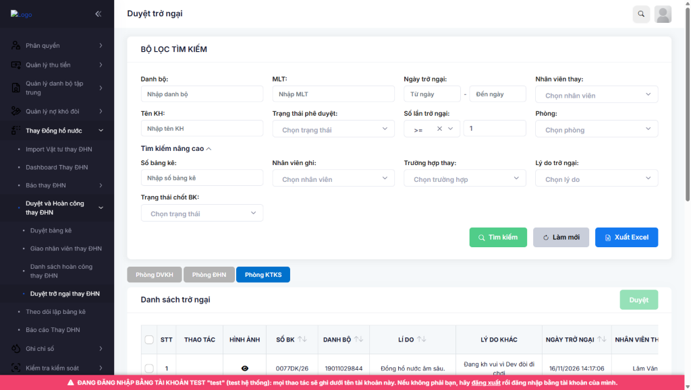
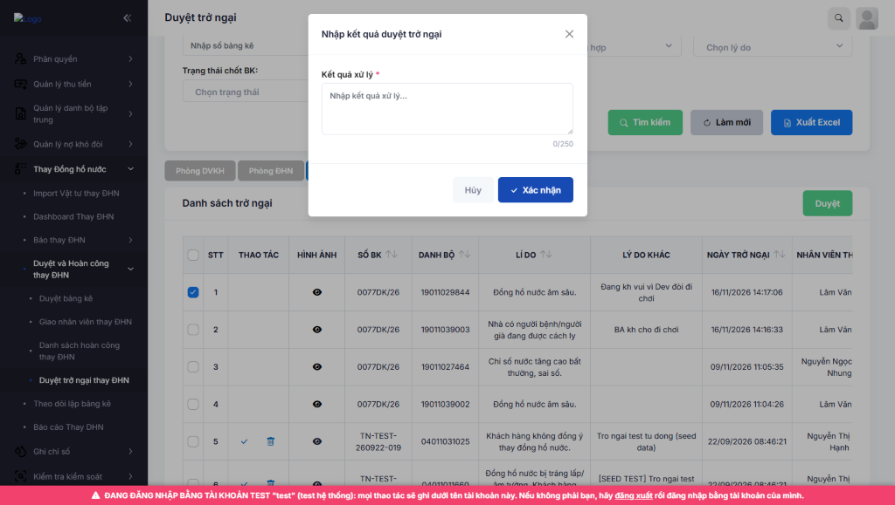

# 08. Duyệt & Xử lý trở ngại thay ĐHN

> **Phiên bản hiện tại:** `v1.1` · **Cập nhật lần cuối:** 2026-11-23 · **Trạng thái:** Cập nhật theo phần mềm hiện tại (`As-Is` — chốt `OPEN-01`, 3 tab phòng ban & 26 loại trở ngại)

---

## 1. Mục tiêu & Tác nhân liên quan

- **Mục tiêu:** Tiếp nhận báo cáo trở ngại từ nhân viên thi công trên Mobile App và phân tuyến cho **3 phòng chuyên môn** xử lý (Duyệt để thi công tiếp hoặc Hủy trở ngại).
- **Tác nhân liên quan (`DEC-03` — mở rộng 3 phòng ban):**
  - **Tab `Phòng DVKH`:** Xử lý các trở ngại liên quan dịch vụ khách hàng (bao gồm loại 1: *Khách hàng không ở nhiều kỳ, nhà bỏ hoang*...).
  - **Tab `Phòng ĐHN`:** Xử lý trở ngại liên quan quản lý ĐHN (bao gồm loại 4: *Khách hàng vắng nhà, SĐT không liên hệ được*...).
  - **Tab `Phòng KTKS`:** Xử lý các trở ngại kiểm tra kiểm soát (âm sâu, tráng lấp, nghi gian lận, không đồng ý thay...).
- **Route thực tế:** `/xulytrongai`.
- **Tham chiếu SRS V1.4:** Mục `4.7 Xử lý trở ngại`.

---

## 2. Luồng nghiệp vụ (Flow & Diagrams)

### 2.1. Flowchart quy trình

### 2.2. Diễn giải luồng xử lý (`v1.1` — Chốt dứt điểm `OPEN-01`)
1. Nhân viên thi công gửi báo cáo trở ngại trên Mobile App, chọn 1 trong **26 loại trở ngại** và đính kèm tối thiểu 1 ảnh (tối đa 5 ảnh).
2. Trong bảng kê hiện tại, danh bộ chuyển trạng thái sang **`Trở ngại`** và được tự động phân tuyến vào 1 trong 3 tab (`Phòng DVKH` / `Phòng ĐHN` / `Phòng KTKS`) trên `/xulytrongai` ở trạng thái **`Chưa duyệt`**.
   - **Chốt `OPEN-01` (Trở ngại Loại 1–3):** Thực tế hệ thống **KHÔNG tự Hủy** và **KHÔNG đẩy ngay sang `Nhắc thay`**; bản ghi giữ trạng thái `Trở ngại` trong bảng kê và đi qua tab **`Phòng DVKH`** duyệt như các loại khác.
3. **Thao tác Duyệt / Hủy duyệt:**
   - Bấm **`Duyệt`** → mở modal **`Nhập kết quả duyệt trở ngại`** (bắt buộc nhập **`Kết quả xử lý *`**, tối đa 250 ký tự) → **không mở popup hoàn công Web**, chuyển sang **`Đã duyệt`** (nút đổi thành `Hủy duyệt`) để nhân viên tiếp tục thi công trên Mobile.
   - Bấm **`Hủy`** (không duyệt) → nhập ghi chú xử lý → chuyển trạng thái **`Hủy trở ngại`**.
4. **Khóa khi bảng kê đã chốt (`BR-33A`):** Các dòng trở ngại thuộc bảng kê **`Đã chốt`** vẫn hiển thị để tra cứu (có bộ lọc `Trạng thái chốt BK`), nhưng **khóa toàn bộ thao tác Duyệt/Hủy (cả icon dòng lẫn checkbox/nút bulk)**.

### 2.3. Sequence Diagram

---

## 3. Đặc tả màn hình & Trường dữ liệu (`/xulytrongai`)

- **Hành vi tải trang:** Tự động load ngay tại tab **`Phòng DVKH`**.
- **3 Tab đơn vị xử lý:** `Phòng DVKH`, `Phòng ĐHN`, `Phòng KTKS`.
- **Bộ lọc cơ bản:** `Danh bộ`, `MLT`, `Ngày trở ngại (Từ–Đến)`, `Nhân viên thay`, `Tên KH`, `Trạng thái phê duyệt` (`Đã duyệt`, `Chưa duyệt`, `Hủy duyệt`), `Số lần trở ngại` (toán tử `>`, `<`, `<=`, `>=` [mặc định], `=` + số mặc định `1`), `Phòng` (`QLML 1`, `QLML 2`).
- **Bộ lọc nâng cao:** `Số bảng kê`, `Nhân viên ghi`, `Trường hợp thay` (`01/02/03`), **`Lý do trở ngại` (26 loại)**, **`Trạng thái chốt BK`** (`Đã chốt`, `Chưa chốt`).
- **23 cột bảng:** `Checkbox`, `STT`, `THAO TÁC`, `HÌNH ẢNH`, `SỐ BK`, `DANH BỘ`, `LÍ DO`, `LÝ DO KHÁC`, `NGÀY TRỞ NGẠI`, `NHÂN VIÊN THAY`, `ĐỊA CHỈ`, `HỌ TÊN`, `MLT`, `NHÂN VIÊN GHI`, `TRỞ NGẠI LẦN`, `TRƯỜNG HỢP THAY`, `GHI CHÚ TRỞ NGẠI`, `TRẠNG THÁI`, `TRẠNG THÁI KTKS`, `LÝ DO TỪ CHỐI (KTKS)`, `ĐỀ XUẤT`, `KẾT QUẢ (KTKS)`, `TRẠNG THÁI BẢNG KÊ`.

---

## 4. Yêu cầu chức năng (Functional Requirements)

| Mã | Mô tả / Hành vi hệ thống (`v1.1`) |
|---|---|
| `FR-38` | Khi `Duyệt` trở ngại, mở modal **`Nhập kết quả duyệt trở ngại`** bắt buộc nhập `Kết quả xử lý *` (`0/250` ký tự); khi `Hủy` yêu cầu nhập ghi chú. |
| `FR-39` | Mặc định sắp xếp giảm dần theo `Ngày trở ngại` (mới nhất trước). |
| `FR-40` | Sau khi `Duyệt` trở ngại, bản ghi chuyển `Đã duyệt` (nút đổi thành `Hủy duyệt`) và nhân viên trên Mobile App có thể tiếp tục hoàn công. |
| `FR-41` | Danh bộ trở ngại lần 3 hoặc nằm trong bảng kê `Đã chốt` chưa hoàn công sẽ xuất hiện tại màn hình **`Nhắc thay tự động`** (`/nhacthaytudong`). |
| `FR-41A` | Hỗ trợ phân tuyến 3 tab (`Phòng DVKH`, `Phòng ĐHN`, `Phòng KTKS`) và lọc theo `Trạng thái chốt BK` (`Đã chốt` / `Chưa chốt`). |

---

## 5. Quy tắc nghiệp vụ (Business Rules)

| Mã | Mô tả chi tiết (`v1.1`) |
|---|---|
| `BR-29` | *(Cập nhật chốt `OPEN-01` & `DEC-03`)* 26 loại trở ngại được phân tuyến tự động về 3 tab **`Phòng DVKH`** (bao gồm loại 1–3, không tự hủy/nhắc thay ngay), **`Phòng ĐHN`** (bao gồm loại 4), và **`Phòng KTKS`** (các trường hợp kiểm tra kiểm soát). |
| `BR-30` – `BR-33` | Duyệt trở ngại cho phép tiếp tục hoàn công trên Mobile; Không duyệt (`Hủy trở ngại`) loại khỏi đợt thi công hiện tại; tối đa 3 lần trở ngại; bắt buộc nhập lý do/kết quả xử lý. |
| `BR-33A` | Trở ngại thuộc bảng kê **`Đã chốt`** chỉ cho phép xem thông tin & hình ảnh, **khóa hoàn toàn thao tác Duyệt/Hủy (cả icon dòng lẫn checkbox/nút bulk)**. |

---

## 6. Tiêu chí nghiệm thu (Acceptance Criteria)

- [x] `AC-01`: Gửi Trở ngại loại 1 (*Nhà bỏ hoang*) từ Mobile → nhảy vào tab `Phòng DVKH` (`Chưa duyệt`), trạng thái trong bảng kê là `Trở ngại`, chưa xuất hiện ở `/nhacthaytudong`.
- [x] `AC-02`: Gửi Trở ngại loại 4 (*KH vắng nhà*) từ Mobile → nhảy vào tab `Phòng ĐHN`; bấm `Duyệt` bắt buộc nhập `Kết quả xử lý *` (0/250 ký tự) → chuyển `Đã duyệt`.
- [ ] `AC-03`: Lọc `Trạng thái chốt BK = Đã chốt` hiển thị đúng bản ghi đã chốt, ẩn icon dòng và **khóa checkbox / nút bulk `Duyệt`** (`BR-33A`).

---

## 7. Giao diện (UI) & Lịch sử thay đổi

**Hình 1: Màn hình Duyệt trở ngại chia 3 tab `Phòng DVKH / Phòng ĐHN / Phòng KTKS` (`v1.1`)**

**Hình 2: Modal `Nhập kết quả duyệt trở ngại` (`v1.1`)**

| Phiên bản | Ngày | Người chốt | Tóm tắt thay đổi |
|---|---|---|---|
| `v1.0` | 2026-11-17 | nhanlt | Chuyển thể từ SRS V1.4 mục `4.7`; cảnh báo mâu thuẫn `BR-29` vs `4.7.1 & BR-37` (`OPEN-01`) |
| `v1.1` | 2026-11-23 | nhanlt | Chốt dứt điểm `OPEN-01` (Loại 1–3 vào tab `Phòng DVKH`, không tự hủy); cập nhật 3 tab phòng ban (`DEC-03`), 26 loại trở ngại, modal kết quả `0/250` ký tự, lọc `Trạng thái chốt BK` và quy tắc khóa BK đã chốt (`BR-33A`) |
