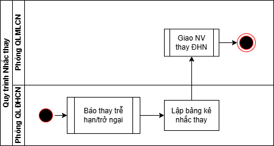
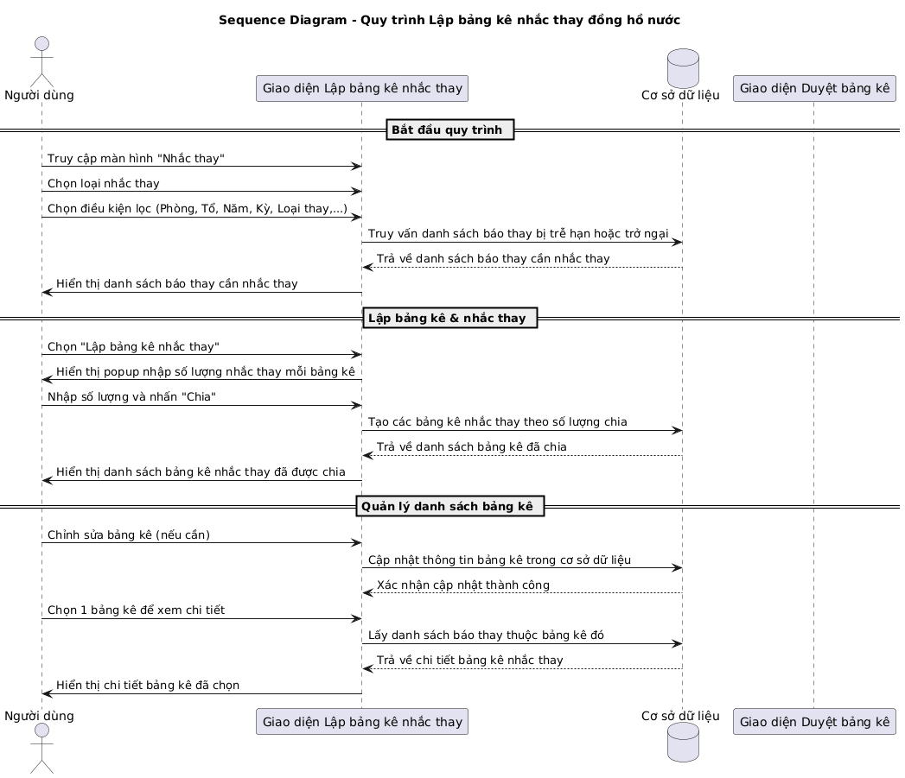
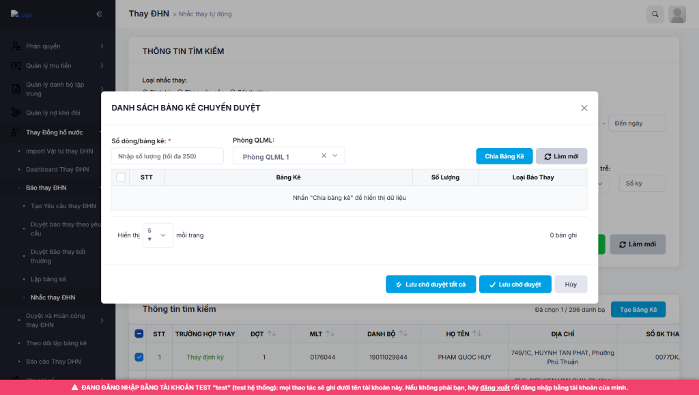

# 09. Nhắc thay ĐHN tự động

> **Phiên bản hiện tại:** `v1.1` · **Cập nhật lần cuối:** 2026-11-23 · **Trạng thái:** Cập nhật theo phần mềm hiện tại (`As-Is` — chốt `OPEN-06` tự sinh mã `XXXXN/26` & giới hạn `300` dòng/BK)

---

## 1. Mục tiêu & Tác nhân liên quan

- **Mục tiêu:** Lọc các báo thay bị trễ hạn (> 30 ngày từ ngày giao NV), trở ngại quá 3 lần / không được duyệt, hoặc các danh bộ chưa thay nằm trong bảng kê đã chốt để gom vào **bảng kê nhắc thay** mới và gửi duyệt Ban Lãnh đạo.
- **Tác nhân liên quan:** Nhân viên Phòng QLĐHCN / Ghi thu (lập & gửi duyệt bảng kê nhắc thay); Ban Lãnh đạo (duyệt bảng kê nhắc thay).
- **Route thực tế:** `/nhacthaytudong` (gồm 2 tab con: `Lập bảng kê` & `Theo dõi bảng kê`).
- **Tham chiếu SRS V1.4:** Mục `4.8 Nhắc thay`.

---

## 2. Luồng nghiệp vụ (Flow & Diagrams)

### 2.1. Flowchart quy trình

### 2.2. Diễn giải luồng chính (`v1.1`)
1. **Nguồn dữ liệu vào Nhắc thay:**
   - Báo thay trễ hạn (quá **30 ngày** kể từ ngày giao NV mà chưa hoàn công).
   - Báo thay trở ngại quá 3 lần / không được duyệt.
   - Các danh bộ chưa hoàn công nằm trong bảng kê **`Đã chốt`**.
2. Vào `/nhacthaytudong` (tab `Lập bảng kê`), chọn `Loại nhắc thay` (`Định kỳ` / `Theo yêu cầu` / `Bất thường`), `Phòng *` và các bộ lọc nâng cao (hỗ trợ multi-select `Loại trở ngại`, `Tổ`, `Cỡ`).
3. Chọn danh bộ → bấm `Tạo Bảng Kê` → mở modal `Danh sách bảng kê chuyển duyệt` → nhập số dòng/bảng kê (tối đa **`300`**, `DEC-05`), `Phòng QLML` tự khóa tương ứng → bấm `Chia Bảng Kê` để **hệ thống tự sinh số bảng kê định dạng `XXXXN/26`** (`OPEN-06` đã chốt) → bấm `Lưu chờ duyệt` (trạng thái `Chờ gửi`).
4. Sang tab **`Theo dõi bảng kê`** (ngay trong `/nhacthaytudong`) để `Gửi duyệt bảng kê` (→ `Chưa duyệt`), `In bảng kê` hoặc `Hủy bảng kê`.

### 2.3. Sequence Diagram

---

## 3. Đặc tả màn hình & Trường dữ liệu (`/nhacthaytudong`)

### 3.1. Tab 1 — `Lập bảng kê`
- **Bộ lọc cơ bản:**
  - `Loại nhắc thay` (Radio): `Định kỳ` (mặc định — không có dropdown `Điều kiện lọc`) | `Theo yêu cầu` (hiện thêm `Loại báo thay *` 22 loại kèm badge số lượng tồn) | `Bất thường` (hiện thêm `Code` 6 mã `60–65`).
  - `Số BK báo thay` (text), `Phòng *` (`Phòng Quản lý ghi thu 1/2`), `Tổ` (multi-select 7 tổ), `Ngày báo` (`Từ ngày – Đến ngày`).
- **Bộ lọc nâng cao:** `Hiệu` (20 hiệu), `Cỡ` (multi-select 14 cỡ), `Đợt` (`1–12`), `Công thức & Số kỳ trễ` (`>`, `<`, `>=`, `<=`, `=` + số kỳ), **`Loại trở ngại`** (multi-select **26 loại**), `Số kỳ không tiêu thụ` (trống mặc định), `Danh bạ`.
- **Bảng kết quả (24 cột cho Định kỳ):** `Checkbox`, `STT`, `TRƯỜNG HỢP THAY`, `ĐỢT`, `MLT`, `DANH BỘ`, `HỌ TÊN`, `ĐỊA CHỈ`, `SỐ BK THAY`, `CS BÁO`, `LẦN TRỞ NGẠI`, `LÝ DO TRỞ NGẠI`, `GHI CHÚ`, `LÝ DO KHÁC`, `SỐ KỲ TRỄ`, `HIỆU`, `CỠ`, `SỐ THÂN`, `NGÀY GẮN`, `NGÀY KD`, `CHÌ THÂN`, `CHÌ GÓC`, `VỊ TRÍ`, `TỔ`.
- **Modal `Danh sách bảng kê chuyển duyệt`:** `Số dòng/bảng kê *` (chuẩn tối đa **`300`** theo `DEC-05` — *ghi chú: bản Dev hiện vẫn hiển thị placeholder `250`, đã log `BUG-04` để Dev đồng bộ*), `Phòng QLML` (tự khóa), `Chia Bảng Kê`, `Lưu chờ duyệt tất cả` / `Lưu chờ duyệt`.

### 3.2. Tab 2 — `Theo dõi bảng kê`
- **Trạng thái phê duyệt (5 trạng thái):** `Chờ gửi`, `Chưa duyệt`, `Đã duyệt`, `Đã hủy`, `Trả về`.
- **Thao tác:** `In bảng kê` (luôn có); `Hủy bảng kê` & `Gửi duyệt bảng kê` (khi `Chờ gửi`).

---

## 4. Yêu cầu chức năng (Functional Requirements)

| Mã | Mô tả / Hành vi hệ thống (`v1.1`) |
|---|---|
| `FR-42`, `FR-43` | Chỉ hiển thị báo thay trễ hạn (> 30 ngày từ ngày giao NV), trở ngại quá số lần/không duyệt, hoặc chưa hoàn công trong BK đã chốt. |
| `FR-44` | *(Cập nhật chốt `OPEN-06`)* Hệ thống **tự động sinh số bảng kê nhắc thay** theo định dạng **`[STT 4 chữ số]N/[2 số cuối năm]`** (vd: `0019N/26`), không nhập tay. |
| `FR-45` | Hỗ trợ bộ lọc multi-select `Loại trở ngại` (26 loại), `Tổ`, `Cỡ`, và tab `Theo dõi bảng kê` ngay trên cùng màn hình. |

---

## 5. Quy tắc nghiệp vụ (Business Rules)

| Mã | Mô tả chi tiết (`v1.1`) |
|---|---|
| `BR-34`, `BR-35` | Nguồn nhắc thay gồm trễ hạn / trở ngại / tồn đọng từ BK đã chốt; bảng kê nhắc thay qua bước BLĐ duyệt như bảng kê thường. |
| `BR-36` | Báo thay được tính là **trễ hạn** khi quá **30 ngày kể từ ngày giao NV thay** mà chưa hoàn công (`86exxt1pz`). |
| `BR-37` | *(Cập nhật chốt `OPEN-01`)* Trở ngại loại 1–3 không tự hủy ngay mà đi qua tab `Phòng DVKH` duyệt trên `/xulytrongai`; chỉ vào Nhắc thay sau khi không duyệt / quá 3 lần / chốt BK. |
| `BR-38`, `BR-39` | Mỗi bảng kê nhắc thay chỉ gồm 1 loại thay duy nhất; giới hạn tối đa **`300` dòng/BK** (`DEC-05`). |

---

## 6. Tiêu chí nghiệm thu (Acceptance Criteria)

- [x] `AC-01`: Danh bộ chưa hoàn công nằm trong BK đã chốt (`0080DK/26` — `19041341834`) xuất hiện ngay tại `/nhacthaytudong`.
- [x] `AC-02`: Bảng kê nhắc thay tự sinh mã `XXXXN/26` (không yêu cầu nhập tay) và tự khóa `Phòng QLML` tương ứng.
- [ ] `AC-03`: Giới hạn `Số dòng/bảng kê` đồng bộ tối đa **`300`** giống `/lapbangke` (`DEC-05`).

---

## 7. Giao diện (UI) & Lịch sử thay đổi

**Hình 1: Modal chia bảng kê nhắc thay tự sinh mã `XXXXN/26` (`v1.1`)**

| Phiên bản | Ngày | Người chốt | Tóm tắt thay đổi |
|---|---|---|---|
| `v1.0` | 2026-11-17 | nhanlt | Chuyển thể từ SRS V1.4 mục `4.8`; gắn note thiếu định nghĩa "Kỳ", validate số BK nhập tay & mâu thuẫn `BR-37` |
| `v1.1` | 2026-11-23 | nhanlt | Chốt `OPEN-06` (tự sinh mã `XXXXN/26`, trễ hạn = quá 30 ngày từ ngày giao NV), chốt `OPEN-01`, nâng chuẩn tối đa `300` dòng/BK (`DEC-05`), bổ sung tab `Theo dõi bảng kê` & lọc multi-select 26 loại trở ngại |
