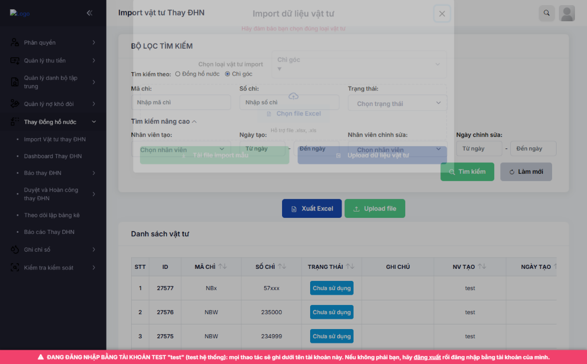
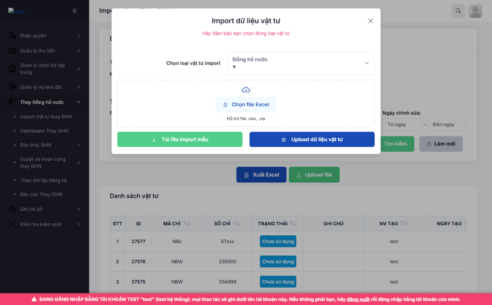

# 10. Import & Quản lý kho vật tư (ĐHN & Chì góc)

> **Phiên bản hiện tại:** `v1.1` · **Cập nhật lần cuối:** 2026-11-23 · **Trạng thái:** Cập nhật đầy đủ theo phần mềm hiện tại (`As-Is` — đóng `OPEN-04` & chốt `DEC-01`)

---

## 1. Mục tiêu & Tác nhân liên quan

- **Mục tiêu:** Nhập (import) từ Excel và quản lý kho vật tư gồm **Đồng hồ nước (ĐHN)** và **Chì góc** theo 4 trạng thái vòng đời, phục vụ tra cứu tự động fill thông số và tự động khóa vật tư khi hoàn công thay ĐHN trên Web & Mobile.
- **Tác nhân liên quan:** Bộ phận Kho / Vật tư, Phòng QLML, Admin.
- **Route thực tế:** `/ImportVatTu`.
- **Tham chiếu SRS V1.4:** Mục `2.1 Bảng 3` (trước đây bỏ trống 100% đặc tả — `OPEN-04`).

---

## 2. Luồng nghiệp vụ (Flow)

1. Vào `/ImportVatTu`, chọn chế độ Radio **`Đồng hồ nước`** hoặc **`Chì góc`** để tra cứu danh sách vật tư hiện có hoặc xuất Excel.
2. Nhấn **`Upload file`** để mở modal **`Import dữ liệu vật tư`**:
   - Chọn `Loại vật tư import` (`Đồng hồ nước` | `Chì góc`).
   - Bấm **`Tải file import mẫu`** để tải file Excel chuẩn:
     - ĐHN: `/ImportVatTu/DownloadTemplateImportDongHoNuoc/dhn` (`template_excel_import_dong_ho_nuoc.xlsx`).
     - Chì góc: `/ImportVatTu/DownloadTemplateImportDongHoNuoc/chiGoc` (`template_excel_import_chi_co.xlsx`).
   - Chọn file `.xlsx` / `.xls` đã điền dữ liệu → bấm **`Upload dữ liệu vật tư`**.
3. **Liên kết tự động với Hoàn công (Web & Mobile):**
   - Khi hoàn công chọn ĐHN / Chì góc ở trạng thái **`Chưa sử dụng`**, hệ thống tự động chuyển vật tư sang **`Đã sử dụng`** và ghi nhận `NV SỬ DỤNG`, `NGÀY SỬ DỤNG`, `MỤC ĐÍCH SD` (`Thay DHN: Danh bộ <X>. Bảng kê: <Y>`).
   - Khi **`Hủy hoàn công`**, hệ thống tự động trả vật tư về **`Chưa sử dụng`** và xóa trắng thông tin sử dụng cũ (`NV SỬ DỤNG`, `NGÀY SỬ DỤNG`, `MỤC ĐÍCH SD`).

---

## 3. Đặc tả màn hình & Trường dữ liệu (`/ImportVatTu`)

### 3.1. Chế độ `Đồng hồ nước` (mặc định; bấm `Tìm kiếm` mới load)
- **Bộ lọc cơ bản:**
  - `Số thân` (text)
  - `Hiệu` (Select2 — 20 hiệu từ `/LapBangKe/GetDropdownHieu`): `ABB`, `ACTARIS`, `AICHI`, `ARAD`, `ASAHI`, `AXIOMA`, `BAYLAN`, `BenyTo`, `B-Meters`, `DELTA`, `ISOMAG`, `ITRON`, `KENT`, `OCTAVE`, `SAPPEL`, `SENSUS`, `SIEMENS`, `SONATA`, `TAC`, `WOLTEX`.
  - `Cỡ` (Select2 — 14 cỡ từ `/LapBangKe/GetDropdownCo`): `15`, `20`, `25`, `30`, `40`, `50`, `60`, `80`, `100`, `150`, `200`, `250`, `300`, `600`.
  - `Trạng thái` (Select2 — 4 trạng thái): `Tồn kho`, `Chưa sử dụng`, `Đã sử dụng`, `Hủy`.
- **Bộ lọc nâng cao:** `Nhân viên tạo`, `Ngày tạo (Từ–Đến)`, `Nhân viên chỉnh sửa`, `Ngày chỉnh sửa (Từ–Đến)`, `Số tem`, `Ngày kiểm định (Từ–Đến)`.
- **19 cột bảng:** `STT`, `ID`, `HIỆU`, `CỠ`, `SỐ THÂN`, `TRẠNG THÁI`, `SỐ TEM`, `GIẤY CHỨNG NHẬN`, `NGÀY RA GIẤY`, `HẠN KIỂM ĐỊNH`, `ĐỢT`, `PHIẾU XUẤT KHO`, `GHI CHÚ`, `TÂN TRANG`, `NV TẠO`, `NGÀY TẠO`, `NV SỬ DỤNG`, `NGÀY SỬ DỤNG`, `MỤC ĐÍCH SD`.

### 3.2. Chế độ `Chì góc` (chuyển sang tự động load)
- **Bộ lọc cơ bản:** `Mã chì` (text), `Số chì` (text), `Trạng thái` (4 trạng thái).
- **Bộ lọc nâng cao:** `Nhân viên tạo`, `Ngày tạo (Từ–Đến)`, `Nhân viên chỉnh sửa`, `Ngày chỉnh sửa (Từ–Đến)`.
- **11 cột bảng:** `STT`, `ID`, `MÃ CHÌ`, `SỐ CHÌ`, `TRẠNG THÁI`, `GHI CHÚ`, `NV TẠO`, `NGÀY TẠO`, `NV SỬ DỤNG`, `NGÀY SỬ DỤNG`, `MỤC ĐÍCH SD`.

### 3.3. Modal `Import dữ liệu vật tư`
- Cảnh báo: `"Hãy đảm bảo bạn chọn đúng loại vật tư"`.
- Dropdown `Chọn loại vật tư import`: `Đồng hồ nước` | `Chì góc`.
- Dropzone upload `.xlsx`, `.xls`; nút `Tải file import mẫu`; nút `Upload dữ liệu vật tư`.

---

## 4. Yêu cầu chức năng (Functional Requirements)

| Mã | Mô tả / Hành vi hệ thống (`v1.1`) |
|---|---|
| `FR-VT-01` | Cho phép chuyển đổi quản lý giữa 2 loại vật tư (`Đồng hồ nước` & `Chì góc`), lọc cơ bản/nâng cao và `Xuất Excel`. |
| `FR-VT-02` | Cho phép tải file Excel mẫu tương ứng cho từng loại vật tư và upload file `.xlsx` / `.xls` để nhập kho hàng loạt. |
| `FR-VT-03` | Tự động cập nhật trạng thái sang **`Đã sử dụng`** (kèm đầy đủ `NV SỬ DỤNG`, `NGÀY SỬ DỤNG`, `MỤC ĐÍCH SD`) ngay khi hoàn công thành công trên Web/Mobile. |
| `FR-VT-04` | Tự động hoàn trả trạng thái về **`Chưa sử dụng`** (và xóa trắng `NV SỬ DỤNG`, `NGÀY SỬ DỤNG`, `MỤC ĐÍCH SD`) khi hủy hoàn công. |

---

## 5. Quy tắc nghiệp vụ (Business Rules)

| Mã | Mô tả chi tiết (`v1.1`) |
|---|---|
| `BR-VT-01` | **Phân tách 4 trạng thái vật tư (`DEC-01`):** • `Tồn kho`: Vật tư lưu kho, **chưa được phép dùng để hoàn công**. • `Chưa sử dụng`: Vật tư đã xuất/sẵn sàng, **được phép chọn khi hoàn công**. • `Đã sử dụng`: Đã gắn cho 1 danh bộ, **khóa không cho chọn trùng**. • `Hủy`: Vật tư hỏng/hủy, không cho dùng. |
| `BR-VT-02` | API tra cứu vật tư khi hoàn công (`LayThongTinSoThanSoChi`) chỉ trả về thành công cho các vật tư có trạng thái **`Chưa sử dụng`**. |
| `BR-VT-03` | Định dạng ghi log sử dụng (`NV SỬ DỤNG`, `NGÀY SỬ DỤNG`, `MỤC ĐÍCH SD`) phải thống nhất giữa cả bảng `Đồng hồ nước` và `Chì góc`. |

---

## 6. Tiêu chí nghiệm thu (Acceptance Criteria)

- [x] `AC-01`: Tải được cả 2 file Excel mẫu (`dhn` và `chiGoc`) trực tiếp từ modal `Upload file`.
- [x] `AC-02`: Hoàn công trên Mobile bằng ĐHN `Chưa sử dụng` (`V03472`) và Chì góc (`NBW 235000`) → cả 2 tự đổi sang `Đã sử dụng` trên `/ImportVatTu`.
- [ ] `AC-03`: Nhập ĐHN trạng thái `Tồn kho` hoặc `Đã sử dụng` vào màn Hoàn công đều bị từ chối (`BR-VT-01`, `BR-VT-02`).
- [ ] `AC-04`: Hủy hoàn công trả vật tư về `Chưa sử dụng` đồng thời xóa trắng `NV SỬ DỤNG`, `NGÀY SỬ DỤNG`, `MỤC ĐÍCH SD` (`FR-VT-04`).

---

## 7. Giao diện (UI) & Lịch sử thay đổi

**Hình 1: Màn hình Import & Quản lý danh sách vật tư (`v1.1`)**

**Hình 2: Modal Import dữ liệu vật tư kèm nút tải file mẫu (`v1.1`)**

| Phiên bản | Ngày | Người chốt | Tóm tắt thay đổi |
|---|---|---|---|
| `v1.0` | 2026-11-17 | nhanlt | Tạo khung đặc tả cho chức năng *Import vật tư* có mặt ở Bảng `2.1` nhưng bị bỏ trống trong SRS V1.4 (`OPEN-04`) |
| `v1.1` | 2026-11-23 | nhanlt | Đóng `OPEN-04`: bổ sung đặc tả 100% thực tế `/ImportVatTu` (2 chế độ ĐHN 19 cột & Chì góc 11 cột, 20 hiệu, 14 cỡ, 2 file Excel mẫu, quy tắc 4 trạng thái `DEC-01` & đồng bộ hoàn công/hủy hoàn công) |
