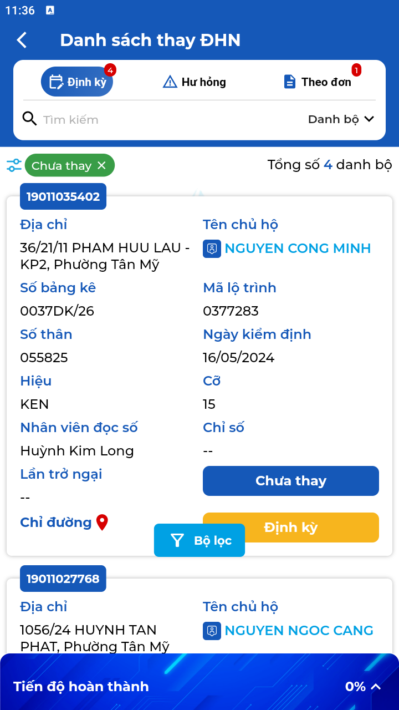
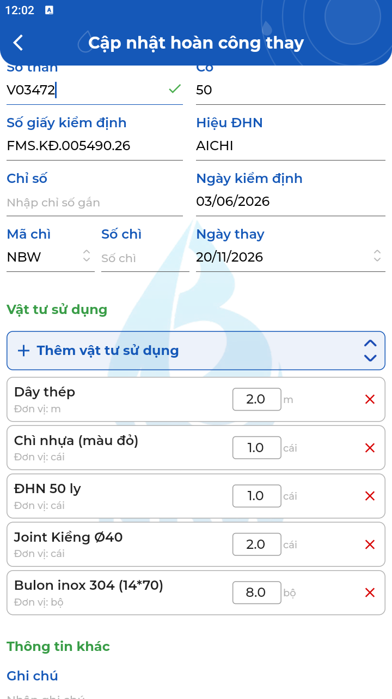
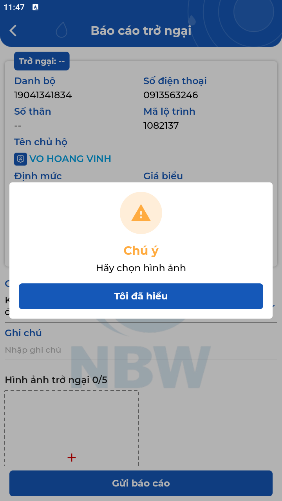

# 11. Mobile App hiện trường (Thi công, Hoàn công & Báo trở ngại)

> **Phiên bản hiện tại:** `v1.1` · **Cập nhật lần cuối:** 2026-11-23 · **Trạng thái:** Cập nhật theo phần mềm hiện tại (`As-Is` — bổ sung đầy đủ UI, Bộ lọc, Auto-fill định mức vật tư & Validate)

---

## 1. Mục tiêu & Tác nhân liên quan

- **Mục tiêu:** Cung cấp ứng dụng di động cho nhân viên thi công hiện trường nhận danh sách công việc được giao, xem chỉ đường, cập nhật hoàn công (tự động fill thông số ĐHN gắn & định mức vật tư) hoặc gửi báo cáo trở ngại đồng bộ tức thì về Web Portal.
- **Tác nhân liên quan:** Nhân viên thi công Phòng QLML (`QLML 1`, `QLML 2`).
- **Tham chiếu SRS V1.4:** Chương `V. ĐẶC TẢ NHÓM CHỨC NĂNG CHÍNH – MOBILE` (`5.1` → `5.4`).

---

## 2. Luồng nghiệp vụ (Flow)

1. Nhân viên đăng nhập Mobile App → màn hình **Home**, bấm icon **Thay ĐHN** (có badge đỏ hiển thị tổng số công việc tồn).
2. Tại **Danh sách thay ĐHN**, xem các danh bộ được giao chia theo **3 tab**: **`Định kỳ`**, **`Hư hỏng`**, **`Theo đơn`** (mỗi tab có badge đỏ đếm tồn, mặc định lọc `Chưa thay`, sắp xếp tăng dần theo `MLT`).
3. Chọn 1 danh bộ cần xử lý → mở màn hình **`Cập nhật hoàn công thay`**:
   - **Thi công thành công:** Nhập **`Chỉ số gỡ`** (bắt buộc), nhập **`Số thân`** ĐHN gắn → app tự kiểm tra kho `Chưa sử dụng` (hiện dấu `✓` xanh), tự fill `Cỡ`, `Số giấy kiểm định`, `Hiệu ĐHN`, `Ngày kiểm định` và **tự động điền sẵn combo `Vật tư sử dụng` theo cỡ ĐHN** → nhập `Chỉ số gắn`, chọn `Mã chì` (mặc định `NBW`) + `Số chì`, chọn ảnh `Trước thay` & `Sau thay` (từ Camera hoặc Thư viện) → bấm **`Cập nhật`** → đồng bộ tức thì lên Portal & khóa vật tư kho.
   - **Gặp trở ngại:** Bấm nút **`Báo cáo trở ngại`** → chọn 1 trong **26 lý do trở ngại**, nhập `Ghi chú` (không bắt buộc), đính kèm tối thiểu **1 ảnh** (tối đa 5 ảnh, từ Camera hoặc Thư viện) → bấm **`Gửi báo cáo`** → đồng bộ ngay về tab phòng tương ứng trên `/xulytrongai`.

---

## 3. Đặc tả màn hình & Trường dữ liệu (`v1.1`)

### 3.1. Màn hình Home & Danh sách thay ĐHN
- **Màn hình Home:** Header chào nhân viên, thanh tìm kiếm nhanh (`Danh bộ`, `HT`, `LT`, `ĐC`), khối `Sử dụng gần đây` & `Tất cả chức năng` (icon `Thay ĐHN` kèm badge đỏ).
- **Màn hình `Danh sách thay ĐHN`:**
  - **3 Tab:** `Định kỳ`, `Hư hỏng`, `Theo đơn` (kèm badge đỏ).
  - **Tìm kiếm nhanh:** Ô text + chọn tiêu chí (`Danh bộ` ▼).
  - **Bottom sheet `Bộ lọc`:**
    - `Trạng thái`: `Tất cả`, `Chưa thay` (mặc định), `Đã thay`, `Trở ngại`, **`Nhắc thay`**.
    - `Thời gian`: `Chọn năm`, `Chọn kỳ`, `Chọn đợt`.
    - `Thời gian giao`: `Từ ngày`, `Đến ngày`.
  - **Thẻ danh bộ:** Mã danh bộ, `Địa chỉ`, `Tên chủ hộ`, `Số bảng kê`, `Mã lộ trình`, `Số thân`, `Ngày kiểm định`, `Hiệu`, `Cỡ`, `Nhân viên đọc số`, `Chỉ số`, `Lần trở ngại`, nút **`Chỉ đường`** (bản đồ), 2 badge trạng thái.
  - **Thanh dưới cùng:** `Tiến độ hoàn thành` + `%` (mặc định đóng/collapse).

### 3.2. Màn hình `Cập nhật hoàn công thay`
- **Phần 1 — Card Thông tin danh bộ (collapsible):** `Danh bộ`, `Tên chủ hộ`, `Số điện thoại`, `Số hợp đồng`, `Mã lộ trình`, `Nhân viên đọc số`, `Số điện thoại NV`, `Địa chỉ` (+ icon bản đồ), `Số lần trở ngại`, 2 badge trạng thái + nút **`Báo cáo trở ngại`**.
- **Phần 2 — `Thông tin ĐHN gỡ` (chốt `TBD-05` / `DEC-05`):** `Hiệu ĐHN`, `Cỡ` (auto-fill), `Số thân`, **`Chỉ số` (bắt buộc — bỏ trống báo `"Vui lòng nhập chỉ số gỡ"`)**, `Chì thân` (mặc định `0`).
- **Phần 3 — `Thông tin ĐHN gắn`:** `Số thân` (nhập đúng kho `Chưa sử dụng` hiện `✓` xanh + tự fill `Cỡ`, `Số giấy kiểm định`, `Hiệu ĐHN`, `Ngày kiểm định`), `Chỉ số`, `Mã chì` (mặc định `NBW`), `Số chì`, `Ngày thay` (mặc định ngày hiện tại `dd/MM/yyyy`).
- **Phần 4 — `Vật tư sử dụng`:** **Tự động điền sẵn combo định mức vật tư theo cỡ ĐHN gắn** (vd: Cỡ 50 tự điền 5 vật tư `Dây thép`, `Chì nhựa`, `ĐHN 50 ly`, `Joint Kiềng Ø40`, `Bulon inox 304`); cho phép chỉnh số lượng, xóa hoặc bấm `+ Thêm vật tư sử dụng`.
- **Phần 5 — `Thông tin khác`:** `Ghi chú`, **`Trước thay 0/5`** (tối thiểu 1 ảnh, tối đa 5 ảnh), **`Sau thay 0/5`** (tối thiểu 1 ảnh — thiếu báo `"Hãy chọn hình ảnh sau thay"`, tối đa 5 ảnh).

### 3.3. Màn hình `Báo cáo trở ngại`
- **Card thông tin danh bộ:** `Trở ngại`, `Danh bộ`, `Số điện thoại`, `Số thân`, `Mã lộ trình`, `Tên chủ hộ`, `Định mức`, `Giá biểu`, `Cỡ`, `Hiệu`, `Địa chỉ`.
- **`Chọn lý do trở ngại`:** Bottom sheet **26 loại trở ngại** (đồng bộ với Web `/xulytrongai`).
- **`Ghi chú`:** Tùy chọn (không bắt buộc).
- **`Hình ảnh trở ngại 0/5`:** **Bắt buộc tối thiểu 1 ảnh** (`"Hãy chọn hình ảnh"`), tối đa 5 ảnh; hỗ trợ cả **`Chụp ảnh`** (Camera) và **`Chọn từ thư viện`** (Gallery).

---

## 4. Yêu cầu chức năng (Functional Requirements)

| Mã | Mô tả / Hành vi hệ thống (`v1.1`) |
|---|---|
| `FR-MOB-01` | Đồng bộ danh sách danh bộ được giao cho đúng nhân viên đăng nhập, chia 3 tab (`Định kỳ`, `Hư hỏng`, `Theo đơn`), sắp xếp tăng dần theo `MLT`. |
| `FR-MOB-02` | Hỗ trợ tìm kiếm nhanh, lọc theo 5 trạng thái (`Tất cả`, `Chưa thay`, `Đã thay`, `Trở ngại`, `Nhắc thay`), `Năm/Kỳ/Đợt`, `Thời gian giao`, và mở bản đồ `Chỉ đường`. |
| `FR-MOB-03` | Khi nhập `Số thân` ĐHN gắn hợp lệ, tự động load thông số kỹ thuật ĐHN và **tự động điền combo `Vật tư sử dụng` theo cỡ ĐHN**. |
| `FR-MOB-04` | Hỗ trợ đính kèm ảnh từ cả **Camera (`Chụp ảnh`)** và **Thư viện (`Chọn từ thư viện`)** cho ảnh Trước thay (`0/5`), Sau thay (`0/5`) và Trở ngại (`0/5`). |
| `FR-MOB-05` | Gửi hoàn công / báo cáo trở ngại đồng bộ tức thì lên Web Portal (`/hoancongthaydhn`, `/xulytrongai`, `/ImportVatTu`) và cập nhật badge đếm số tồn. |

---

## 5. Quy tắc nghiệp vụ (Business Rules)

| Mã | Mô tả chi tiết (`v1.1`) |
|---|---|
| `BR-MOB-01` | Nhân viên chỉ thấy và thao tác trên các danh bộ được giao cho chính mình. |
| `BR-MOB-02` | Hoàn công bắt buộc nhập **`Chỉ số gỡ`**, **`Số thân` ĐHN gắn** (thuộc kho `Chưa sử dụng` — `DEC-03`), **`Chì góc`**, tối thiểu **1 ảnh Trước thay** và **1 ảnh Sau thay** *(đóng `TBD-05` / `DEC-05`)*. |
| `BR-MOB-03` | Báo cáo trở ngại bắt buộc chọn **1 trong 26 lý do** và tối thiểu **1 hình ảnh** (không bắt buộc ghi chú). |

> [!WARNING] Hạng mục TBD còn lại cho Phase sau (`TBD-08`)
> Cơ chế làm việc khi mất mạng (**Offline Mode** lưu tạm hàng đợi gửi lại) và xử lý xung đột khi Web thu hồi phân công lúc Mobile đang ngoại tuyến sẽ tiếp tục rà soát ở `TBD-08`.

---

## 6. Tiêu chí nghiệm thu (Acceptance Criteria)

- [x] `AC-MOB-01`: Giao 2 danh bộ từ Web (`/giaonvthaydhn`) → xuất hiện ngay trên Mobile của nhân viên đúng tab `Định kỳ`, sắp xếp tăng dần theo `MLT`.
- [x] `AC-MOB-02`: Bấm `Cập nhật` khi bỏ trống `Chỉ số gỡ` báo `"Vui lòng nhập chỉ số gỡ"`; thiếu ảnh sau thay báo `"Hãy chọn hình ảnh sau thay"`.
- [x] `AC-MOB-03`: Nhập `Số thân` ĐHN `Chưa sử dụng` (`V03472`, Cỡ 50) hiện `✓` xanh, auto-fill 4 thông số và tự điền 5 vật tư định mức → gửi hoàn công thành công (`"Đã cập nhật hoàn công"`) và đồng bộ tức thì lên Portal + khóa vật tư kho.
- [x] `AC-MOB-04`: Báo trở ngại thiếu ảnh báo `"Hãy chọn hình ảnh"`; chọn ảnh từ Thư viện & gửi thành công → đồng bộ ngay về đúng tab phòng ban trên `/xulytrongai`.

---

## 7. Giao diện (UI) & Lịch sử thay đổi

**Hình 1: Danh sách thay ĐHN trên Mobile (`v1.1` — 3 tab, badge đỏ & nút Chỉ đường)**

**Hình 2: Màn hình Hoàn công tự động fill thông số ĐHN & định mức vật tư (`v1.1`)**

**Hình 3: Validate bắt buộc ảnh khi gửi Báo cáo trở ngại (`v1.1`)**

| Phiên bản | Ngày | Người chốt | Tóm tắt thay đổi |
|---|---|---|---|
| `v1.0` | 2026-11-17 | nhanlt | Chuyển thể từ SRS V1.4 chương `V`; đánh dấu thiếu toàn bộ BR/FR/AC, Offline mode & mâu thuẫn ĐHN gỡ (`TBD-05`, `TBD-08`) |
| `v1.1` | 2026-11-23 | nhanlt | Bổ sung đầy đủ đặc tả thực tế Mobile App (`FR-MOB-01..05`, `BR-MOB-01..03`, `AC-MOB-01..04`): 3 tab `Định kỳ/Hư hỏng/Theo đơn`, bộ lọc chi tiết, tự điền combo vật tư theo cỡ ĐHN, validate `Chỉ số gỡ` & ảnh trước/sau/trở ngại (Camera + Thư viện) |
