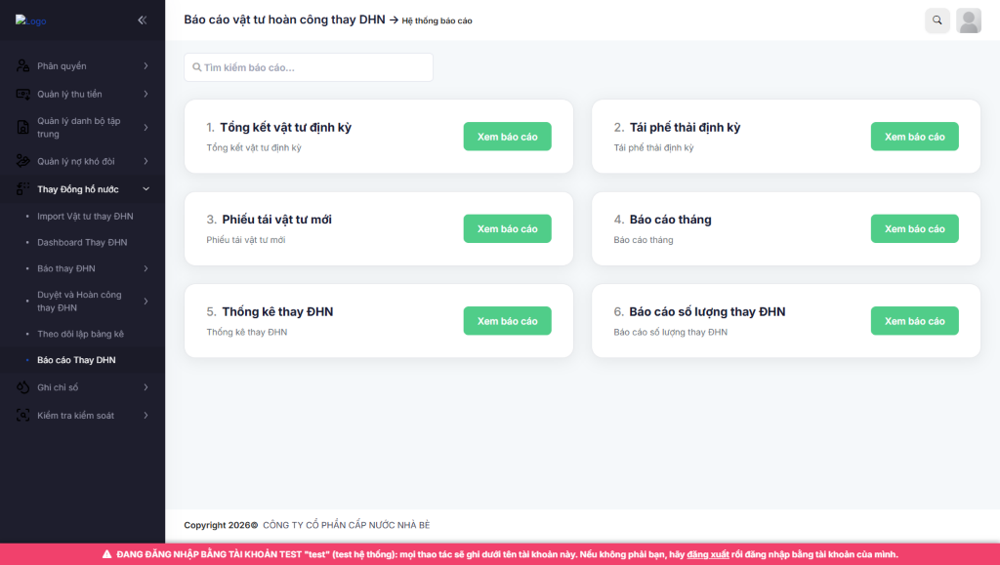
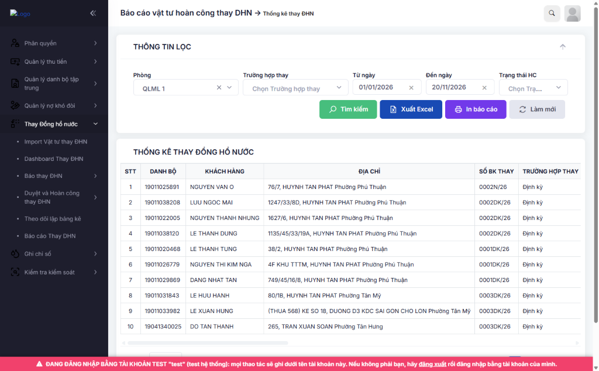
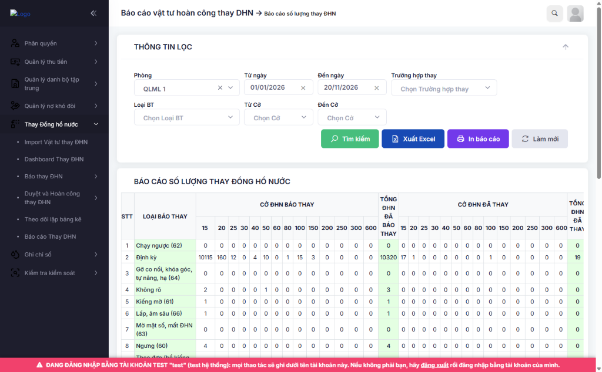

# 12. Báo cáo Thay ĐHN (6 mẫu báo cáo vật tư & sản lượng)

> **Phiên bản hiện tại:** `v1.1` · **Cập nhật lần cuối:** 2026-11-23 · **Trạng thái:** Tính năng mới bổ sung so với SRS V1.4 (`As-Is`)

---

## 1. Mục tiêu & Tác nhân liên quan

- **Mục tiêu:** Cung cấp phân hệ báo cáo tổng hợp vật tư sử dụng, vật tư tái nhập/phế thải, sản lượng thay ĐHN theo tháng, theo cỡ đồng hồ và danh sách chi tiết hoàn công để phục vụ quyết toán vật tư và báo cáo Ban Lãnh đạo.
- **Tác nhân liên quan:** Phòng QLML (`QLML 1`, `QLML 2`), Bộ phận Vật tư/Kho, Ban Lãnh đạo.
- **Route thực tế:** `/baocaohoancongbaothaydhn` (Hub 6 mẫu báo cáo).
- **Tham chiếu SRS V1.4:** **Chưa có trong SRS V1.4** (bổ sung mới ở phiên bản `v1.1`).

---

## 2. Luồng nghiệp vụ (Flow)

1. Người dùng vào menu **Báo cáo Thay DHN** (`/baocaohoancongbaothaydhn`) → hiển thị Hub gồm ô tìm kiếm nhanh và **6 thẻ mẫu báo cáo**.
2. Chọn **`Xem báo cáo`** trên mẫu cần tra cứu → nhập bộ lọc thời gian/phòng/trường hợp thay → bấm **`Tìm kiếm`** để xem số liệu.
3. Sử dụng **`Xuất Excel`** hoặc **`In báo cáo`** để xuất biểu mẫu phục vụ báo cáo định kỳ.
4. Riêng mẫu **`1. Tổng kết vật tư định kỳ`**: sau khi kiểm tra số liệu `SỬ DỤNG`, người dùng nhập số lượng **`THỰC CẤP`**, **`GHI CHÚ`** (hệ thống tính `TÁI NHẬP`), bấm **`Chốt dữ liệu`** để lưu kỳ quyết toán xuống bảng **`DỮ LIỆU ĐÃ CHỐT`** (có thể chỉnh sửa và bấm **`Lưu thay đổi`**).

---

## 3. Đặc tả 6 mẫu báo cáo & Trường dữ liệu

*(Tất cả 6 mẫu đều hỗ trợ 4 nút chung: `Tìm kiếm`, `Xuất Excel`, `In báo cáo`, `Làm mới`.)*

| STT | Tên báo cáo | Route | Bộ lọc | Cấu trúc cột & Nghiệp vụ chính |
|---|---|---|---|---|
| **1** | **Tổng kết vật tư định kỳ** | `/BaoCaoHoanCongBaoThayDHN/TongKetVatTuDinhKy` | `Phòng *` (`QLML 1/2`), `Trường hợp thay *` (4 loại), `Từ ngày *`, `Đến ngày *` | `STT`, `CHỈ DANH VẬT TƯ`, `MÃ SỐ VẬT TƯ`, `ĐƠN VỊ TÍNH`, `THỰC CẤP` (editable), `SỬ DỤNG`, `TÁI NHẬP`, `GHI CHÚ` (editable). Gồm 2 bảng: bảng tổng hợp tạm (`Chốt dữ liệu`) và bảng **`DỮ LIỆU ĐÃ CHỐT`** (`Lưu thay đổi`). |
| **2** | **Tái phế thải định kỳ** | `/BaoCaoHoanCongBaoThayDHN/TaiPheThaiDinhKy` | `Phòng *`, `Tháng *`, `Năm *`, `Trường hợp thay *` | `STT`, `CHỈ DANH VẬT TƯ`, `ĐƠN VỊ TÍNH`, `SỐ LƯỢNG`, `GHI CHÚ`, `BẰNG SỐ`, `BẰNG CHỮ`. |
| **3** | **Phiếu tái vật tư mới** | `/BaoCaoHoanCongBaoThayDHN/PhieuTaiVatTuMoi` | `Phòng *`, `Tháng *`, `Năm *` | `STT`, `DANH MỤC VẬT TƯ`, `SỐ LƯỢNG`, `ĐƠN VỊ TÍNH`, `GHI CHÚ`. |
| **4** | **Báo cáo tháng** | `/BaoCaoHoanCongBaoThayDHN/BaoCaoThangV2` | `Phòng *`, `Từ ngày *`, `Đến ngày *` | `THỜI GIAN`, `PHÒNG`, `CÔNG TÁC THAY`, `ĐHN CỠ NHỎ`, `ĐHN CỠ LỚN`, `15 LY`, `25 LY`, `50 LY`, `80 LY`, `100 LY`, `150 LY`, `200 LY`. |
| **5** | **Thống kê thay ĐHN** | `/BaoCaoHoanCongBaoThayDHN/ThongKeThayDHN` | `Phòng`, `Trường hợp thay`, `Từ ngày`, `Đến ngày`, `Trạng thái HC` | 23 cột chi tiết từng danh bộ (`DANH BỘ`, `KHÁCH HÀNG`, `ĐỊA CHỈ`, `SỐ BK THAY`, `TRƯỜNG HỢP THAY`, `LOẠI BT`, `CS BÁO`, `HIỆU/CS/CỠ/SỐ THÂN GỠ`, `HIỆU/CS/CỠ/SỐ THÂN GẮN`, `SỐ BK HC`, `CHÌ GÓC`, `NGÀY KĐ`, `NGÀY THAY`, `NGÀY HC`, `NHÂN VIÊN HC`, `LÝ DO TRỞ NGẠI`), phân trang `10/25/50/100`. |
| **6** | **Báo cáo số lượng thay ĐHN** | `/BaoCaoHoanCongBaoThayDHN/BaoCaoSoLuongThayDHN` | `Phòng`, `Từ ngày`, `Đến ngày`, `Trường hợp thay`, `Loại BT`, `Từ Cở`, `Đến Cở` | Bảng chéo theo `LOẠI BÁO THAY` × `CỞ ĐHN BÁO THAY` (`15..600`) → `TỔNG ĐHN ĐÃ BÁO THAY` và `CỞ ĐHN ĐÃ THAY` → `TỔNG ĐHN ĐÃ THAY`, kèm dòng **`TỔNG CỘNG`** cuối bảng. |

---

## 4. Yêu cầu chức năng (Functional Requirements)

| Mã | Mô tả / Hành vi hệ thống (`v1.1`) |
|---|---|
| `FR-BC-01` | Hiển thị Hub 6 mẫu báo cáo kèm thanh tìm kiếm nhanh tên báo cáo. |
| `FR-BC-02` | Cho phép lọc dữ liệu, xem trực tiếp trên lưới, `Xuất Excel` và `In báo cáo` trên cả 6 mẫu. |
| `FR-BC-03` | Trên Báo cáo 1 (`Tổng kết vật tư định kỳ`), cho phép nhập `THỰC CẤP` / `GHI CHÚ`, bấm `Chốt dữ liệu` và `Lưu thay đổi` dữ liệu đã chốt. |
| `FR-BC-04` | Trên Báo cáo 6 (`Báo cáo số lượng thay ĐHN`), tự động tổng hợp chính xác theo từng cỡ đồng hồ và dòng `TỔNG CỘNG`. |

---

## 5. Quy tắc nghiệp vụ (Business Rules)

| Mã | Mô tả chi tiết (`v1.1`) |
|---|---|
| `BR-BC-01` | Số liệu vật tư sử dụng và sản lượng thay trên 6 báo cáo tổng hợp trực tiếp từ dữ liệu hoàn công của các bảng kê theo đúng `Phòng QLML` và khoảng thời gian lọc. |
| `BR-BC-02` | Trên Báo cáo 1, dữ liệu sau khi bấm `Chốt dữ liệu` được tách riêng vào bảng `DỮ LIỆU ĐÃ CHỐT` để làm cơ sở đối chiếu với Báo cáo 2 (`Tái phế thải`) và Báo cáo 3 (`Phiếu tái vật tư mới`). |

---

## 6. Tiêu chí nghiệm thu (Acceptance Criteria)

- [x] `AC-BC-01`: Hub `/baocaohoancongbaothaydhn` hiển thị đủ 6 mẫu báo cáo và điều hướng chính xác từng mẫu.
- [x] `AC-BC-02`: Báo cáo 5 (`Thống kê thay ĐHN`) tải đủ 23 cột dữ liệu chi tiết theo bộ lọc `Phòng` & khoảng ngày.
- [x] `AC-BC-03`: Báo cáo 6 (`Báo cáo số lượng thay ĐHN`) cộng tổng hàng ngang & hàng dọc khớp 100% ở dòng `TỔNG CỘNG`, không phát sinh `NaN`/lỗi.

---

## 7. Giao diện (UI) & Lịch sử thay đổi

**Hình 1: Hub 6 mẫu Báo cáo Thay ĐHN (`v1.1`)**

**Hình 2: Báo cáo 5 — Thống kê thay ĐHN (`v1.1`)**

**Hình 3: Báo cáo 6 — Báo cáo số lượng thay ĐHN (`v1.1`)**

| Phiên bản | Ngày | Người chốt | Tóm tắt thay đổi |
|---|---|---|---|
| `v1.1` | 2026-11-23 | nhanlt | Bổ sung mới đặc tả phân hệ **Báo cáo Thay ĐHN** (6 mẫu báo cáo) phát hiện từ phần mềm thực tế trên Dev |
